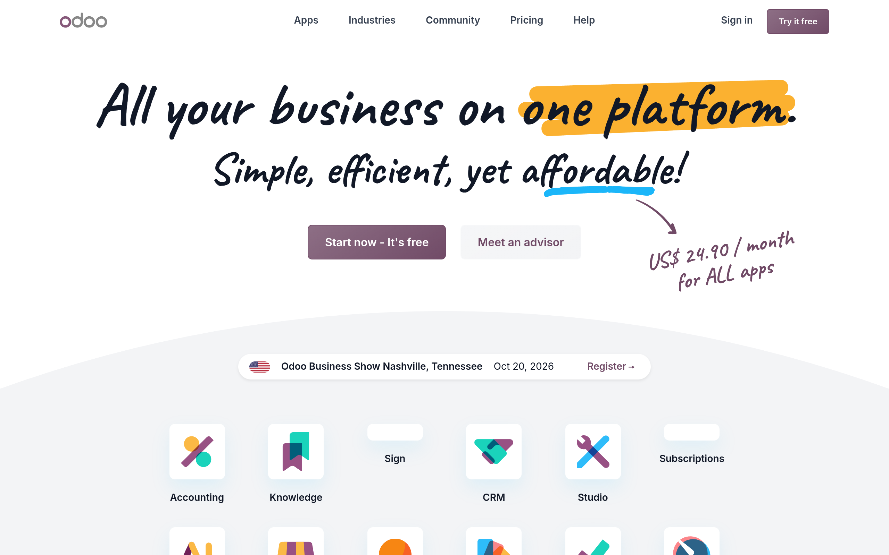
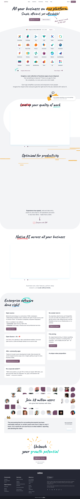
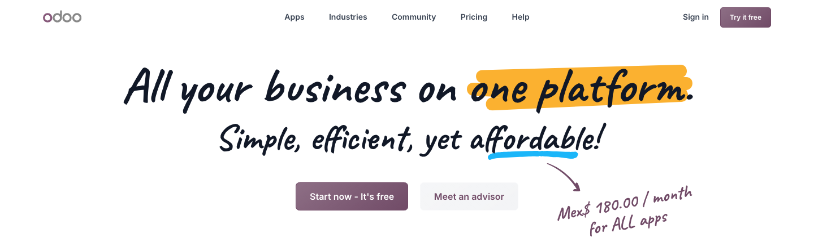
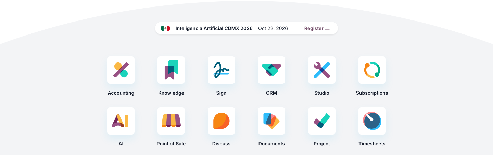
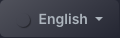
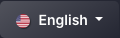
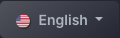
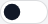

# odoo Design System

You are building UI for **odoo**. Dark-themed, warm palette, sans-serif typography (MarshmallowIcons), compact density on a 4px grid, expressive motion.

## Visual Reference

**IMPORTANT**: Study ALL screenshots below before writing any UI. Match colors, typography, spacing, layout, and motion exactly as shown.

### Homepage



### Scroll Journey (Cinematic Visual States)

> These screenshots capture the website at different scroll depths. The design changes dramatically as you scroll — each frame shows a different cinematic state. Replicate these exact visual transitions.

#### 0% — Hero / Above the fold


#### 17% — Mid-page at 17% scroll


#### 33% — Mid-page at 33% scroll


#### 50% — Mid-page at 50% scroll


#### 67% — Mid-page at 67% scroll


#### 83% — Mid-page at 83% scroll


#### 100% — Footer / End of page


> Read `references/DESIGN.md` for full token details. Read `references/ANIMATIONS.md` for motion specs. Read `references/LAYOUT.md` for layout structure. Read `references/COMPONENTS.md` for component patterns.

## Ultra Reference Files

This package includes extended documentation. **Read these files before implementing:**

| File | Contents |
|------|----------|
| `references/DESIGN.md` | Full design system tokens, colors, typography, spacing |
| `references/VISUAL_GUIDE.md` | **START HERE** — Master visual guide with all screenshots embedded |
| `references/ANIMATIONS.md` | CSS keyframes, scroll triggers, motion library stack, video specs |
| `references/LAYOUT.md` | Flex/grid containers, page structure, spacing relationships |
| `references/COMPONENTS.md` | DOM component patterns, HTML structure, class fingerprints |
| `references/INTERACTIONS.md` | Hover/focus states with before/after style diffs |
| `screens/scroll/` | 7 scroll journey screenshots showing cinematic states |

### Animation Stack Detected

- **Web Animations API (4 active)** — animation

## Design Philosophy

- **Layered depth** — use shadow tokens to create a sense of physical layering. Each elevation level has a specific shadow.
- **Gradient accents** — gradients are used thoughtfully for emphasis, not decoration.
- **Type pairing** — MarshmallowIcons for body/UI text, odoo_ui_icons for headings/display. Never introduce a third typeface.
- **compact density** — 4px base grid. Every dimension is a multiple of 4.
- **warm palette** — the color temperature runs warm, matching the sans-serif typography.
- **Restrained accent** — `#ffc107` is the only pop of color. Used exclusively for CTAs, links, focus rings, and active states.
- **Expressive motion** — animations are an integral part of the experience. Use spring physics and layout animations.

## Color System

### Core Palette

| Role | Token | Hex | Use |
|------|-------|-----|-----|
| Background | `--background` | `#111827` | Page/app background |
| Surface | `--surface` | `#000000` | Cards, panels, modals |
| Text Primary | `--text-primary` | `#f8f9fa` | Headings, body text |
| Text Muted | `--text-muted` | `#374151` | Captions, placeholders |
| Accent | `--accent` | `#ffc107` | CTAs, links, focus rings |
| Border | `--border` | `#495057` | Dividers, card borders |

### Status Colors

| Status | Hex | Use |
|--------|-----|-----|
| Success | `#28a745` | Confirmations, positive trends |
| Warning | `#fbb130` | Caution states, pending items |
| Danger | `#dc3545` | Errors, destructive actions |

### Extended Palette

- **o-color-1:** `#714b67`
- **o-color-2:** `#017e84`
- **primary-bg-subtle:** `#e3dbe1` — Secondary text, placeholder text
- **dark-border-subtle:** `#adb5bd` — Secondary text, placeholder text
- **pagination-hover-border-color:** `#e7e8e9` — Light surface or highlight color
- **btn-disabled-color:** `#6c757d`
- **btn-hover-border-color:** `#5a3c52`
- **primary-text-emphasis:** `#65435c`

### CSS Variable Tokens

```css
--o-cc5-btn-secondary-border: ;
--o-cc5-btn-secondary: #f8f9fa;
--o-cc5-btn-primary-border: ;
--o-cc5-btn-primary: ;
--o-cc4-btn-secondary-border: ;
--o-cc4-btn-secondary: #f8f9fa;
--o-cc4-btn-primary-border: ;
--o-cc4-btn-primary: #111827;
--o-cc3-btn-secondary-border: ;
--o-cc3-btn-secondary: #f8f9fa;
--o-cc3-btn-primary-border: ;
--o-cc3-btn-primary: ;
--o-cc2-btn-secondary-border: ;
--o-cc2-btn-secondary: ;
--o-cc2-btn-primary-border: ;
--o-cc2-btn-primary: ;
--o-cc1-btn-secondary-border: ;
--o-cc1-btn-secondary: ;
--o-cc1-btn-primary-border: ;
--o-cc1-btn-primary: ;
```

## Typography

### Font Stack

- **MarshmallowIcons** — Heading 1, Heading 2, Heading 3
- **odoo_ui_icons** — Body, Caption
- **SFMono-Regular** — Code

### Font Sources

```css
@font-face {
  font-family: "odoo_ui_icons";
  src: url("fonts/odoo_ui_icons-Regular.woff2") format("woff2");
  font-weight: 400;
}
@font-face {
  font-family: "MarshmallowIcons";
  src: url("fonts/MarshmallowIcons-900.woff2") format("woff2");
  font-weight: 900;
}
@font-face {
  font-family: "Inter";
  src: url("fonts/Inter-Bold.ttf") format("truetype");
  font-weight: 700;
}
@font-face {
  font-family: "Inter";
  src: url("fonts/Inter-Regular.ttf") format("truetype");
  font-weight: 400;
}
@font-face {
  font-family: "Caveat";
  src: url("fonts/Caveat-Bold.ttf") format("truetype");
  font-weight: 700;
}
@font-face {
  font-family: "Caveat";
  src: url("fonts/Caveat-Regular.ttf") format("truetype");
  font-weight: 400;
}
```

### Type Scale

| Role | Family | Size | Weight |
|------|--------|------|--------|
| Heading 1 | MarshmallowIcons | 128px | 700 |
| Heading 2 | MarshmallowIcons | 112px | 700 |
| Heading 3 | MarshmallowIcons | 96px | 700 |
| Body | odoo_ui_icons | 1rem | 400 |
| Caption | odoo_ui_icons | 0.875rem | 400 |
| Code | SFMono-Regular | 14px | 400 |

### Typography Rules

- Body/UI: **MarshmallowIcons**, Headings: **odoo_ui_icons** — these are the only display fonts
- Max 3-4 font sizes per screen
- Headings: weight 600-700, body: weight 400
- Use color and opacity for text hierarchy, not additional font sizes
- Line height: 1.5 for body, 1.2 for headings

## Spacing & Layout

### Base Grid: 4px

Every dimension (margin, padding, gap, width, height) must be a multiple of **4px**.

### Spacing Scale

`2, 4, 6, 8, 10, 12, 14, 16, 18, 20, 22, 24` px

### Spacing as Meaning

| Spacing | Use |
|---------|-----|
| 4-8px | Tight: related items (icon + label, avatar + name) |
| 12-16px | Medium: between groups within a section |
| 24-32px | Wide: between distinct sections |
| 48px+ | Vast: major page section breaks |

### Border Radius

Scale: `inherit, 0.0rem, 0px 0px 11px 11px, .1em, 0.25rem, 0.3rem, 0.375rem, 0.4rem, 0.5rem, 0.625rem, 0.75rem, .75rem, 1rem, 1.2em, 1.25rem, 1.5rem, 2em, 2px, 3rem, 3px, 4px, 4.8px, 5px, 6px, 6.4px, 8rem, 8px, 10rem, 11px 11px 0px 0px, 12px, 20px, 22px, 50rem, 62.5rem, 100px, , 25px, 32px, 100em, 100%, 800px, 999px`
Default: `4.8px`

### Container

Max-width: `991.98px`, centered with auto margins.

### Breakpoints

| Name | Value |
|------|-------|
| xs | 340px |
| xs | 476px |
| xs | 480px |
| sm | 575.98px |
| sm | 576px |
| sm | 600px |
| md | 650px |
| md | 651px |
| md | 767px |
| md | 767.98px |
| md | 768px |
| lg | 769px |
| lg | 770px |
| lg | 991px |
| lg | 991.98px |
| lg | 992px |
| lg | 1024px |
| xl | 1199.98px |
| xl | 1200px |
| 2xl | 1399.98px |
| 2xl | 1400px |
| 2xl | 1900px |
| 2xl | 1920px |

Mobile-first: design for small screens, layer on responsive overrides.

## Component Patterns

### Card

```css
.card {
  background: #000000;
  border: 1px solid #495057;
  border-radius: 4.8px;
  padding: 16px;
  box-shadow: inherit;
}
```

```html
<div class="card">
  <h3>Card Title</h3>
  <p>Card content goes here.</p>
</div>
```

### Button

```css
/* Primary */
.btn-primary {
  background: #ffc107;
  color: #f8f9fa;
  border-radius: 4.8px;
  padding: 8px 16px;
  font-weight: 500;
  transition: opacity 150ms ease;
}
.btn-primary:hover { opacity: 0.9; }

/* Ghost */
.btn-ghost {
  background: transparent;
  border: 1px solid #495057;
  color: #f8f9fa;
  border-radius: 4.8px;
  padding: 8px 16px;
}
```

```html
<button class="btn-primary">Get Started</button>
<button class="btn-ghost">Learn More</button>
```

### Input

```css
.input {
  background: #111827;
  border: 1px solid #495057;
  border-radius: 4.8px;
  padding: 8px 12px;
  color: #f8f9fa;
  font-size: 14px;
}
.input:focus { border-color: #ffc107; outline: none; }
```

```html
<input class="input" type="text" placeholder="Search..." />
```

### Badge / Chip

```css
.badge {
  display: inline-flex;
  align-items: center;
  padding: 4px 8px;
  border-radius: 9999px;
  font-size: 12px;
  font-weight: 500;
  background: #000000;
  color: #374151;
}
```

```html
<span class="badge">New</span>
<span class="badge">Beta</span>
```

### Modal / Dialog

```css
.modal-backdrop { background: rgba(0, 0, 0, 0.6); }
.modal {
  background: #000000;
  border: 1px solid #495057;
  border-radius: 999px;
  padding: 24px;
  max-width: 480px;
  width: 90vw;
  box-shadow: 0 0 5px 10px rgba(240,8,0,0.4);
}
```

```html
<div class="modal-backdrop">
  <div class="modal">
    <h2>Dialog Title</h2>
    <p>Dialog content.</p>
    <button class="btn-primary">Confirm</button>
    <button class="btn-ghost">Cancel</button>
  </div>
</div>
```

### Table

```css
.table { width: 100%; border-collapse: collapse; }
.table th {
  text-align: left;
  padding: 8px 12px;
  font-weight: 500;
  font-size: 12px;
  color: #374151;
  text-transform: uppercase;
  letter-spacing: 0.05em;
  border-bottom: 1px solid #495057;
}
.table td {
  padding: 12px;
  border-bottom: 1px solid #495057;
}
```

```html
<table class="table">
  <thead><tr><th>Name</th><th>Status</th><th>Date</th></tr></thead>
  <tbody>
    <tr><td>Item One</td><td>Active</td><td>Jan 1</td></tr>
    <tr><td>Item Two</td><td>Pending</td><td>Jan 2</td></tr>
  </tbody>
</table>
```

### Navigation

```css
.nav {
  display: flex;
  align-items: center;
  gap: 8px;
  padding: 12px 16px;
  border-bottom: 1px solid #495057;
}
.nav-link {
  color: #374151;
  padding: 8px 12px;
  border-radius: 4.8px;
  transition: color 150ms;
}
.nav-link:hover { color: #f8f9fa; }
.nav-link.active { color: #ffc107; }
```

```html
<nav class="nav">
  <a href="/" class="nav-link active">Home</a>
  <a href="/about" class="nav-link">About</a>
  <a href="/pricing" class="nav-link">Pricing</a>
  <button class="btn-primary" style="margin-left: auto">Get Started</button>
</nav>
```

### Extracted Components

These components were found in the codebase:

**Button** (`html`)
- Variants: `sm`, `outline-secondary`, `close`, `link`, `primary`

**Input** (`html`)

**Card** (`html`)
- Variants: `body`

**Navigation** (`html`)

**Modal** (`html`)

## Page Structure

The following page sections were detected:

- **Hero** — Hero section (detected from heading structure)
- **Footer** — Page footer with links and info (65 items)

When building pages, follow this section order and structure.

## Animation & Motion

This project uses **expressive motion**. Animations are part of the design language.

### CSS Animations

- `animate-red`
- `progress-bar-stripes`
- `spinner-border`
- `spinner-grow`
- `placeholder-glow`

### Motion Tokens

- **Duration scale:** `0ms`, `0.22s`, `.3s`, `1s`, `50ms`, `100ms`, `120ms`, `150ms`, `200ms`, `220ms`, `250ms`, `300ms`, `333.33333333ms`, `350ms`, `400ms`, `450ms`, `500ms`, `600ms`, `650ms`, `700ms`, `800ms`, `1000ms`, `1500ms`, `1600ms`, `2000ms`, `2500ms`, `3000ms`
- **Easing functions:** `ease-in-out`, `linear`, `ease`, `ease-out`, `cubic-bezier(0.215,0.61,0.355,1)`, `ease-in`, `cubic-bezier(0.19,1,0.22,1)`, `cubic-bezier(0.55,0.055,0.675,0.19)`, `cubic-bezier(0.175,0.885,0.32,1)`, `cubic-bezier(0.5,0,1,0.5)`, `cubic-bezier(0,0.5,0.5,1)`, `cubic-bezier(0.02,0.01,0.47,1)`, `cubic-bezier(0.55,0,0.1,1)`, `cubic-bezier(0.5,0.95,0,0.5)`, `cubic-bezier(0.175,0.885,0.32,1.275)`, `cubic-bezier(0.22,1,0.36,1)`, `cubic-bezier(0.2,0.8,0.3,1.1)`
- **Animated properties:** `background-color`, `border-color`, `box-shadow`

### Motion Guidelines

- **Duration:** Use values from the duration scale above. Short (0ms) for micro-interactions, long (3000ms) for page transitions
- **Easing:** Use `ease-in-out` as the default easing curve
- **Direction:** Elements enter from bottom/right, exit to top/left
- **Reduced motion:** Always respect `prefers-reduced-motion` — disable animations when set

## Depth & Elevation

### Shadow Tokens

- Subtle: `inset 0 0 0 1px #714b67`
- Subtle: `inset 0 0 0 1px rgba(var(--border-rgb),0.5)`
- Subtle: `inset 0 0 0 1px rgba(255,255,255,0.9)`
- Subtle: `inset 0 0 0 1px var(--dropdown-color)`
- Subtle: `inset 0 0 0 1px #ADB5BD`
- Subtle: `0-1px 0#714b67`

### Z-Index Scale

`0, 1, 2, 3, 4, 5, 6, 7, 10, 19, 20, 21, 99, 100, 999, 1000, 1001, 1020, 1029, 1030, 1031, 1040, 1044, 1045, 1046, 1049, 1050, 1054, 1055, 1056, 1057, 1070, 1080, 1090, 1095, 2000, 2147483647`

Use these exact values — never invent z-index values.

## Anti-Patterns (Never Do)

- **No blur effects** — no backdrop-blur, no filter: blur()
- **No zebra striping** — tables and lists use borders for separation
- **No invented colors** — every hex value must come from the palette above
- **No arbitrary spacing** — every dimension is a multiple of 4px
- **No extra fonts** — only MarshmallowIcons and odoo_ui_icons and SFMono-Regular are allowed
- **No arbitrary border-radius** — use the scale: 0.0rem, .1em, 0.25rem, 0.3rem, 0.375rem, 0.4rem, 0.5rem, 0.625rem, 0.75rem, .75rem
- **No opacity for disabled states** — use muted colors instead

## Workflow

1. **Read** `references/DESIGN.md` before writing any UI code
2. **Pick colors** from the Color System section — never invent new ones
3. **Set typography** — MarshmallowIcons, odoo_ui_icons, SFMono-Regular only, using the type scale
4. **Build layout** on the 4px grid — check every margin, padding, gap
5. **Match components** to patterns above before creating new ones
6. **Apply elevation** — use shadow tokens
7. **Validate** — every value traces back to a design token. No magic numbers.

## Brand Spec

- **Favicon:** `https://odoocdn.com/web/image/website/1/favicon`
- **Site URL:** `https://www.odoo.com`
- **Brand color:** `#ffc107`
- **Brand typeface:** MarshmallowIcons

## Quick Reference

```
Background:     #111827
Surface:        #000000
Text:           #f8f9fa / #374151
Accent:         #ffc107
Border:         #495057
Font:           MarshmallowIcons
Spacing:        4px grid
Radius:         4.8px
Components:     11 detected
```

## When to Trigger

Activate this skill when:
- Creating new components, pages, or visual elements for odoo
- Writing CSS, Tailwind classes, styled-components, or inline styles
- Building page layouts, templates, or responsive designs
- Reviewing UI code for design consistency
- The user mentions "odoo" design, style, UI, or theme
- Generating mockups, wireframes, or visual prototypes

---

# Full Reference Files

> Every output file is embedded below. Claude has full design system context from /skills alone.

## Design System Tokens (DESIGN.md)

# odoo DESIGN.md

> Auto-generated design system — reverse-engineered via static analysis by skillui.
> Frameworks: None detected
> Colors: 20 · Fonts: 3 · Components: 11
> Icon library: not detected · State: not detected
> Primary theme: dark · Dark mode toggle: no · Motion: expressive

## Visual Reference

**Match this design exactly** — study colors, fonts, spacing, and component shapes before writing any UI code.


---

## 1. Visual Theme & Atmosphere

This is a **dark-themed** interface with a warm tone. Depth is expressed through layered shadows and subtle surface color variation. Typography pairs **odoo_ui_icons** for display/headings with **MarshmallowIcons** for body text, creating clear visual hierarchy through type contrast. Spacing follows a **4px base grid** (compact density), with scale: 2, 4, 6, 8, 10, 12, 14, 16px. The accent color **#ffc107** anchors interactive elements (buttons, links, focus rings). Motion is expressive — spring physics, layout animations, and staggered reveals are part of the visual language.

---

## 2. Color Palette & Roles

| Token | Hex | Role | Use |
|---|---|---|---|
| o-cc4-btn-primary | `#111827` | background | Page background, darkest surface |
| emphasis-color | `#000000` | surface | Card and panel backgrounds |
| o-cc5-btn-secondary | `#f8f9fa` | text-primary | Headings and body text |
| body-color | `#374151` | text-muted | Captions, placeholders, secondary info |
| light-text-emphasis | `#495057` | border | Dividers, card borders, outlines |
| warning | `#ffc107` | accent | CTAs, links, focus rings, active states |
| danger | `#dc3545` | danger | Error states, destructive actions |
| success | `#28a745` | success | Success states, positive indicators |
| o-color-7 | `#fbb130` | warning | Warning states, caution indicators |
| o-color-2 | `#017e84` | info | Informational highlights |
| o-color-1 | `#714b67` | unknown | Palette color |
| primary-bg-subtle | `#e3dbe1` | unknown | Palette color |
| dark-border-subtle | `#adb5bd` | unknown | Palette color |
| pagination-hover-border-color | `#e7e8e9` | unknown | Palette color |
| btn-disabled-color | `#6c757d` | unknown | Palette color |
| btn-hover-border-color | `#5a3c52` | unknown | Palette color |
| primary-text-emphasis | `#65435c` | unknown | Palette color |
| unknown | `#03f9e3` | unknown | Palette color |
| background-color | `#222933` | unknown | Palette color |
| table-border-color | `#caccd0` | unknown | Palette color |

### CSS Variable Tokens

```css
--o-cc5-btn-secondary-border: ;
--o-cc5-btn-secondary: #f8f9fa;
--o-cc5-btn-primary-border: ;
--o-cc5-btn-primary: ;
--o-cc4-btn-secondary-border: ;
--o-cc4-btn-secondary: #f8f9fa;
--o-cc4-btn-primary-border: ;
--o-cc4-btn-primary: #111827;
--o-cc3-btn-secondary-border: ;
--o-cc3-btn-secondary: #f8f9fa;
--o-cc3-btn-primary-border: ;
--o-cc3-btn-primary: ;
--o-cc2-btn-secondary-border: ;
--o-cc2-btn-secondary: ;
--o-cc2-btn-primary-border: ;
--o-cc2-btn-primary: ;
--o-cc1-btn-secondary-border: ;
--o-cc1-btn-secondary: ;
--o-cc1-btn-primary-border: ;
--o-cc1-btn-primary: ;
```


---

## 3. Typography Rules

**Font Stack:**
- **MarshmallowIcons** — Heading 1, Heading 2, Heading 3
- **odoo_ui_icons** — Body, Caption
- **SFMono-Regular** — Code

**Font Sources:**

```css
@font-face {
  font-family: "odoo_ui_icons";
  src: url("fonts/odoo_ui_icons-Regular.woff2") format("woff2");
  font-weight: 400;
}
@font-face {
  font-family: "MarshmallowIcons";
  src: url("fonts/MarshmallowIcons-900.woff2") format("woff2");
  font-weight: 900;
}
@font-face {
  font-family: "Inter";
  src: url("fonts/Inter-Bold.ttf") format("truetype");
  font-weight: 700;
}
@font-face {
  font-family: "Inter";
  src: url("fonts/Inter-Regular.ttf") format("truetype");
  font-weight: 400;
}
@font-face {
  font-family: "Caveat";
  src: url("fonts/Caveat-Bold.ttf") format("truetype");
  font-weight: 700;
}
@font-face {
  font-family: "Caveat";
  src: url("fonts/Caveat-Regular.ttf") format("truetype");
  font-weight: 400;
}
```

| Role | Font | Size | Weight |
|---|---|---|---|
| Heading 1 | MarshmallowIcons | 128px | 700 |
| Heading 2 | MarshmallowIcons | 112px | 700 |
| Heading 3 | MarshmallowIcons | 96px | 700 |
| Body | odoo_ui_icons | 1rem | 400 |
| Caption | odoo_ui_icons | 0.875rem | 400 |
| Code | SFMono-Regular | 14px | 400 |

**Typographic Rules:**
- Limit to 3 font families max per screen
- Use **MarshmallowIcons** for body/UI text, **odoo_ui_icons** for display/headings
- Maintain consistent hierarchy: no more than 3-4 font sizes per screen
- Headings use bold (600-700), body uses regular (400)
- Line height: 1.5 for body text, 1.2 for headings
- Use color and opacity for secondary hierarchy, not additional font sizes


---

## 4. Component Stylings

### Layout (1)

**Footer** — `html`

### Navigation (1)

**Navigation** — `html`

### Data Display (3)

**Card** — `html`
- Variants: `body`

**Badge** — `html`

**List** — `html`

### Data Input (2)

**Button** — `html`
- Variants: `sm`, `outline-secondary`, `close`, `link`, `primary`
- Animation: 

**Input** — `html`
- State: :focus, :placeholder

### Overlay (1)

**Modal** — `html`

### Media (3)

**Image** — `html`

**Icon** — `html`

**Map/Canvas** — `html`


---

## 5. Layout Principles

- **Base spacing unit:** 4px
- **Spacing scale:** 2, 4, 6, 8, 10, 12, 14, 16, 18, 20, 22, 24
- **Border radius:** inherit, 0.0rem, 0px 0px 11px 11px, .1em, 0.25rem, 0.3rem, 0.375rem, 0.4rem, 0.5rem, 0.625rem, 0.75rem, .75rem, 1rem, 1.2em, 1.25rem, 1.5rem, 2em, 2px, 3rem, 3px, 4px, 4.8px, 5px, 6px, 6.4px, 8rem, 8px, 10rem, 11px 11px 0px 0px, 12px, 20px, 22px, 50rem, 62.5rem, 100px, , 25px, 32px, 100em, 100%, 800px, 999px
- **Max content width:** 991.98px

**Spacing as Meaning:**
| Spacing | Use |
|---|---|
| 4-8px | Tight: related items within a group |
| 12-16px | Medium: between groups |
| 24-32px | Wide: between sections |
| 48px+ | Vast: major section breaks |


---

## 6. Depth & Elevation

### Flat — subtle depth hints

- `inset 0 0 0 1px #714b67`
- `inset 0 0 0 1px rgba(var(--border-rgb),0.5)`
- `inset 0 0 0 1px rgba(255,255,255,0.9)`

### Raised — cards, buttons, interactive elements

- `inherit`
- `0 0 0 0.25rem rgba(113,75,103,0.25)`
- `0 0 0 2px #fff,0 0 0 3px #714b67`

### Floating — dropdowns, popovers, modals

- `0 0 5px 10px rgba(240,8,0,0.4)`
- `0 6px 10px 0 rgba(0,0,0,0.1),0 2px 2px 0 rgba(0,0,0,0.05)`
- `0 0 20px rgba(0,0,0,0.25)`

### Overlay — full-screen overlays, top-level dialogs

- `inset 0 0 0 9999px var(--table-bg-state,var(--table-bg-type,var(--table-accent-bg)))`
- `0 0 40px #000000`
- `0 0 40px 2px rgba(var(--TourPointer__border-color-rgb),0.5)`

### Z-Index Scale

`0, 1, 2, 3, 4, 5, 6, 7, 10, 19, 20, 21, 99, 100, 999, 1000, 1001, 1020, 1029, 1030, 1031, 1040, 1044, 1045, 1046, 1049, 1050, 1054, 1055, 1056, 1057, 1070, 1080, 1090, 1095, 2000, 2147483647`


---

## 7. Animation & Motion

This project uses **expressive motion**. Animations are an integral part of the experience.

### CSS Animations

- `@keyframes animate-red`
- `@keyframes progress-bar-stripes`
- `@keyframes spinner-border`
- `@keyframes spinner-grow`
- `@keyframes placeholder-glow`
- `@keyframes placeholder-wave`
- `@keyframes fa-spin`
- `@keyframes bounceIn`

### Animated Components

- **Button**: 

### Motion Guidelines

- Duration: 150-300ms for micro-interactions, 300-500ms for page transitions
- Easing: `ease-out` for enters, `ease-in` for exits
- Always respect `prefers-reduced-motion`


---

## 8. Do's and Don'ts

### Do's

- Use `#ffc107` for interactive elements (buttons, links, focus rings)
- Use `#111827` as the primary page background
- Pair **MarshmallowIcons** (body) with **odoo_ui_icons** (display) — these are the only allowed fonts
- Follow the **4px** spacing grid for all margins, padding, and gaps
- Use the defined shadow tokens for elevation — see Section 6
- Use border-radius from the scale: inherit, 0.0rem, 0px 0px 11px 11px, .1em, 0.25rem
- Reuse existing components from Section 4 before creating new ones

### Don'ts

- Don't introduce colors outside this palette — extend the design tokens first
- Don't introduce additional font families beyond MarshmallowIcons and odoo_ui_icons and SFMono-Regular
- Don't use arbitrary spacing values — stick to multiples of 4px
- Don't create custom box-shadow values outside the system tokens
- Don't use arbitrary border-radius values — pick from the defined scale
- Don't duplicate component patterns — check Section 4 first
- Don't use backdrop-blur or blur effects

### Anti-Patterns (detected from codebase)

- No blur or backdrop-blur effects
- No zebra striping on tables/lists


---

## 9. Responsive Behavior

| Name | Value | Source |
|---|---|---|
| xs | 340px | css |
| xs | 476px | css |
| xs | 480px | css |
| sm | 575.98px | css |
| sm | 576px | css |
| sm | 600px | css |
| md | 650px | css |
| md | 651px | css |
| md | 767px | css |
| md | 767.98px | css |
| md | 768px | css |
| lg | 769px | css |
| lg | 770px | css |
| lg | 991px | css |
| lg | 991.98px | css |
| lg | 992px | css |
| lg | 1024px | css |
| xl | 1199.98px | css |
| xl | 1200px | css |
| 2xl | 1399.98px | css |
| 2xl | 1400px | css |
| 2xl | 1900px | css |
| 2xl | 1920px | css |

**Approach:** Use `@media (min-width: ...)` queries matching the breakpoints above.


---

## 10. Agent Prompt Guide

Use these as starting points when building new UI:

### Build a Card

```
Background: #000000
Border: 1px solid #495057
Radius: 4.8px
Padding: 16px
Font: MarshmallowIcons
Use shadow tokens from Section 6.
```

### Build a Button

```
Primary: bg #ffc107, text white
Ghost: bg transparent, border #495057
Padding: 8px 16px
Radius: 4.8px
Hover: opacity 0.9 or lighter shade
Focus: ring with #ffc107
```

### Build a Page Layout

```
Background: #111827
Max-width: 991.98px, centered
Grid: 4px base
Responsive: mobile-first, breakpoints from Section 9
```

### Build a Stats Card

```
Surface: #000000
Label: #374151 (muted, 12px, uppercase)
Value: #f8f9fa (primary, 24-32px, bold)
Status: use success/warning/danger from Section 2
```

### Build a Form

```
Input bg: #111827
Input border: 1px solid #495057
Focus: border-color #ffc107
Label: #374151 12px
Spacing: 16px between fields
Radius: 4.8px
```

### General Component

```
1. Read DESIGN.md Sections 2-6 for tokens
2. Colors: only from palette
3. Font: MarshmallowIcons, type scale from Section 3
4. Spacing: 4px grid
5. Components: match patterns from Section 4
6. Elevation: shadow tokens
```

## Visual Guide — Screenshots (VISUAL_GUIDE.md)

# odoo — Visual Guide

> Master visual reference. Study every screenshot carefully before implementing any UI.
> Match colors, layout, typography, spacing, and motion states exactly.

**Motion Stack:** **Web Animations API (4 active)**

## Scroll Journey

The page has cinematic scroll animations. Each screenshot below shows the exact visual state at that scroll depth.
**Replicate these transitions precisely** — the design changes dramatically as you scroll.

### Hero — Above the fold

*Scroll position: 0px of 8894px total*


### 17% scroll depth

*Scroll position: 1359px of 8894px total*


### 33% scroll depth

*Scroll position: 2638px of 8894px total*


### 50% scroll depth

*Scroll position: 3997px of 8894px total*


### 67% scroll depth

*Scroll position: 5356px of 8894px total*


### 83% scroll depth

*Scroll position: 6635px of 8894px total*


### Footer — End of page

*Scroll position: 7994px of 8894px total*


## Full Page Screenshots

### Open Source ERP and CRM | Odoo

*URL: `https://www.odoo.com`*


## Section Screenshots

Clipped sections showing individual components in context.

### Section 1 — `section`

*1440×446px*


### Section 2 — `section`

*1440×891px*


## Animations & Motion (ANIMATIONS.md)

# Animation Reference

> Cinematic motion design extracted from live DOM. Follow these specs exactly to recreate the experience.

## Motion Technology Stack

| Library | Type | Notes |
|---------|------|-------|
| **Web Animations API (4 active)** | animation |  |

## Scroll Journey

The page is **8,894px** tall. Each frame below shows what the user sees at that scroll depth.

> **Use these screenshots to understand WHAT animates, WHEN it animates, and HOW it moves.**

### 0% — Top / Hero
Scroll position: 0px


### 17% — Opening Section
Scroll position: 1,359px


### 33% — First Feature Section
Scroll position: 2,638px


### 50% — Mid-Page
Scroll position: 3,997px


### 67% — Lower Content
Scroll position: 5,356px


### 83% — Near Footer
Scroll position: 6,635px


### 100% — Bottom / Footer
Scroll position: 7,994px


## Video Elements

| # | Role | Autoplay | Loop | Muted | Size | First Frame |
|---|------|----------|------|-------|------|-------------|
| 1 | background | — | ✓ | ✓ | 1068×611 | — |
| 2 | background | — | ✓ | ✓ | 1068×611 | — |

- **Source:** `https://download.odoocdn.com/videos/odoo_com/video_homepage.webm`
- **Source:** `https://download.odoocdn.com/videos/odoo_com/video_ai_homepage.webm`

## Scroll Animation Patterns

| Pattern | Library | Element Count | Duration | Delay | Easing |
|---------|---------|---------------|----------|-------|--------|
| scroll-reveal (paused → running) | CSS + IntersectionObserver | 5 | — | — | — |

### CSS + IntersectionObserver Implementation

```css
.animate-on-scroll {
  opacity: 0;
  transform: translateY(40px);
  animation: fadeSlideUp 0.6s ease-out forwards;
  animation-play-state: paused;
}
.animate-on-scroll.visible {
  animation-play-state: running;
}
```

```javascript
const observer = new IntersectionObserver((entries) => {
  entries.forEach(e => {
    if (e.isIntersecting) e.target.classList.add('visible');
  });
}, { threshold: 0.1 });
document.querySelectorAll('.animate-on-scroll').forEach(el => observer.observe(el));
```

## How to Recreate This Motion Design

### Step 1 — Install Dependencies

```bash
```

### Step 2 — Scroll-Reveal Pattern

Elements that animate into view follow this pattern:

```css
/* Initial hidden state */
.reveal {
  opacity: 0;
  transform: translateY(40px);
  transition: opacity 0.6s cubic-bezier(0.4, 0, 0.2, 1),
              transform 0.6s cubic-bezier(0.4, 0, 0.2, 1);
}
.reveal.visible {
  opacity: 1;
  transform: translateY(0);
}
```

### Step 3 — Key Motion Principles

- **Video backgrounds** — use `<video autoplay loop muted playsinline>` for background videos. Always include a poster image fallback
- **Always add** `@media (prefers-reduced-motion: reduce) { * { animation-duration: 0.01ms !important; transition-duration: 0.01ms !important; } }`

### Step 4 — Scroll Journey Reference

Match what happens at each scroll position:

- **0%** (`0px`) → `screens/scroll/scroll-000.png`
- **17%** (`1359px`) → `screens/scroll/scroll-017.png`
- **33%** (`2638px`) → `screens/scroll/scroll-033.png`
- **50%** (`3997px`) → `screens/scroll/scroll-050.png`
- **67%** (`5356px`) → `screens/scroll/scroll-067.png`
- **83%** (`6635px`) → `screens/scroll/scroll-083.png`
- **100%** (`7994px`) → `screens/scroll/scroll-100.png`

## Layout & Grid (LAYOUT.md)

# Layout Reference

> Auto-extracted from live DOM. Use this to understand how the site is structured spatially.

## Spacing System

**Base grid:** 4px

**Scale:** `2, 4, 6, 8, 10, 12, 14, 16, 18, 20, 22, 24, 26, 28, 30` px

| Spacing | Semantic Use |
|---------|-------------|
| 4px | Tight — within a component |
| 8px | Medium — between sibling items |
| 16px | Wide — between sections |
| 32px | Vast — major section breaks |

## Flex Layouts

| Element | Direction | Justify | Align | Gap | Children |
|---------|-----------|---------|-------|-----|----------|
| `div.row` | row | — | — | — | 2 |
| `div.position-absolute.top-0` | row | center | center | — | 1 |
| `div#s_wd_users_mosaic.d-flex.flex-wrap` | row | space-between | — | — | 60 |
| `div.d-flex.align-items-center` | row | space-between | center | — | 1 |
| `div.row.justify-content-center` | row | center | — | — | 1 |
| `div.row.justify-content-center` | row | center | — | — | 1 |
| `div.row.justify-content-center` | row | center | — | — | 1 |
| `div.row.justify-content-center` | row | center | — | — | 2 |
| `div.row` | row | — | — | — | 2 |
| `div.row.g-0` | row | space-between | — | — | 2 |

## Grid Layouts

| Element | Template Columns | Gap | Children |
|---------|-----------------|-----|----------|
| `div.row.o_grid_mode` | `107.328px 107.328px 107.344px 107.328px 107.328px ` | 0px | 5 |

## Structural Containers

### `<header>` (`header#top.o_no_autohide_menu.o_affix_enabled`)

```
display:          block
children:         2
```

### `<main>` 

```
display:          block
children:         2
```

### `<footer>` (`footer#bottom.o_footer.o_colored_level`)

```
display:          block
children:         2
```

### `<section>` (`section.pt-5.pb-6`)

```
display:          block
padding:          48px 0px 64px
children:         1
```

### `<section>` (`section.bg-200.o_colored_level`)

```
display:          block
padding:          64px 0px
children:         3
```

### `<section>` (`section.bg-200.o_colored_level`)

```
display:          block
padding:          0px 0px 64px
children:         1
```

### `<section>` (`section.bg-200.o_colored_level`)

```
display:          block
padding:          64px 0px 0px
children:         1
```

### `<section>` (`section.bg-200.o_colored-level`)

```
display:          block
padding:          0px 0px 192px
children:         1
```

### `<section>` (`section.bg-200.py-5`)

```
display:          block
padding:          96px 0px
children:         2
```

### `<section>` (`section.text-lg-center.pb-5`)

```
display:          block
padding:          96px 0px 48px
children:         1
```

### `<section>` (`section.s_wd_features.py-5`)

```
display:          block
padding:          96px 0px
children:         1
```

### `<section>` (`section.s_wd_users`)

```
display:          block
children:         1
```

## Layout Rules

- **Container max-width:** `1320px` — always center with `margin: auto`
- Primary layout system: **Flexbox**
- Secondary layout system: **CSS Grid** (used for card grids and multi-column layouts)
- Every spacing value must be a multiple of **4px**
- Never use arbitrary margin/padding values outside the spacing scale

## Component Patterns (COMPONENTS.md)

# Component Reference

> Repeated DOM patterns detected by structural analysis. Each component appeared 3+ times.

## Detected Components

| Component | Category | Instances | Key Classes |
|-----------|----------|-----------|-------------|
| **Dropdown Item** | card | 122× | `.dropdown-item` |
| **S Wd Users Box** | unknown | 60× | `.s_wd_users_box` |
| **Col 4** | unknown | 24× | `.col-4`, `.col-lg-2`, `.col-sm-3` |
| **Img Thumbnail** | unknown | 24× | `.img-thumbnail`, `.mb-3`, `.rounded-1` |
| **Small** | unknown | 24× | `.small`, `.text-o-color-5`, `.text-truncate` |
| **O Nav App Family** | unknown | 16× | `.o_nav_app_family` |
| **D Inline** | card | 7× | `.d-inline`, `.dropdown-item` |
| **S Wd Features Title** | unknown | 6× | `.s_wd_features_title` |
| **Row** | unknown | 5× | `.row` |
| **O Nav Com Family** | unknown | 4× | `.o_nav_com_family` |
| **Row** | unknown | 4× | `.row` |
| **Img Thumbnail** | unknown | 4× | `.img-thumbnail`, `.o_anim_fade_in`, `.o_animate` |
| **Btn** | button | 4× | `.btn`, `.btn-primary` |
| **O Footer Title** | unknown | 4× | `.o_footer_title` |
| **Dropdown** | list-item | 3× | `.dropdown` |
| **Container** | unknown | 3× | `.container` |
| **S Wd Features Item** | card | 3× | `.s_wd_features_item` |
| **Mb 4** | unknown | 3× | `.mb-4` |
| **List Unstyled** | unknown | 3× | `.list-unstyled`, `.o_footer_links` |

## Cards

### Dropdown Item

**Instances found:** 122

**CSS classes:** `.dropdown-item`

**HTML structure:**

```html
<a class="dropdown-item" href="/app/accounting">Accounting</a>
```

**Base styles (from design tokens):**

```css
.dropdown-item {
  background: #000000;
  border: 1px solid #495057;
  border-radius: 4.8px;
  padding: 8px;
}```

### D Inline

**Instances found:** 7

**CSS classes:** `.d-inline` `.dropdown-item`

**HTML structure:**

```html
<a target="_blank" href="https://github.com/odoo/odoo" class="d-inline dropdown-item"><i class="fa fa-fw fa-github" focusable="false"></i><span class="visually-hidden">Github</span></a>
```

**Base styles (from design tokens):**

```css
.d-inline {
  background: #000000;
  border: 1px solid #495057;
  border-radius: 4.8px;
  padding: 8px;
}```

### S Wd Features Item

**Instances found:** 3

**CSS classes:** `.s_wd_features_item`

**HTML structure:**

```html
<div class="s_wd_features_item"> <h4 class="s_wd_features_title">40k+ community apps</h4> <p class="mb-4">Thanks to its open source development mo…</p> <a href="//apps.odoo.com/apps" target="_blank" class="btn btn-primary">Browse Community Apps</a> </div>
```

**Base styles (from design tokens):**

```css
.s_wd_features_item {
  background: #000000;
  border: 1px solid #495057;
  border-radius: 4.8px;
  padding: 8px;
}```

## List Items

### Dropdown

**Instances found:** 3

**CSS classes:** `.dropdown`

**HTML structure:**

```html
<li class="dropdown"> <a href="#" aria-label="Apps: use the dropdown menu to switch apps" data-bs-toggle="dropdown" data-bs-display="static" aria-expanded="false" class="dropdown-toggle x_wd_no_caret">Apps</a> <div class="start-0 dropdown-menu o_secondary_nav" data-bs-parent="o_primary_nav"> <div class="container"> <div class="row"> <div class="col-lg-3 o_finance_apps "> <div class="o_nav_app_family">Finance</div> <ul> <li><a class="dropdown-item" href="/app/accounting">Accounting</a></li> <li><a class="dropdown-item" href="/app/invoicing">Invoicing</a></li> <li></li> </ul> </div> </div> </div
```

**Base styles (from design tokens):**

```css
.dropdown {
  padding: 4px 0;
  border-bottom: 1px solid #495057;
}```

## Buttons

### Btn

**Instances found:** 4

**CSS classes:** `.btn` `.btn-primary`

**HTML structure:**

```html
<a href="/page/editions" class="btn btn-primary">Compare Editions</a>
```

**Base styles (from design tokens):**

```css
.btn {
  background: #ffc107;
  color: #f8f9fa;
  border-radius: 4.8px;
  padding: 4px 8px;
  cursor: pointer;
}```

## Other Components

### S Wd Users Box

**Instances found:** 60

**CSS classes:** `.s_wd_users_box`

**HTML structure:**

```html
<div class="s_wd_users_box" style="background-position: 0px 0px;"></div>
```

**Base styles (from design tokens):**

```css
.s_wd_users_box {
  background: #000000;
  padding: 4px;
}```

### Col 4

**Instances found:** 24

**CSS classes:** `.col-4` `.col-lg-2` `.col-sm-3` `.mb-3` `.p-0` `.text-center`

**HTML structure:**

```html
<a href="/app/accounting" class="x_wd_app_entry text-center mb-3 col-4 col-sm-3 col-lg-2 p-0"> <figure>  <figcaption class="text-truncate small text-o-color-5">Accounting</figcaption> </figure> </a>
```

**Base styles (from design tokens):**

```css
.col-4 {
  background: #000000;
  padding: 4px;
}```

### Img Thumbnail

**Instances found:** 24

**CSS classes:** `.img-thumbnail` `.mb-3` `.rounded-1`

**HTML structure:**

```html

```

**Base styles (from design tokens):**

```css
.img-thumbnail {
  background: #000000;
  padding: 4px;
}```

### Small

**Instances found:** 24

**CSS classes:** `.small` `.text-o-color-5` `.text-truncate`

**HTML structure:**

```html
<figcaption class="text-truncate small text-o-color-5">Accounting</figcaption>
```

**Base styles (from design tokens):**

```css
.small {
  background: #000000;
  padding: 4px;
}```

### O Nav App Family

**Instances found:** 16

**CSS classes:** `.o_nav_app_family`

**HTML structure:**

```html
<div class="o_nav_app_family">Finance</div>
```

**Base styles (from design tokens):**

```css
.o_nav_app_family {
  background: #000000;
  padding: 4px;
}```

### S Wd Features Title

**Instances found:** 6

**CSS classes:** `.s_wd_features_title`

**HTML structure:**

```html
<h4 class="s_wd_features_title">Open source</h4>
```

**Base styles (from design tokens):**

```css
.s_wd_features_title {
  background: #000000;
  padding: 4px;
}```

### Row

**Instances found:** 5

**CSS classes:** `.row`

**HTML structure:**

```html
<div class="row"> <div class="col-lg-3 o_finance_apps "> <div class="o_nav_app_family">Finance</div> <ul> <li><a class="dropdown-item" href="/app/accounting">Accounting</a></li> <li><a class="dropdown-item" href="/app/invoicing">Invoicing</a></li> <li><a class="dropdown-item" href="/app/expenses">Expenses</a></li> <li><a class="dropdown-item" href="/app/sign">Sign</a></li> <li></li> </ul> </div> </div>
```

**Base styles (from design tokens):**

```css
.row {
  background: #000000;
  padding: 4px;
}```

### O Nav Com Family

**Instances found:** 4

**CSS classes:** `.o_nav_com_family`

**HTML structure:**

```html
<div class="o_nav_com_family">Learn</div>
```

**Base styles (from design tokens):**

```css
.o_nav_com_family {
  background: #000000;
  padding: 4px;
}```

### Row

**Instances found:** 4

**CSS classes:** `.row`

**HTML structure:**

```html
<div class="row"> <div class="col-lg-6 pt40 d-none d-lg-block text-start"> <div class="form-check form-switch d-inline-block ps-3 x_wd_corner_highlight_04"> <input class="form-check-input m-0" type="checkbox" role="switch" id="x_wd_apps_switcher" style="width: 3rem; height: 1.5rem;"> <label class="form-check-label fw-bold text-o-color-1 px-3" for="x_wd_apps_switcher">Imagine without odoo</label> </div> </div> <div class="col-lg-6 pt40 text-end"> <a href="/page/all-apps">View all Apps
```

**Base styles (from design tokens):**

```css
.img-thumbnail {
  background: #000000;
  padding: 4px;
}```

### O Footer Title

**Instances found:** 4

**CSS classes:** `.o_footer_title`

**HTML structure:**

```html
<span class="o_footer_title">Community</span>
```

**Base styles (from design tokens):**

```css
.o_footer_title {
  background: #000000;
  padding: 4px;
}```

### Container

**Instances found:** 3

**CSS classes:** `.container`

**HTML structure:**

```html
<div class="container"> <div class="row"> <div class="col-lg-3 o_learn_com"> <div class="o_nav_com_family">Learn</div> <ul> <li><a class="dropdown-item" href="/slides/all/tag/odoo-tutorials-9">Tutorials</a></li> <li><a class="dropdown-item" href="/page/docs">Documentation</a></li> <li><a class="dropdown-item" href="/slides/all?slide_category=certification">Certifications</a></li> <li><a class="dropdown-item" href="/training-events">Training</a></li> </ul> </div> </div> </div>
```

**Base styles (from design tokens):**

```css
.container {
  background: #000000;
  padding: 4px;
}```

### Mb 4

**Instances found:** 3

**CSS classes:** `.mb-4`

**HTML structure:**

```html
<p class="mb-4">Thanks to its open source development model, Odoo became the world's largest business apps store. Imagine getting an app for every business needs.</p>
```

**Base styles (from design tokens):**

```css
.mb-4 {
  background: #000000;
  padding: 4px;
}```

### List Unstyled

**Instances found:** 3

**CSS classes:** `.list-unstyled` `.o_footer_links`

**HTML structure:**

```html
<ul class="o_footer_links list-unstyled"> <li><a href="/page/download">Download</a></li> <li class="divider"></li> <li><a href="https://github.com/odoo/odoo">Github</a></li> <li><a href="https://runbot.odoo.com/">Runbot</a></li> <li><a href="https://github.com/odoo/odoo/wiki/Translations">Translations</a></li> </ul>
```

**Base styles (from design tokens):**

```css
.list-unstyled {
  background: #000000;
  padding: 4px;
}```

## Component Rules

- Match class names exactly from the patterns above
- Each component instance must be visually identical to others of its type
- Do not add extra wrappers or change the DOM structure
- Use `#495057` for all dividers within components
- Use `#ffc107` for all interactive/active states

## Interactions & States (INTERACTIONS.md)

# Interaction Reference

> Micro-interactions extracted from live DOM. Recreate these exactly for authentic feel.

## Coverage

| Component Type | Count | States Captured |
|----------------|-------|----------------|
| Button | 1 | default, hover, focus |
| Link | 3 | default, focus, hover |
| Input | 3 | default, hover, focus |

## Transition System

These transition declarations were extracted from interactive elements:

```css
transition: color 0.15s ease-in-out, background-color 0.15s ease-in-out, border-color 0.15s ease-in-out, box-shadow 0.15s ease-in-out;
transition: all;
transition: color 0.15s ease-in-out, background-color 0.15s ease-in-out, border-color 0.15s ease-in-out;
transition: background-position 0.15s ease-in-out;
transition: opacity 0.2s;
```

Apply these to all interactive elements. Never invent new durations or easings.

## Button Interactions

### Button 1 — `English`

**States:**

- Default: `../screens/states/button-1-default.png`
- Hover: `../screens/states/button-1-hover.png`
- Focus: `../screens/states/button-1-focus.png`

**On focus:**

```css
/* color: rgb(173, 181, 189) → */ color: rgb(255, 255, 255);
/* border-color: rgb(173, 181, 189) → */ border-color: rgb(255, 255, 255);
/* outline: rgb(173, 181, 189) none 3px → */ outline: rgb(255, 255, 255) none 0px;
/* outline-color: rgb(173, 181, 189) → */ outline-color: rgb(255, 255, 255);
```

**Transition:** `color 0.15s ease-in-out, background-color 0.15s ease-in-out, border-color 0.15s ease-in-out, box-shadow 0.15s ease-in-out`

## Link Interactions

### Link 1 — `Odoo`

**States:**

- Default: `../screens/states/link-1-default.png`
- Focus: `../screens/states/link-1-focus.png`

**On focus:**

```css
/* color: rgb(55, 65, 81) → */ color: rgb(17, 24, 39);
/* border-color: rgb(55, 65, 81) → */ border-color: rgb(17, 24, 39);
/* outline: rgb(55, 65, 81) none 3px → */ outline: rgb(17, 24, 39) none 3px;
/* outline-color: rgb(55, 65, 81) → */ outline-color: rgb(17, 24, 39);
```

**Transition:** `all`

### Link 2 — `Sign in`

**States:**

- Default: `../screens/states/link-2-default.png`
- Focus: `../screens/states/link-2-focus.png`

**On focus:**

```css
/* color: rgb(55, 65, 81) → */ color: rgb(17, 24, 39);
/* border-color: rgb(55, 65, 81) → */ border-color: rgb(17, 24, 39);
/* box-shadow: none → */ box-shadow: rgba(113, 75, 103, 0.25) 0px 0px 0px 4px;
/* outline: rgb(55, 65, 81) none 3px → */ outline: rgb(17, 24, 39) none 3px;
/* outline-color: rgb(55, 65, 81) → */ outline-color: rgb(17, 24, 39);
```

**Transition:** `color 0.15s ease-in-out, background-color 0.15s ease-in-out, border-color 0.15s ease-in-out`

### Link 3 — `Try it free`

**States:**

- Default: `../screens/states/link-3-default.png`
- Hover: `../screens/states/link-3-hover.png`
- Focus: `../screens/states/link-3-focus.png`

**On hover:**

```css
/* background-color: rgb(113, 75, 103) → */ background-color: rgb(96, 64, 88);
/* border-color: rgb(113, 75, 103) → */ border-color: rgb(90, 60, 82);
```

**On focus:**

```css
/* background-color: rgb(113, 75, 103) → */ background-color: rgb(96, 64, 88);
/* border-color: rgb(113, 75, 103) → */ border-color: rgb(90, 60, 82);
/* box-shadow: none → */ box-shadow: rgba(134, 102, 126, 0.5) 0px 0px 0px 4px;
/* outline: rgb(255, 255, 255) none 3px → */ outline: rgb(255, 255, 255) none 0px;
```

**Transition:** `color 0.15s ease-in-out, background-color 0.15s ease-in-out, border-color 0.15s ease-in-out, box-shadow 0.15s ease-in-out`

## Input Interactions

### Input 1 — `checkbox`

**States:**

- Default: `../screens/states/input-1-default.png`
- Hover: `../screens/states/input-1-hover.png`
- Focus: `../screens/states/input-1-focus.png`

**On hover:**

```css
/* border-color: color(srgb 0.0666667 0.0941176 0.152941 / 0.15) → */ border-color: rgb(113, 75, 103);
```

**On focus:**

```css
/* border-color: color(srgb 0.0666667 0.0941176 0.152941 / 0.15) → */ border-color: rgb(184, 165, 179);
/* box-shadow: none → */ box-shadow: rgba(113, 75, 103, 0.25) 0px 0px 0px 4px;
/* outline: rgb(17, 24, 39) none 3px → */ outline: rgb(17, 24, 39) none 0px;
```

**Transition:** `background-position 0.15s ease-in-out`

### Input 2 — `range`

**States:**

- Default: `../screens/states/input-2-default.png`
- Hover: `../screens/states/input-2-hover.png`
- Focus: `../screens/states/input-2-focus.png`

**Transition:** `opacity 0.2s`

_No visible style changes detected for this element._

### Input 3 — `range`

**States:**

- Default: `../screens/states/input-3-default.png`
- Hover: `../screens/states/input-3-hover.png`
- Focus: `../screens/states/input-3-focus.png`

**Transition:** `opacity 0.2s`

_No visible style changes detected for this element._

## Interaction Rules

- Accent color `#ffc107` is used for focus rings, active states, and hover highlights
- Hover effects include **color transitions** — use the extracted values, not approximations
- Focus states use **outline** (not box-shadow) — always match the extracted focus ring
- Transition durations in use: `0.15s`, `0.2s`
- Always respect `prefers-reduced-motion` — set all transitions to `0s` when enabled

## Design Tokens — JSON Files

### tokens/colors.json
```json
{
  "$schema": "https://design-tokens.github.io/community-group/format/",
  "core": {
    "text-primary": {
      "value": "#f8f9fa",
      "role": "text-primary",
      "name": "o-cc5-btn-secondary"
    },
    "text-muted": {
      "value": "#374151",
      "role": "text-muted",
      "name": "body-color"
    },
    "background": {
      "value": "#111827",
      "role": "background",
      "name": "o-cc4-btn-primary"
    },
    "surface": {
      "value": "#000000",
      "role": "surface",
      "name": "emphasis-color"
    },
    "border": {
      "value": "#495057",
      "role": "border",
      "name": "light-text-emphasis"
    },
    "accent": {
      "value": "#ffc107",
      "role": "accent",
      "name": "warning"
    }
  },
  "status": {
    "danger": {
      "value": "#dc3545",
      "role": "danger",
      "name": "danger"
    },
    "success": {
      "value": "#28a745",
      "role": "success",
      "name": "success"
    },
    "warning": {
      "value": "#fbb130",
      "role": "warning",
      "name": "o-color-7"
    }
  },
  "extended": {
    "o-color-1": {
      "value": "#714b67",
      "role": "unknown",
      "name": "o-color-1"
    },
    "o-color-2": {
      "value": "#017e84",
      "role": "info",
      "name": "o-color-2"
    },
    "primary-bg-subtle": {
      "value": "#e3dbe1",
      "role": "unknown",
      "name": "primary-bg-subtle"
    },
    "dark-border-subtle": {
      "value": "#adb5bd",
      "role": "unknown",
      "name": "dark-border-subtle"
    },
    "pagination-hover-border-color": {
      "value": "#e7e8e9",
      "role": "unknown",
      "name": "pagination-hover-border-color"
    },
    "btn-disabled-color": {
      "value": "#6c757d",
      "role": "unknown",
      "name": "btn-disabled-color"
    },
    "btn-hover-border-color": {
      "value": "#5a3c52",
      "role": "unknown",
      "name": "btn-hover-border-color"
    },
    "primary-text-emphasis": {
      "value": "#65435c",
      "role": "unknown",
      "name": "primary-text-emphasis"
    },
    "color-03f9e3": {
      "value": "#03f9e3",
      "role": "unknown"
    },
    "background-color": {
      "value": "#222933",
      "role": "unknown",
      "name": "background-color"
    },
    "table-border-color": {
      "value": "#caccd0",
      "role": "unknown",
      "name": "table-border-color"
    }
  },
  "meta": {
    "theme": "dark",
    "extracted": "2026-10-17"
  }
}
```

### tokens/spacing.json
```json
{
  "base": {
    "value": "4px",
    "description": "Grid unit — all spacing must be multiples of this"
  },
  "unit": "px",
  "scale": {
    "xs": {
      "value": "2px",
      "px": 2
    },
    "sm": {
      "value": "4px",
      "px": 4
    },
    "md": {
      "value": "6px",
      "px": 6
    },
    "lg": {
      "value": "8px",
      "px": 8
    },
    "xl": {
      "value": "10px",
      "px": 10
    },
    "2xl": {
      "value": "12px",
      "px": 12
    },
    "3xl": {
      "value": "14px",
      "px": 14
    },
    "4xl": {
      "value": "16px",
      "px": 16
    },
    "5xl": {
      "value": "18px",
      "px": 18
    },
    "6xl": {
      "value": "20px",
      "px": 20
    }
  },
  "multipliers": {
    "1x": {
      "value": "4px",
      "raw": 4
    },
    "2x": {
      "value": "8px",
      "raw": 8
    },
    "3x": {
      "value": "12px",
      "raw": 12
    },
    "4x": {
      "value": "16px",
      "raw": 16
    },
    "5x": {
      "value": "20px",
      "raw": 20
    },
    "6x": {
      "value": "24px",
      "raw": 24
    },
    "7x": {
      "value": "28px",
      "raw": 28
    },
    "8x": {
      "value": "32px",
      "raw": 32
    },
    "9x": {
      "value": "36px",
      "raw": 36
    },
    "10x": {
      "value": "40px",
      "raw": 40
    },
    "11x": {
      "value": "44px",
      "raw": 44
    },
    "12x": {
      "value": "48px",
      "raw": 48
    },
    "13x": {
      "value": "52px",
      "raw": 52
    },
    "14x": {
      "value": "56px",
      "raw": 56
    },
    "15x": {
      "value": "60px",
      "raw": 60
    },
    "16x": {
      "value": "64px",
      "raw": 64
    }
  },
  "meta": {
    "totalValues": 15,
    "min": 2,
    "max": 30
  }
}
```

### tokens/typography.json
```json
{
  "families": [
    "MarshmallowIcons",
    "odoo_ui_icons",
    "SFMono-Regular"
  ],
  "scale": {
    "heading-1": {
      "fontFamily": "MarshmallowIcons",
      "fontSize": "128px",
      "fontWeight": "700",
      "lineHeight": null,
      "source": "css"
    },
    "heading-2": {
      "fontFamily": "MarshmallowIcons",
      "fontSize": "112px",
      "fontWeight": "700",
      "lineHeight": null,
      "source": "css"
    },
    "heading-3": {
      "fontFamily": "MarshmallowIcons",
      "fontSize": "96px",
      "fontWeight": "700",
      "lineHeight": null,
      "source": "css"
    },
    "body": {
      "fontFamily": "odoo_ui_icons",
      "fontSize": "1rem",
      "fontWeight": "400",
      "lineHeight": null,
      "source": "css"
    },
    "caption": {
      "fontFamily": "odoo_ui_icons",
      "fontSize": "0.875rem",
      "fontWeight": "400",
      "lineHeight": null,
      "source": "css"
    },
    "code": {
      "fontFamily": "SFMono-Regular",
      "fontSize": "14px",
      "fontWeight": "400",
      "lineHeight": null,
      "source": "css"
    }
  },
  "fontFaces": [
    {
      "family": "odoo_ui_icons",
      "src": "https://odoocdn.com/web/assets/ef84e3c/web.odoo_ui_icons.min.woff2",
      "format": "woff2",
      "weight": "400"
    },
    {
      "family": "odoo_ui_icons",
      "src": "https://odoocdn.com/web/assets/9d2a627/web.odoo_ui_icons.min.woff",
      "format": "woff",
      "weight": "400"
    },
    {
      "family": "MarshmallowIcons",
      "src": "https://odoocdn.com/openerp_website/static/src/fonts/MarshmallowIcons.woff2",
      "format": "woff2",
      "weight": "900"
    },
    {
      "family": "Inter",
      "src": "https://fonts.gstatic.com/s/inter/v20/UcCO3FwrK3iLTeHuS_nVMrMxCp50SjIw2boKoduKmMEVuOKfAZ9hjQ.ttf",
      "format": "truetype",
      "weight": "300"
    },
    {
      "family": "Inter",
      "src": "https://fonts.gstatic.com/s/inter/v20/UcCO3FwrK3iLTeHuS_nVMrMxCp50SjIw2boKoduKmMEVuLyfAZ9hjQ.ttf",
      "format": "truetype",
      "weight": "400"
    },
    {
      "family": "Inter",
      "src": "https://fonts.gstatic.com/s/inter/v20/UcCO3FwrK3iLTeHuS_nVMrMxCp50SjIw2boKoduKmMEVuI6fAZ9hjQ.ttf",
      "format": "truetype",
      "weight": "500"
    },
    {
      "family": "Inter",
      "src": "https://fonts.gstatic.com/s/inter/v20/UcCO3FwrK3iLTeHuS_nVMrMxCp50SjIw2boKoduKmMEVuGKYAZ9hjQ.ttf",
      "format": "truetype",
      "weight": "600"
    },
    {
      "family": "Caveat",
      "src": "https://fonts.gstatic.com/s/caveat/v23/WnznHAc5bAfYB2QRah7pcpNvOx-pjRV6eIWpZA.ttf",
      "format": "truetype",
      "weight": "700"
    }
  ],
  "rules": {
    "maxSizesPerScreen": 4,
    "headingWeightRange": "600-700",
    "bodyWeight": 400,
    "lineHeightBody": 1.5,
    "lineHeightHeading": 1.2
  }
}
```

## Bundled Fonts (fonts/)

The following font files are bundled in the `fonts/` directory:

- `fonts/Caveat-Bold.ttf`
- `fonts/Caveat-Medium.ttf`
- `fonts/Caveat-Regular.ttf`
- `fonts/Caveat-SemiBold.ttf`
- `fonts/Inter-Black.ttf`
- `fonts/Inter-Bold.ttf`
- `fonts/Inter-ExtraBold.ttf`
- `fonts/Inter-ExtraLight.ttf`
- `fonts/Inter-Light.ttf`
- `fonts/Inter-Medium.ttf`
- `fonts/Inter-Regular.ttf`
- `fonts/Inter-SemiBold.ttf`
- `fonts/Inter-Thin.ttf`
- `fonts/MarshmallowIcons-900.woff2`
- `fonts/odoo_ui_icons-Regular.woff`
- `fonts/odoo_ui_icons-Regular.woff2`

Use these local font files in `@font-face` declarations instead of fetching from Google Fonts.

## Screenshots Inventory (screens/)

> Study all screenshots carefully before implementing any UI. Match every visual detail exactly.

### Scroll Journey (screens/scroll/)

*Cinematic scroll states — page visual at each scroll depth*


### Full Page Screenshots (screens/pages/)

*Full-page screenshots of each crawled URL*



### Section Clips (screens/sections/)

*Clipped individual sections and components*





### Interaction States (screens/states/)

*Hover, focus, and active state captures*










### Screenshot Index (screens/INDEX.md)

# Screenshot Index

## Scroll Journey

> Shows the cinematic state at each point of the page

| Scroll | Y Position | File |
|--------|-----------|------|
| 0% | 0px | `screens/scroll/scroll-000.png` |
| 17% | 1359px | `screens/scroll/scroll-017.png` |
| 33% | 2638px | `screens/scroll/scroll-033.png` |
| 50% | 3997px | `screens/scroll/scroll-050.png` |
| 67% | 5356px | `screens/scroll/scroll-067.png` |
| 83% | 6635px | `screens/scroll/scroll-083.png` |
| 100% | 7994px | `screens/scroll/scroll-100.png` |

## Pages

| Page | URL | File |
|------|-----|------|
| Open Source ERP and CRM | Odoo | `https://www.odoo.com` | `screens/pages/home.png` |

## Sections

| Page | Section | File |
|------|---------|------|
| home | #1 (section) | `screens/sections/home-section-1.png` |
| home | #2 (section) | `screens/sections/home-section-2.png` |

## Homepage Screenshots (screenshots/)


