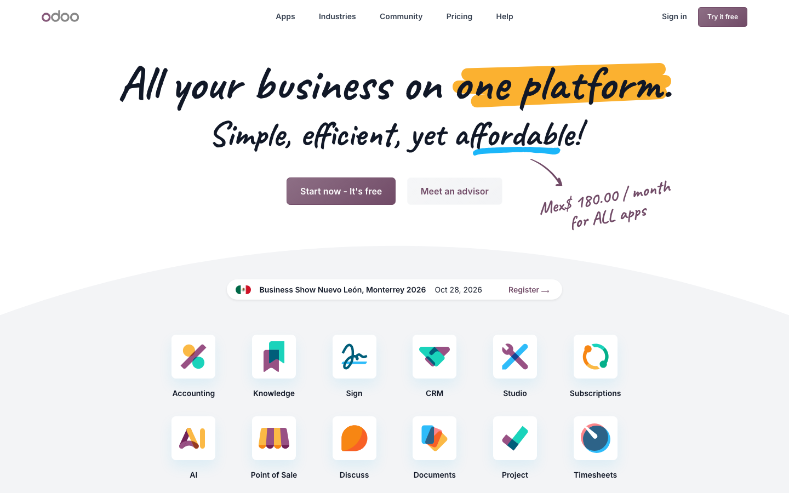
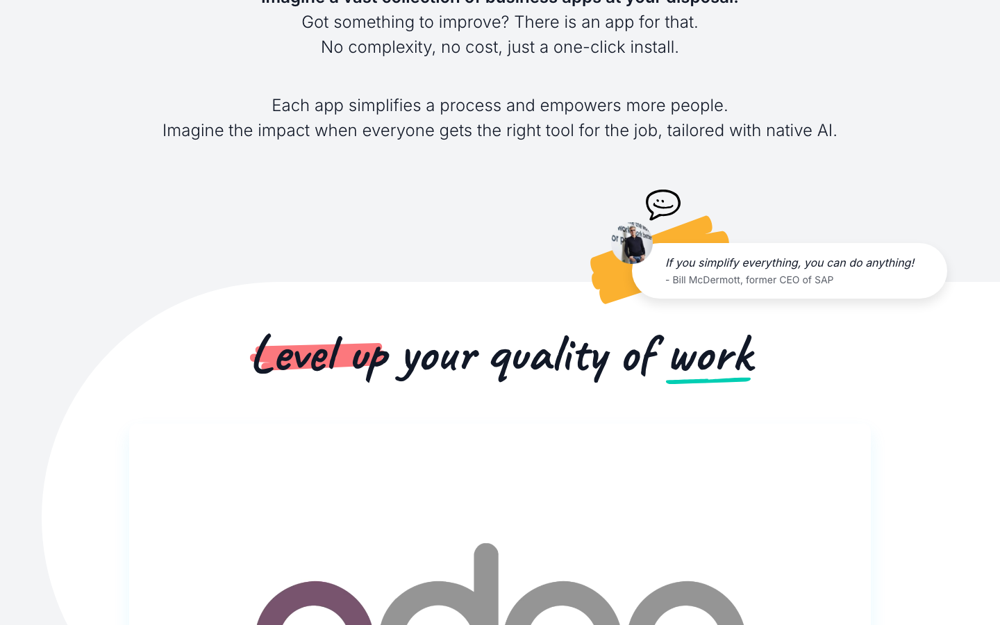
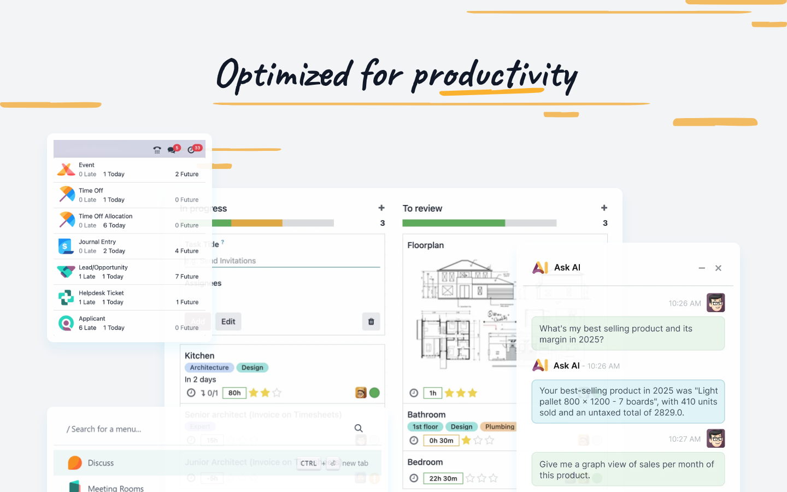
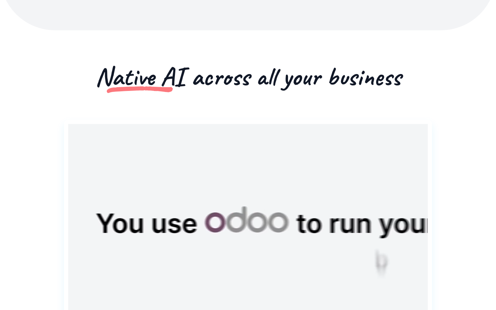
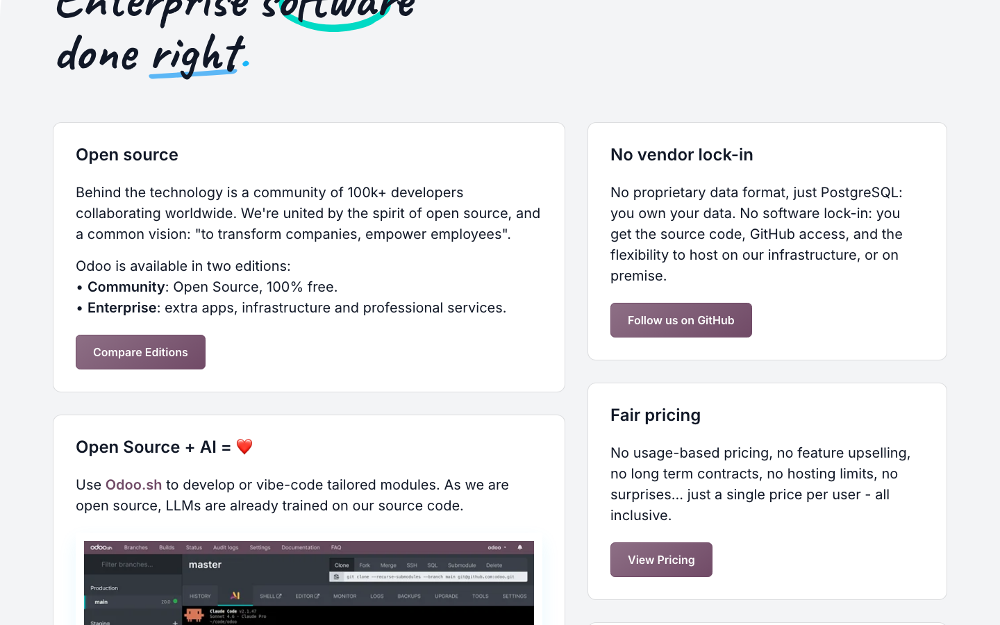
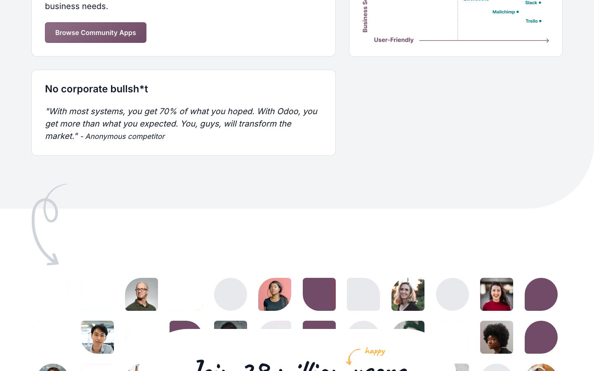
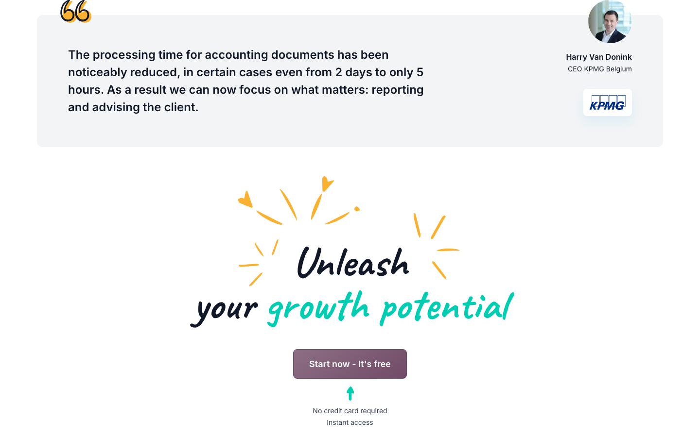

# Animation Reference

> Cinematic motion design extracted from live DOM. Follow these specs exactly to recreate the experience.

## Motion Technology Stack

| Library | Type | Notes |
|---------|------|-------|
| **Web Animations API (4 active)** | animation |  |

## Scroll Journey

The page is **8,894px** tall. Each frame below shows what the user sees at that scroll depth.

> **Use these screenshots to understand WHAT animates, WHEN it animates, and HOW it moves.**

### 0% — Top / Hero
Scroll position: 0px



### 17% — Opening Section
Scroll position: 1,359px



### 33% — First Feature Section
Scroll position: 2,638px



### 50% — Mid-Page
Scroll position: 3,997px



### 67% — Lower Content
Scroll position: 5,356px



### 83% — Near Footer
Scroll position: 6,635px



### 100% — Bottom / Footer
Scroll position: 7,994px



## Video Elements

| # | Role | Autoplay | Loop | Muted | Size | First Frame |
|---|------|----------|------|-------|------|-------------|
| 1 | background | — | ✓ | ✓ | 1068×611 | — |
| 2 | background | — | ✓ | ✓ | 1068×611 | — |

- **Source:** `https://download.odoocdn.com/videos/odoo_com/video_homepage.webm`
- **Source:** `https://download.odoocdn.com/videos/odoo_com/video_ai_homepage.webm`

## Scroll Animation Patterns

| Pattern | Library | Element Count | Duration | Delay | Easing |
|---------|---------|---------------|----------|-------|--------|
| scroll-reveal (paused → running) | CSS + IntersectionObserver | 5 | — | — | — |

### CSS + IntersectionObserver Implementation

```css
.animate-on-scroll {
  opacity: 0;
  transform: translateY(40px);
  animation: fadeSlideUp 0.6s ease-out forwards;
  animation-play-state: paused;
}
.animate-on-scroll.visible {
  animation-play-state: running;
}
```

```javascript
const observer = new IntersectionObserver((entries) => {
  entries.forEach(e => {
    if (e.isIntersecting) e.target.classList.add('visible');
  });
}, { threshold: 0.1 });
document.querySelectorAll('.animate-on-scroll').forEach(el => observer.observe(el));
```

## How to Recreate This Motion Design

### Step 1 — Install Dependencies

```bash
```

### Step 2 — Scroll-Reveal Pattern

Elements that animate into view follow this pattern:

```css
/* Initial hidden state */
.reveal {
  opacity: 0;
  transform: translateY(40px);
  transition: opacity 0.6s cubic-bezier(0.4, 0, 0.2, 1),
              transform 0.6s cubic-bezier(0.4, 0, 0.2, 1);
}
.reveal.visible {
  opacity: 1;
  transform: translateY(0);
}
```

### Step 3 — Key Motion Principles

- **Video backgrounds** — use `<video autoplay loop muted playsinline>` for background videos. Always include a poster image fallback
- **Always add** `@media (prefers-reduced-motion: reduce) { * { animation-duration: 0.01ms !important; transition-duration: 0.01ms !important; } }`

### Step 4 — Scroll Journey Reference

Match what happens at each scroll position:

- **0%** (`0px`) → `screens/scroll/scroll-000.png`
- **17%** (`1359px`) → `screens/scroll/scroll-017.png`
- **33%** (`2638px`) → `screens/scroll/scroll-033.png`
- **50%** (`3997px`) → `screens/scroll/scroll-050.png`
- **67%** (`5356px`) → `screens/scroll/scroll-067.png`
- **83%** (`6635px`) → `screens/scroll/scroll-083.png`
- **100%** (`7994px`) → `screens/scroll/scroll-100.png`

