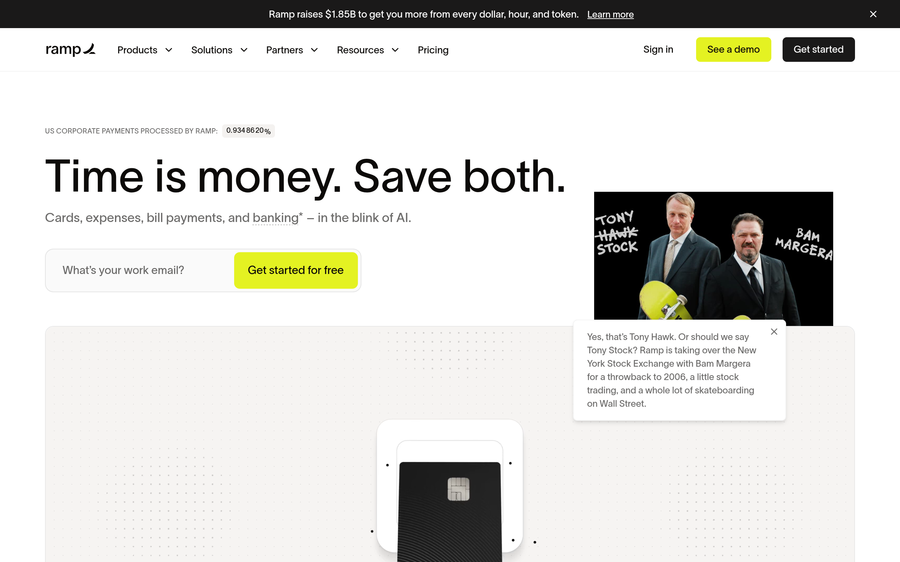
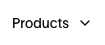
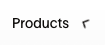
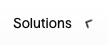
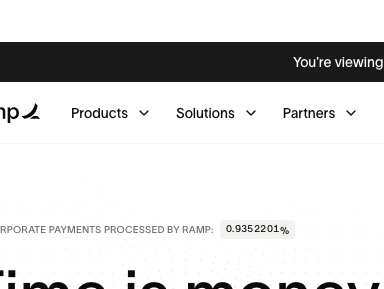

# ramp Design System

You are building UI for **ramp**. Dark-themed, cool palette, sans-serif typography (IBM Plex Sans), compact density on a 4px grid, expressive motion.

## Visual Reference

**IMPORTANT**: Study ALL screenshots below before writing any UI. Match colors, typography, spacing, layout, and motion exactly as shown.

### Homepage



### Scroll Journey (Cinematic Visual States)

> These screenshots capture the website at different scroll depths. The design changes dramatically as you scroll — each frame shows a different cinematic state. Replicate these exact visual transitions.

#### 0% — Hero / Above the fold


#### 17% — Mid-page at 17% scroll


#### 33% — Mid-page at 33% scroll


#### 50% — Mid-page at 50% scroll


#### 67% — Mid-page at 67% scroll


#### 83% — Mid-page at 83% scroll


#### 100% — Footer / End of page


### Video Backgrounds (First Frames)


> Read `references/DESIGN.md` for full token details. Read `references/ANIMATIONS.md` for motion specs. Read `references/LAYOUT.md` for layout structure. Read `references/COMPONENTS.md` for component patterns.

## Ultra Reference Files

This package includes extended documentation. **Read these files before implementing:**

| File | Contents |
|------|----------|
| `references/DESIGN.md` | Full design system tokens, colors, typography, spacing |
| `references/VISUAL_GUIDE.md` | **START HERE** — Master visual guide with all screenshots embedded |
| `references/ANIMATIONS.md` | CSS keyframes, scroll triggers, motion library stack, video specs |
| `references/LAYOUT.md` | Flex/grid containers, page structure, spacing relationships |
| `references/COMPONENTS.md` | DOM component patterns, HTML structure, class fingerprints |
| `references/INTERACTIONS.md` | Hover/focus states with before/after style diffs |
| `screens/scroll/` | 7 scroll journey screenshots showing cinematic states |

## Design Philosophy

- **Layered depth** — use shadow tokens to create a sense of physical layering. Each elevation level has a specific shadow.
- **Gradient accents** — gradients are used thoughtfully for emphasis, not decoration.
- **Type pairing** — IBM Plex Sans for body/UI text, Lausanne for headings/display. Never introduce a third typeface.
- **compact density** — 4px base grid. Every dimension is a multiple of 4.
- **cool palette** — the color temperature runs cool, matching the sans-serif typography.
- **Restrained accent** — `#0066ff` is the only pop of color. Used exclusively for CTAs, links, focus rings, and active states.
- **Expressive motion** — animations are an integral part of the experience. Use spring physics and layout animations.

## Color System

### Core Palette

| Role | Token | Hex | Use |
|------|-------|-----|-----|
| Background | `--background` | `#000000` | Page/app background |
| Surface | `--surface` | `#1f1f1d` | Cards, panels, modals |
| Text Primary | `--text-primary` | `#ffffff` | Headings, body text |
| Text Muted | `--text-muted` | `#6a7282` | Captions, placeholders |
| Accent | `--accent` | `#0066ff` | CTAs, links, focus rings |
| Border | `--border` | `#4a5565` | Dividers, card borders |

### Status Colors

| Status | Hex | Use |
|--------|-----|-----|
| Success | `#18a957` | Confirmations, positive trends |
| Warning | `#f3ece1` | Caution states, pending items |
| Danger | `#e96516` | Errors, destructive actions |

### Extended Palette

- **color-gray-100:** `#f3f4f6` — Light surface or highlight color
- **color-gray-200:** `#e5e7eb` — Light surface or highlight color
- **border-primary:** `#d2cecb`
- **text-primary:** `#0c0a08` — Deep background layer or shadow color
- **spring:** `#5683d2`
- **color-gray-300:** `#d1d5dc`
- **color-cyan-400:** `#00d2ef`
- `#2a0a3c`

### CSS Variable Tokens

```css
--text-color-primary: var(--text-primary);
--text-color-primaryReverse: var(--text-primaryReverse);
--background-color-black: var(--black);
--background-color-solar: var(--solar);
--background-color-solarLight: var(--solarLight);
--background-color-smolder: var(--smolder);
--background-color-grayLight: var(--grayLight);
--background-color-grayMedium: var(--grayMedium);
--background-color-grayDark: var(--grayDark);
--background-color-white: var(--white);
--background-color-springLight: var(--springLight);
--background-color-spring: var(--spring);
--background-image-midnight: var(--midnight);
--background-image-dusk: var(--dusk);
--background-image-daylight: var(--daylight);
--border-color-primary: var(--border-primary);
--accent-color-primary: var(--text-primary);
--z-index-popover: var(--z-popover);
--text-primary: #0c0a08;
--text-primaryReverse: #fff;
```

## Typography

### Font Stack

- **IBM Plex Sans** — Heading 1, Heading 2, Heading 3
- **Lausanne** — Body, Caption
- **IBM Plex Mono** — Code

### Font Sources

```css
@font-face {
  font-family: "Lausanne";
  src: url("fonts/Lausanne-Regular.woff2") format("woff2");
  font-weight: 400;
}
@font-face {
  font-family: "Lausanne";
  src: url("fonts/Lausanne-700.woff2") format("woff2");
  font-weight: 700;
}
@font-face {
  font-family: "IBM Plex Mono";
  src: url("fonts/IBMPlexMono-Bold.ttf") format("truetype");
  font-weight: 700;
}
@font-face {
  font-family: "IBM Plex Mono";
  src: url("fonts/IBMPlexMono-Regular.ttf") format("truetype");
  font-weight: 400;
}
@font-face {
  font-family: "IBM Plex Sans";
  src: url("fonts/IBMPlexSans-Bold.ttf") format("truetype");
  font-weight: 700;
}
@font-face {
  font-family: "IBM Plex Sans";
  src: url("fonts/IBMPlexSans-Regular.ttf") format("truetype");
  font-weight: 400;
}
@font-face {
  font-family: "IBM Plex Sans JP";
  src: url("fonts/IBMPlexSansJP-Bold.ttf") format("truetype");
  font-weight: 700;
}
@font-face {
  font-family: "IBM Plex Sans JP";
  src: url("fonts/IBMPlexSansJP-Regular.ttf") format("truetype");
  font-weight: 400;
}
```

### Type Scale

| Role | Family | Size | Weight |
|------|--------|------|--------|
| Heading 1 | IBM Plex Sans | clamp(9rem,28.5vw,25.625rem) | 700 |
| Heading 2 | IBM Plex Sans | 140px | 700 |
| Heading 3 | IBM Plex Sans | clamp(6rem,29vw,8rem) | 700 |
| Body | Lausanne | 20px | 400 |
| Caption | Lausanne | 18px | 400 |
| Code | IBM Plex Mono | 14px | 400 |

### Typography Rules

- Body/UI: **IBM Plex Sans**, Headings: **Lausanne** — these are the only display fonts
- Max 3-4 font sizes per screen
- Headings: weight 600-700, body: weight 400
- Use color and opacity for text hierarchy, not additional font sizes
- Line height: 1.5 for body, 1.2 for headings

## Spacing & Layout

### Base Grid: 4px

Every dimension (margin, padding, gap, width, height) must be a multiple of **4px**.

### Spacing Scale

`2, 4, 6, 8, 10, 12, 16, 20, 22, 24, 28, 30` px

### Spacing as Meaning

| Spacing | Use |
|---------|-----|
| 4-8px | Tight: related items (icon + label, avatar + name) |
| 12-16px | Medium: between groups within a section |
| 24-32px | Wide: between distinct sections |
| 48px+ | Vast: major page section breaks |

### Border Radius

Scale: `0px 0px 12px 12px, .1875rem, .25rem, 2px, 3px, 4px, 6px, 8px, 10px, 12px, 14px, 16px, 18px, 20px, 24px, 28px, 32px, 60px, 100px, clamp(2px,.5vw,6px), 999px, inherit`
Default: `16px`

### Container

Max-width: `1023px`, centered with auto margins.

### Breakpoints

| Name | Value |
|------|-------|
| md | 47.999rem |
| xs | 380px |
| xs | 480px |
| sm | 500px |
| md | 767px |
| md | 768px |
| lg | 860px |
| lg | 991px |
| lg | 992px |
| lg | 1023px |
| lg | 1024px |
| xl | 1100px |
| xl | 1280px |
| 2xl | 1360px |
| 2xl | 1440px |

Mobile-first: design for small screens, layer on responsive overrides.

## Component Patterns

### Card

```css
.card {
  background: #1f1f1d;
  border: 1px solid #4a5565;
  border-radius: 16px;
  padding: 16px;
  box-shadow: rgba(0, 0, 0, 0) 0px 0px 0px 0px, rgba(0, 0, 0, 0) 0px 0px 0px 0px, rgba(0, 0, 0, 0) 0px 0px 0px 0px, rgba(0, 0, 0, 0) 0px 0px 0px 0px, rgba(255, 255, 255, 0.6) 0px 0px 2px 0px inset;
}
```

```html
<div class="card">
  <h3>Card Title</h3>
  <p>Card content goes here.</p>
</div>
```

### Button

```css
/* Primary */
.btn-primary {
  background: #0066ff;
  color: #ffffff;
  border-radius: 16px;
  padding: 8px 16px;
  font-weight: 500;
  transition: opacity 150ms ease;
}
.btn-primary:hover { opacity: 0.9; }

/* Ghost */
.btn-ghost {
  background: transparent;
  border: 1px solid #4a5565;
  color: #ffffff;
  border-radius: 16px;
  padding: 8px 16px;
}
```

```html
<button class="btn-primary">Get Started</button>
<button class="btn-ghost">Learn More</button>
```

### Input

```css
.input {
  background: #000000;
  border: 1px solid #4a5565;
  border-radius: 16px;
  padding: 8px 12px;
  color: #ffffff;
  font-size: 14px;
}
.input:focus { border-color: #0066ff; outline: none; }
```

```html
<input class="input" type="text" placeholder="Search..." />
```

### Badge / Chip

```css
.badge {
  display: inline-flex;
  align-items: center;
  padding: 4px 8px;
  border-radius: 9999px;
  font-size: 12px;
  font-weight: 500;
  background: #1f1f1d;
  color: #6a7282;
}
```

```html
<span class="badge">New</span>
<span class="badge">Beta</span>
```

### Modal / Dialog

```css
.modal-backdrop { background: rgba(0, 0, 0, 0.6); }
.modal {
  background: #1f1f1d;
  border: 1px solid #4a5565;
  border-radius: inherit;
  padding: 24px;
  max-width: 480px;
  width: 90vw;
  box-shadow: 0 0 30px #1111112c;
}
```

```html
<div class="modal-backdrop">
  <div class="modal">
    <h2>Dialog Title</h2>
    <p>Dialog content.</p>
    <button class="btn-primary">Confirm</button>
    <button class="btn-ghost">Cancel</button>
  </div>
</div>
```

### Table

```css
.table { width: 100%; border-collapse: collapse; }
.table th {
  text-align: left;
  padding: 8px 12px;
  font-weight: 500;
  font-size: 12px;
  color: #6a7282;
  text-transform: uppercase;
  letter-spacing: 0.05em;
  border-bottom: 1px solid #4a5565;
}
.table td {
  padding: 12px;
  border-bottom: 1px solid #4a5565;
}
```

```html
<table class="table">
  <thead><tr><th>Name</th><th>Status</th><th>Date</th></tr></thead>
  <tbody>
    <tr><td>Item One</td><td>Active</td><td>Jan 1</td></tr>
    <tr><td>Item Two</td><td>Pending</td><td>Jan 2</td></tr>
  </tbody>
</table>
```

### Navigation

```css
.nav {
  display: flex;
  align-items: center;
  gap: 8px;
  padding: 12px 16px;
  border-bottom: 1px solid #4a5565;
}
.nav-link {
  color: #6a7282;
  padding: 8px 12px;
  border-radius: 16px;
  transition: color 150ms;
}
.nav-link:hover { color: #ffffff; }
.nav-link.active { color: #0066ff; }
```

```html
<nav class="nav">
  <a href="/" class="nav-link active">Home</a>
  <a href="/about" class="nav-link">About</a>
  <a href="/pricing" class="nav-link">Pricing</a>
  <button class="btn-primary" style="margin-left: auto">Get Started</button>
</nav>
```

### Extracted Components

These components were found in the codebase:

**Button** (`html`)

**Input** (`html`)

**Card** (`html`)
- Variants: `:scale-102`

## Page Structure

The following page sections were detected:

- **Navigation** — Top navigation bar (7 items)
- **Hero** — Hero/banner section with headline and CTAs
- **Footer** — Page footer with links and info (135 items)
- **Cards** — Grid of 4 card elements (4 items)
- **Faq** — FAQ/accordion section

When building pages, follow this section order and structure.

## Animation & Motion

This project uses **expressive motion**. Animations are part of the design language.

### CSS Animations

- `skeleton`
- `arrow-slide`
- `accordion-down`
- `accordion-up`
- `slideDownAndFade`

### Motion Tokens

- **Duration scale:** `0s`, `.1s`, `.15s`, `.2s`, `.3s`, `.5s`, `.7s`, `1s`, `3.8s`, `4s`, `4.2s`, `4.5s`, `4.8s`, `5s`, `5.2s`, `5.5s`, `6s`, `120s`, `150ms`, `160s`, `200ms`, `250ms`, `300ms`, `350ms`, `400ms`, `500ms`, `600ms`, `680ms`, `750ms`, `1200ms`, `1400ms`, `1500ms`, `1700ms`, `1800ms`
- **Easing functions:** `cubic-bezier(.22,1,.36,1)`, `cubic-bezier(.87,0,.13,1)`, `linear`, `ease-in-out`, `cubic-bezier(.4,0,.2,1)`, `cubic-bezier(0,0,.2,1)`, `cubic-bezier(.16,1,.3,1)`
- **Animated properties:** `color`, `background-color`

### Motion Guidelines

- **Duration:** Use values from the duration scale above. Short (0s) for micro-interactions, long (1800ms) for page transitions
- **Easing:** Use `cubic-bezier(.22,1,.36,1)` as the default easing curve
- **Direction:** Elements enter from bottom/right, exit to top/left
- **Reduced motion:** Always respect `prefers-reduced-motion` — disable animations when set

## Depth & Elevation

### Shadow Tokens

- Subtle: `rgba(0, 0, 0, 0) 0px 0px 0px 0px, rgba(0, 0, 0, 0) 0px 0px 0px 0px, rgba(0, 0, 0, 0) 0px 0px 0px 0px, rgba(0, 0, 0, 0) 0px 0px 0px 0px, rgba(255, 255, 255, 0.6) 0px 0px 2px 0px inset`
- Overlay (modals, dialogs): `0 0 30px #1111112c`
- Overlay (modals, dialogs): `0 8px 30px #00000014`
- Overlay (modals, dialogs): `rgba(0, 0, 0, 0.008) 0px 232px 65px 0px, rgba(0, 0, 0, 0.03) 0px 35px 59px 0px, rgba(0, 0, 0, 0.09) 0px 20px 50px 0px, rgba(0, 0, 0, 0.067) 0px 37px 37px 0px, rgba(0, 0, 0, 0.086) 0px 9px 20px 0px, rgba(0, 0, 0, 0.08) 0px 0px 0px 0px`

### Z-Index Scale

`0, 1, 2, 3, 4, 5, 10, 12, 20, 30, 40, 50, 60, 500`

Use these exact values — never invent z-index values.

## Anti-Patterns (Never Do)

- **No blur effects** — no backdrop-blur, no filter: blur()
- **No zebra striping** — tables and lists use borders for separation
- **No invented colors** — every hex value must come from the palette above
- **No arbitrary spacing** — every dimension is a multiple of 4px
- **No extra fonts** — only IBM Plex Sans and Lausanne and IBM Plex Mono are allowed
- **No arbitrary border-radius** — use the scale: .1875rem, .25rem, 2px, 3px, 4px, 6px, 8px, 10px, 12px, 14px
- **No opacity for disabled states** — use muted colors instead
- **No pill shapes** — this design doesn't use rounded-full / 9999px radius

## Workflow

1. **Read** `references/DESIGN.md` before writing any UI code
2. **Pick colors** from the Color System section — never invent new ones
3. **Set typography** — IBM Plex Sans, Lausanne, IBM Plex Mono only, using the type scale
4. **Build layout** on the 4px grid — check every margin, padding, gap
5. **Match components** to patterns above before creating new ones
6. **Apply elevation** — use shadow tokens
7. **Validate** — every value traces back to a design token. No magic numbers.

## Brand Spec

- **Favicon:** `/favicon.ico`
- **Site URL:** `https://ramp.com`
- **Brand color:** `#0066ff`
- **Brand typeface:** IBM Plex Sans

## Quick Reference

```
Background:     #000000
Surface:        #1f1f1d
Text:           #ffffff / #6a7282
Accent:         #0066ff
Border:         #4a5565
Font:           IBM Plex Sans
Spacing:        4px grid
Radius:         16px
Components:     11 detected
```

## When to Trigger

Activate this skill when:
- Creating new components, pages, or visual elements for ramp
- Writing CSS, Tailwind classes, styled-components, or inline styles
- Building page layouts, templates, or responsive designs
- Reviewing UI code for design consistency
- The user mentions "ramp" design, style, UI, or theme
- Generating mockups, wireframes, or visual prototypes

---

# Full Reference Files

> Every output file is embedded below. Claude has full design system context from /skills alone.

## Design System Tokens (DESIGN.md)

# ramp DESIGN.md

> Auto-generated design system — reverse-engineered via static analysis by skillui.
> Frameworks: None detected
> Colors: 20 · Fonts: 3 · Components: 11
> Icon library: not detected · State: not detected
> Primary theme: dark · Dark mode toggle: no · Motion: expressive

## Visual Reference

**Match this design exactly** — study colors, fonts, spacing, and component shapes before writing any UI code.


---

## 1. Visual Theme & Atmosphere

This is a **dark-themed** interface with a cool tone. Depth is expressed through layered shadows and subtle surface color variation. Typography pairs **Lausanne** for display/headings with **IBM Plex Sans** for body text, creating clear visual hierarchy through type contrast. Spacing follows a **4px base grid** (compact density), with scale: 2, 4, 6, 8, 10, 12, 16, 20px. The accent color **#0066ff** anchors interactive elements (buttons, links, focus rings). Motion is expressive — spring physics, layout animations, and staggered reveals are part of the visual language.

---

## 2. Color Palette & Roles

| Token | Hex | Role | Use |
|---|---|---|---|
| background | `#000000` | background | Page background, darkest surface |
| surface | `#1f1f1d` | surface | Card and panel backgrounds |
| tw-ring-offset-color | `#ffffff` | text-primary | Headings and body text |
| color-gray-500 | `#6a7282` | text-muted | Captions, placeholders, secondary info |
| color-gray-600 | `#4a5565` | border | Dividers, card borders, outlines |
| accent | `#0066ff` | accent | CTAs, links, focus rings, active states |
| danger | `#e96516` | danger | Error states, destructive actions |
| success | `#18a957` | success | Success states, positive indicators |
| warning | `#f3ece1` | warning | Warning states, caution indicators |
| spring | `#5683d2` | info | Informational highlights |
| color-gray-100 | `#f3f4f6` | unknown | Palette color |
| color-gray-200 | `#e5e7eb` | unknown | Palette color |
| border-primary | `#d2cecb` | unknown | Palette color |
| text-primary | `#0c0a08` | unknown | Palette color |
| color-gray-300 | `#d1d5dc` | unknown | Palette color |
| color-cyan-400 | `#00d2ef` | unknown | Palette color |
| unknown | `#2a0a3c` | unknown | Palette color |
| unknown | `#5ab570` | unknown | Palette color |
| unknown | `#b2c7eb` | unknown | Palette color |
| color-blue-600 | `#155dfc` | unknown | Palette color |

### CSS Variable Tokens

```css
--tw-border-spacing-x: 0;
--tw-border-spacing-y: 0;
--tw-border-style: solid;
--text-color-primary: var(--text-primary);
--text-color-primaryReverse: var(--text-primaryReverse);
--background-color-black: var(--black);
--background-color-solar: var(--solar);
--background-color-solarLight: var(--solarLight);
--background-color-smolder: var(--smolder);
--background-color-grayLight: var(--grayLight);
--background-color-grayMedium: var(--grayMedium);
--background-color-grayDark: var(--grayDark);
--background-color-white: var(--white);
--background-color-springLight: var(--springLight);
--background-color-spring: var(--spring);
--background-image-midnight: var(--midnight);
--background-image-dusk: var(--dusk);
--background-image-daylight: var(--daylight);
--border-color-primary: var(--border-primary);
--accent-color-primary: var(--text-primary);
```


---

## 3. Typography Rules

**Font Stack:**
- **IBM Plex Sans** — Heading 1, Heading 2, Heading 3
- **Lausanne** — Body, Caption
- **IBM Plex Mono** — Code

**Font Sources:**

```css
@font-face {
  font-family: "Lausanne";
  src: url("fonts/Lausanne-Regular.woff2") format("woff2");
  font-weight: 400;
}
@font-face {
  font-family: "Lausanne";
  src: url("fonts/Lausanne-700.woff2") format("woff2");
  font-weight: 700;
}
@font-face {
  font-family: "IBM Plex Mono";
  src: url("fonts/IBMPlexMono-Bold.ttf") format("truetype");
  font-weight: 700;
}
@font-face {
  font-family: "IBM Plex Mono";
  src: url("fonts/IBMPlexMono-Regular.ttf") format("truetype");
  font-weight: 400;
}
@font-face {
  font-family: "IBM Plex Sans";
  src: url("fonts/IBMPlexSans-Bold.ttf") format("truetype");
  font-weight: 700;
}
@font-face {
  font-family: "IBM Plex Sans";
  src: url("fonts/IBMPlexSans-Regular.ttf") format("truetype");
  font-weight: 400;
}
@font-face {
  font-family: "IBM Plex Sans JP";
  src: url("fonts/IBMPlexSansJP-Bold.ttf") format("truetype");
  font-weight: 700;
}
@font-face {
  font-family: "IBM Plex Sans JP";
  src: url("fonts/IBMPlexSansJP-Regular.ttf") format("truetype");
  font-weight: 400;
}
```

| Role | Font | Size | Weight |
|---|---|---|---|
| Heading 1 | IBM Plex Sans | clamp(9rem,28.5vw,25.625rem) | 700 |
| Heading 2 | IBM Plex Sans | 140px | 700 |
| Heading 3 | IBM Plex Sans | clamp(6rem,29vw,8rem) | 700 |
| Body | Lausanne | 20px | 400 |
| Caption | Lausanne | 18px | 400 |
| Code | IBM Plex Mono | 14px | 400 |

**Typographic Rules:**
- Limit to 3 font families max per screen
- Use **IBM Plex Sans** for body/UI text, **Lausanne** for display/headings
- Maintain consistent hierarchy: no more than 3-4 font sizes per screen
- Headings use bold (600-700), body uses regular (400)
- Line height: 1.5 for body text, 1.2 for headings
- Use color and opacity for secondary hierarchy, not additional font sizes


---

## 4. Component Stylings

### Layout (1)

**Footer** — `html`

### Navigation (1)

**Navigation** — `html`

### Data Display (3)

**Card** — `html`
- Variants: `:scale-102`

**Badge** — `html`

**List** — `html`

### Data Input (2)

**Button** — `html`
- Animation: 

**Input** — `html`
- State: :focus, :placeholder

### Overlay (1)

**Modal** — `html`

### Media (3)

**Image** — `html`

**Icon** — `html`

**Map/Canvas** — `html`


---

## 5. Layout Principles

- **Base spacing unit:** 4px
- **Spacing scale:** 2, 4, 6, 8, 10, 12, 16, 20, 22, 24, 28, 30
- **Border radius:** 0px 0px 12px 12px, .1875rem, .25rem, 2px, 3px, 4px, 6px, 8px, 10px, 12px, 14px, 16px, 18px, 20px, 24px, 28px, 32px, 60px, 100px, clamp(2px,.5vw,6px), 999px, inherit
- **Max content width:** 1023px

**Spacing as Meaning:**
| Spacing | Use |
|---|---|
| 4-8px | Tight: related items within a group |
| 12-16px | Medium: between groups |
| 24-32px | Wide: between sections |
| 48px+ | Vast: major section breaks |


---

## 6. Depth & Elevation

### Flat — subtle depth hints

- `rgba(0, 0, 0, 0) 0px 0px 0px 0px, rgba(0, 0, 0, 0) 0px 0px 0px 0px, rgba(0, 0, 0, 0) 0px 0px 0px 0px, rgba(0, 0, 0, 0) 0px 0px 0px 0px, rgba(255, 255, 255, 0.6) 0px 0px 2px 0px inset`

### Overlay — full-screen overlays, top-level dialogs

- `0 0 30px #1111112c`
- `0 8px 30px #00000014`
- `rgba(0, 0, 0, 0.008) 0px 232px 65px 0px, rgba(0, 0, 0, 0.03) 0px 35px 59px 0px, rgba(0, 0, 0, 0.09) 0px 20px 50px 0px, rgba(0, 0, 0, 0.067) 0px 37px 37px 0px, rgba(0, 0, 0, 0.086) 0px 9px 20px 0px, rgba(0, 0, 0, 0.08) 0px 0px 0px 0px`

### Z-Index Scale

`0, 1, 2, 3, 4, 5, 10, 12, 20, 30, 40, 50, 60, 500`


---

## 7. Animation & Motion

This project uses **expressive motion**. Animations are an integral part of the experience.

### CSS Animations

- `@keyframes skeleton`
- `@keyframes arrow-slide`
- `@keyframes accordion-down`
- `@keyframes accordion-up`
- `@keyframes slideDownAndFade`
- `@keyframes slideLeftAndFade`
- `@keyframes slideUpAndFade`
- `@keyframes slideRightAndFade`

### Animated Components

- **Button**: 

### Motion Guidelines

- Duration: 150-300ms for micro-interactions, 300-500ms for page transitions
- Easing: `ease-out` for enters, `ease-in` for exits
- Always respect `prefers-reduced-motion`


---

## 8. Do's and Don'ts

### Do's

- Use `#0066ff` for interactive elements (buttons, links, focus rings)
- Use `#000000` as the primary page background
- Pair **IBM Plex Sans** (body) with **Lausanne** (display) — these are the only allowed fonts
- Follow the **4px** spacing grid for all margins, padding, and gaps
- Use the defined shadow tokens for elevation — see Section 6
- Use border-radius from the scale: 0px 0px 12px 12px, .1875rem, .25rem, 2px, 3px
- Reuse existing components from Section 4 before creating new ones

### Don'ts

- Don't introduce colors outside this palette — extend the design tokens first
- Don't introduce additional font families beyond IBM Plex Sans and Lausanne and IBM Plex Mono
- Don't use arbitrary spacing values — stick to multiples of 4px
- Don't create custom box-shadow values outside the system tokens
- Don't use arbitrary border-radius values — pick from the defined scale
- Don't duplicate component patterns — check Section 4 first
- Don't use backdrop-blur or blur effects

### Anti-Patterns (detected from codebase)

- No blur or backdrop-blur effects
- No zebra striping on tables/lists


---

## 9. Responsive Behavior

| Name | Value | Source |
|---|---|---|
| md | 47.999rem | css |
| xs | 380px | css |
| xs | 480px | css |
| sm | 500px | css |
| md | 767px | css |
| md | 768px | css |
| lg | 860px | css |
| lg | 991px | css |
| lg | 992px | css |
| lg | 1023px | css |
| lg | 1024px | css |
| xl | 1100px | css |
| xl | 1280px | css |
| 2xl | 1360px | css |
| 2xl | 1440px | css |

**Approach:** Use `@media (min-width: ...)` queries matching the breakpoints above.


---

## 10. Agent Prompt Guide

Use these as starting points when building new UI:

### Build a Card

```
Background: #1f1f1d
Border: 1px solid #4a5565
Radius: 16px
Padding: 16px
Font: IBM Plex Sans
Use shadow tokens from Section 6.
```

### Build a Button

```
Primary: bg #0066ff, text white
Ghost: bg transparent, border #4a5565
Padding: 8px 16px
Radius: 16px
Hover: opacity 0.9 or lighter shade
Focus: ring with #0066ff
```

### Build a Page Layout

```
Background: #000000
Max-width: 1023px, centered
Grid: 4px base
Responsive: mobile-first, breakpoints from Section 9
```

### Build a Stats Card

```
Surface: #1f1f1d
Label: #6a7282 (muted, 12px, uppercase)
Value: #ffffff (primary, 24-32px, bold)
Status: use success/warning/danger from Section 2
```

### Build a Form

```
Input bg: #000000
Input border: 1px solid #4a5565
Focus: border-color #0066ff
Label: #6a7282 12px
Spacing: 16px between fields
Radius: 16px
```

### General Component

```
1. Read DESIGN.md Sections 2-6 for tokens
2. Colors: only from palette
3. Font: IBM Plex Sans, type scale from Section 3
4. Spacing: 4px grid
5. Components: match patterns from Section 4
6. Elevation: shadow tokens
```

## Visual Guide — Screenshots (VISUAL_GUIDE.md)

# ramp — Visual Guide

> Master visual reference. Study every screenshot carefully before implementing any UI.
> Match colors, layout, typography, spacing, and motion states exactly.

**WebGL/3D:** Detected (9 canvas elements) — replicate with Three.js or CSS 3D transforms

## Scroll Journey

The page has cinematic scroll animations. Each screenshot below shows the exact visual state at that scroll depth.
**Replicate these transitions precisely** — the design changes dramatically as you scroll.

### Hero — Above the fold

*Scroll position: 0px of 14554px total*


### 17% scroll depth

*Scroll position: 2321px of 14554px total*


### 33% scroll depth

*Scroll position: 4506px of 14554px total*


### 50% scroll depth

*Scroll position: 6827px of 14554px total*


### 67% scroll depth

*Scroll position: 9148px of 14554px total*


### 83% scroll depth

*Scroll position: 11333px of 14554px total*


### Footer — End of page

*Scroll position: 13652px of 14554px total*


## Video Backgrounds

These videos play as background elements. Use first-frame as poster image while video loads.

### Video 2 (background)

*Source: `https://assets.ramp.com/nextjs/videos/homepage-hero-423.webm...`*


## Full Page Screenshots

### Spend Management, Corporate Cards & Accounts Payable Solutions | Ramp

*URL: `https://ramp.com`*


## Section Screenshots

Clipped sections showing individual components in context.

### Section 1 — `section`

*1440×1013px*


## Animations & Motion (ANIMATIONS.md)

# Animation Reference

> Cinematic motion design extracted from live DOM. Follow these specs exactly to recreate the experience.

## Motion Technology Stack

| Library | Type | Notes |
|---------|------|-------|
| Canvas (9 elements) | WebGL/3D | WebGL context detected — likely Three.js or custom shader |

## Scroll Journey

The page is **14,554px** tall. Each frame below shows what the user sees at that scroll depth.

> **Use these screenshots to understand WHAT animates, WHEN it animates, and HOW it moves.**

### 0% — Top / Hero
Scroll position: 0px


### 17% — Opening Section
Scroll position: 2,321px


### 33% — First Feature Section
Scroll position: 4,506px


### 50% — Mid-Page
Scroll position: 6,827px


### 67% — Lower Content
Scroll position: 9,148px


### 83% — Near Footer
Scroll position: 11,333px


### 100% — Bottom / Footer
Scroll position: 13,652px


## Video Elements

| # | Role | Autoplay | Loop | Muted | Size | First Frame |
|---|------|----------|------|-------|------|-------------|
| 1 | content | ✓ | ✓ | ✓ | — | — |
| 2 | background | ✓ | ✓ | ✓ | 1310×584 | [view](../screens/scroll/video-2-frame.png) |
| 3 | content | ✓ | ✓ | ✓ | 753×753 | — |

- **Source:** `https://assets.ramp.com/nextjs/videos/homepage-hero-mobile-423.webm`
**Video 2 first frame:**


- **Source:** `https://assets.ramp.com/nextjs/videos/homepage-hero-423.webm`
- **Source:** `https://assets.ramp.com/nextjs/videos/homepage-perplexity-thumbnail.mp4`

## Scroll Animation Patterns

| Pattern | Library | Element Count | Duration | Delay | Easing |
|---------|---------|---------------|----------|-------|--------|
| parallax / sticky scroll | CSS | 1 | — | — | — |

### CSS Implementation

## CSS Keyframes (45 extracted)

### `@keyframes constructionClouds-module__3i1Joq__cloudBob`

Duration: `auto` · Easing: `ease-in-out` · Delay: `0s` · Iteration: `infinite` · Fill: `none`

Used by: `.constructionClouds-module__3i1Joq__cloudBob1, .constructionClouds-module__3i1Jo`, `.constructionClouds-module__3i1Joq__moneyBob1, .constructionClouds-module__3i1Jo`

```css
@keyframes constructionClouds-module__3i1Joq__cloudBob {
  0%, 100% {
    transform: translateY(0px);
  }
  50% {
    transform: translateY(-12px);
  }
}
```

> Transform/motion animation

### `@keyframes arrow-slide`

Duration: `0.5s` · Easing: `ease-in-out` · Delay: `0s` · Iteration: `1` · Fill: `forwards`

Used by: `.animate-arrow-slide`

```css
@keyframes arrow-slide {
  0% {
    opacity: 1;
    transform: translate(0px);
  }
  20% {
    opacity: 0;
    transform: translate(8px);
  }
  40% {
    opacity: 0;
    transform: translate(-8px);
  }
  60% {
    opacity: 0;
    transform: translate(-8px);
  }
  100% {
    opacity: 1;
    transform: translate(0px);
  }
}
```

> Fade + motion enter animation

### `@keyframes accordion-down`

Duration: `0.2s` · Easing: `ease-out` · Delay: `0s` · Iteration: `1` · Fill: `none`

Used by: `.animate-accordion-down`

```css
@keyframes accordion-down {
  0% {
    height: 0px;
  }
  100% {
    height: var(--radix-accordion-content-height,var(--bits-accordion-content-height,var(--reka-accordion-content-height,var(--kb-accordion-content-height,var(--ngp-accordion-content-height,auto)))));
  }
}
```

> Dimension expand/collapse

### `@keyframes accordion-up`

Duration: `0.2s` · Easing: `ease-out` · Delay: `0s` · Iteration: `1` · Fill: `none`

Used by: `.animate-accordion-up`

```css
@keyframes accordion-up {
  0% {
    height: var(--radix-accordion-content-height,var(--bits-accordion-content-height,var(--reka-accordion-content-height,var(--kb-accordion-content-height,var(--ngp-accordion-content-height,auto)))));
  }
  100% {
    height: 0px;
  }
}
```

> Dimension expand/collapse

### `@keyframes slideDownAndFade`

Duration: `0.4s` · Easing: `cubic-bezier(0.16, 1, 0.3, 1)` · Delay: `0s` · Iteration: `1` · Fill: `none`

Used by: `.animate-slideDownAndFade`

```css
@keyframes slideDownAndFade {
  0% {
    opacity: 0;
    transform: translateY(-2px);
  }
  100% {
    opacity: 1;
    transform: translateY(0px);
  }
}
```

> Fade + motion enter animation

### `@keyframes slideLeftAndFade`

Duration: `0.4s` · Easing: `cubic-bezier(0.16, 1, 0.3, 1)` · Delay: `0s` · Iteration: `1` · Fill: `none`

Used by: `.animate-slideLeftAndFade`

```css
@keyframes slideLeftAndFade {
  0% {
    opacity: 0;
    transform: translate(2px);
  }
  100% {
    opacity: 1;
    transform: translate(0px);
  }
}
```

> Fade + motion enter animation

### `@keyframes slideUpAndFade`

Duration: `0.4s` · Easing: `cubic-bezier(0.16, 1, 0.3, 1)` · Delay: `0s` · Iteration: `1` · Fill: `none`

Used by: `.animate-slideUpAndFade`

```css
@keyframes slideUpAndFade {
  0% {
    opacity: 0;
    transform: translateY(2px);
  }
  100% {
    opacity: 1;
    transform: translateY(0px);
  }
}
```

> Fade + motion enter animation

### `@keyframes slideRightAndFade`

Duration: `0.4s` · Easing: `cubic-bezier(0.16, 1, 0.3, 1)` · Delay: `0s` · Iteration: `1` · Fill: `none`

Used by: `.animate-slideRightAndFade`

```css
@keyframes slideRightAndFade {
  0% {
    opacity: 0;
    transform: translate(-2px);
  }
  100% {
    opacity: 1;
    transform: translate(0px);
  }
}
```

> Fade + motion enter animation

### `@keyframes spin`

Duration: `1s` · Easing: `linear` · Delay: `0s` · Iteration: `infinite` · Fill: `none`

Used by: `.fides-spinner`

```css
@keyframes spin {
  100% {
    transform: rotate(360deg);
  }
}
```

> Transform/motion animation

### `@keyframes nav-out`

Duration: `0.15s` · Easing: `ease-in-out` · Delay: `0s` · Iteration: `1` · Fill: `none`

Used by: `.nav-sheet[data-state="closed"]`

```css
@keyframes nav-out {
  0% {
    transform: translateY(0px);
  }
  100% {
    transform: translateY(calc(-100% - 56px));
  }
}
```

> Transform/motion animation

### `@keyframes nav-in`

Duration: `0.3s` · Easing: `cubic-bezier(0, 0.55, 0.45, 1)` · Delay: `0s` · Iteration: `1` · Fill: `none`

Used by: `.nav-sheet[data-state="open"]`

```css
@keyframes nav-in {
  0% {
    transform: translateY(calc(-100% - 56px));
  }
  100% {
    transform: translateY(0px);
  }
}
```

> Transform/motion animation

### `@keyframes PopupLightbox-module__sYoECq__overlayShow`

Duration: `0.3s` · Easing: `cubic-bezier(0.4, 0, 0.2, 1)` · Delay: `0s` · Iteration: `1` · Fill: `forwards`

Used by: `.PopupLightbox-module__sYoECq__lightbox-overlay`

```css
@keyframes PopupLightbox-module__sYoECq__overlayShow {
  0% {
    opacity: 0;
  }
  100% {
    opacity: 0.25;
  }
}
```

> Opacity fade

### `@keyframes PopupLightbox-module__sYoECq__contentShow`

Duration: `0.3s` · Easing: `cubic-bezier(0.4, 0, 0.2, 1)` · Delay: `0s` · Iteration: `1` · Fill: `forwards`

Used by: `.PopupLightbox-module__sYoECq__lightbox-content`

```css
@keyframes PopupLightbox-module__sYoECq__contentShow {
  0% {
    opacity: 0;
    transform: translate(-50%, -48%) scale(0.96);
  }
  100% {
    opacity: 1;
    transform: translate(-50%, -50%) scale(1);
  }
}
```

> Fade + motion enter animation

### `@keyframes PersonalizeClient-module__bf7S1a__personalization-border-trace`

Duration: `3.4s` · Easing: `linear` · Delay: `0s` · Iteration: `infinite` · Fill: `none`

Used by: `.PersonalizeClient-module__bf7S1a__borderTracer::before`

```css
@keyframes PersonalizeClient-module__bf7S1a__personalization-border-trace {
  100% {
    --personalization-trace-angle: 360deg;
  }
}
```

### `@keyframes PersonalizeClient-module__bf7S1a__personalization-status-wash`

Duration: `1.8s` · Easing: `linear` · Delay: `0s` · Iteration: `infinite` · Fill: `none`

Used by: `.PersonalizeClient-module__bf7S1a__personalizingWash`

```css
@keyframes PersonalizeClient-module__bf7S1a__personalization-status-wash {
  100% {
    background-position-x: 0px;
    background-position-y: center;
  }
}
```

> Background color/gradient shift · Background position (shimmer/scroll)

### `@keyframes constructionClouds-module__3i1Joq__cloudDrift`

Duration: `auto` · Easing: `linear` · Delay: `0s` · Iteration: `infinite` · Fill: `none`

Used by: `.constructionClouds-module__3i1Joq__cloud`

```css
@keyframes constructionClouds-module__3i1Joq__cloudDrift {
  0% {
    translate: -100vw;
  }
  100% {
    translate: 100vw;
  }
}
```

### `@keyframes KbMediaAccordion-module__N0Z4LW__accordionItem`

Duration: `0.3s` · Easing: `linear` · Delay: `0s` · Iteration: `1` · Fill: `none`

Used by: `.KbMediaAccordion-module__N0Z4LW__accordionItem`

```css
@keyframes KbMediaAccordion-module__N0Z4LW__accordionItem {
  0% {
    transform: scaleX(0);
  }
  100% {
    transform: scaleX(1);
  }
}
```

> Transform/motion animation

### `@keyframes WistiaDialogClient-module__8XEj-W__contentFadeIn`

Duration: `0.3s` · Easing: `cubic-bezier(0.4, 0, 0.2, 1)` · Delay: `0s` · Iteration: `1` · Fill: `none`

Used by: `.WistiaDialogClient-module__8XEj-W__wistiaContent`

```css
@keyframes WistiaDialogClient-module__8XEj-W__contentFadeIn {
  0% {
    opacity: 0;
  }
  100% {
    opacity: 1;
  }
}
```

> Opacity fade

### `@keyframes PlatformCard-module__MXf3fW__platform-card-arrow-out-45`

Duration: `0.5s` · Easing: `ease-in-out` · Delay: `0s` · Iteration: `1` · Fill: `forwards`

Used by: `.PlatformCard-module__MXf3fW__root:hover .PlatformCard-module__MXf3fW__arrowIcon`

```css
@keyframes PlatformCard-module__MXf3fW__platform-card-arrow-out-45 {
  0% {
    opacity: 1;
    transform: translate(0px);
  }
  20% {
    opacity: 0;
    transform: translate(8px, -8px);
  }
  40% {
    opacity: 0;
    transform: translate(-8px, 8px);
  }
  60% {
    opacity: 0;
    transform: translate(-8px, 8px);
  }
  100% {
    opacity: 1;
    transform: translate(0px);
  }
}
```

> Fade + motion enter animation

### `@keyframes CardComparisonModal-module__BRoqIa__overlayShow`

Duration: `0.2s` · Easing: `cubic-bezier(0.4, 0, 0.2, 1)` · Delay: `0s` · Iteration: `1` · Fill: `none`

Used by: `.CardComparisonModal-module__BRoqIa__modal-overlay`

```css
@keyframes CardComparisonModal-module__BRoqIa__overlayShow {
  0% {
    opacity: 0;
  }
  100% {
    opacity: 1;
  }
}
```

> Opacity fade

### `@keyframes CardComparisonModal-module__BRoqIa__contentShow`

Duration: `0.2s` · Easing: `cubic-bezier(0.4, 0, 0.2, 1)` · Delay: `0s` · Iteration: `1` · Fill: `none`

Used by: `.CardComparisonModal-module__BRoqIa__modal-content`

```css
@keyframes CardComparisonModal-module__BRoqIa__contentShow {
  0% {
    opacity: 0;
    transform: translate(-50%, -48%) scale(0.96);
  }
  100% {
    opacity: 1;
    transform: translate(-50%, -50%) scale(1);
  }
}
```

> Fade + motion enter animation

### `@keyframes ConstructionAnimatedScrollHero-module__CQVgEG__crane-lower-translate`

Duration: `2.5s` · Easing: `cubic-bezier(0.22, 1, 0.36, 1)` · Delay: `0s` · Iteration: `1` · Fill: `both`

Used by: `.ConstructionAnimatedScrollHero-module__CQVgEG__craneLowerTranslate`

```css
@keyframes ConstructionAnimatedScrollHero-module__CQVgEG__crane-lower-translate {
  0% {
    transform: translateY(-60px);
  }
  100% {
    transform: translateY(0px);
  }
}
```

> Transform/motion animation

### `@keyframes ConstructionAnimatedScrollHero-module__CQVgEG__crane-lower-translate-mobile`

Duration: `2.5s` · Easing: `cubic-bezier(0.22, 1, 0.36, 1)` · Delay: `0s` · Iteration: `1` · Fill: `both`

Used by: `.ConstructionAnimatedScrollHero-module__CQVgEG__craneLowerTranslateMobile`

```css
@keyframes ConstructionAnimatedScrollHero-module__CQVgEG__crane-lower-translate-mobile {
  0% {
    transform: translate(-50%, -60px);
  }
  100% {
    transform: translate(-50%);
  }
}
```

> Transform/motion animation

### `@keyframes ConstructionAnimatedScrollHero-module__CQVgEG__crane-lower-fade`

Duration: `1s` · Easing: `cubic-bezier(0.22, 1, 0.36, 1)` · Delay: `0s` · Iteration: `1` · Fill: `both`

Used by: `.ConstructionAnimatedScrollHero-module__CQVgEG__craneLowerFade`

```css
@keyframes ConstructionAnimatedScrollHero-module__CQVgEG__crane-lower-fade {
  0% {
    opacity: 0;
  }
  100% {
    opacity: 1;
  }
}
```

> Opacity fade

### `@keyframes swipe-out`

Duration: `0.2s` · Easing: `ease-out` · Delay: `0s` · Iteration: `1` · Fill: `forwards`

Used by: `[data-sonner-toast][data-swipe-out="true"][data-y-position="bottom"], [data-sonn`

```css
@keyframes swipe-out {
  0% {
    transform: translateY(calc(var(--lift) * var(--offset) + var(--swipe-amount)));
    opacity: 1;
  }
  100% {
    transform: translateY(calc(var(--lift) * var(--offset) + var(--swipe-amount) + var(--lift) * -100%));
    opacity: 0;
  }
}
```

> Fade + motion enter animation

### `@keyframes sonner-fade-in`

Duration: `0.3s` · Easing: `ease` · Delay: `0s` · Iteration: `1` · Fill: `forwards`

Used by: `:where([data-sonner-toast][data-promise="true"]) :where([data-icon]) > svg`

```css
@keyframes sonner-fade-in {
  0% {
    opacity: 0;
    transform: scale(0.8);
  }
  100% {
    opacity: 1;
    transform: scale(1);
  }
}
```

> Fade + motion enter animation

### `@keyframes sonner-fade-out`

Duration: `0.2s` · Easing: `ease` · Delay: `0s` · Iteration: `1` · Fill: `forwards`

Used by: `.sonner-loading-wrapper[data-visible="false"]`

```css
@keyframes sonner-fade-out {
  0% {
    opacity: 1;
    transform: scale(1);
  }
  100% {
    opacity: 0;
    transform: scale(0.8);
  }
}
```

> Fade + motion enter animation

### `@keyframes sonner-spin`

Duration: `1.2s` · Easing: `linear` · Delay: `0s` · Iteration: `infinite` · Fill: `none`

Used by: `.sonner-loading-bar`

```css
@keyframes sonner-spin {
  0% {
    opacity: 1;
  }
  100% {
    opacity: 0.15;
  }
}
```

> Opacity fade

### `@keyframes spin`

Duration: `1s` · Easing: `linear` · Delay: `0s` · Iteration: `infinite` · Fill: `none`

Used by: `.fides-spinner`

```css
@keyframes spin {
  0% {
    transform: rotate(0deg);
  }
  100% {
    transform: rotate(1turn);
  }
}
```

> Transform/motion animation

### `@keyframes fides-skeleton-loading`

Duration: `1.4s` · Easing: `ease` · Iteration: `infinite`

Used by: `.fides-skeleton__component`

```css
@keyframes fides-skeleton-loading {
  0% {
    background-position-x: 100%;
    background-position-y: 50%;
  }
  100% {
    background-position-x: 0px;
    background-position-y: 50%;
  }
}
```

> Background color/gradient shift · Background position (shimmer/scroll)

### `@keyframes ping`

```css
@keyframes ping {
  75%, 100% {
    opacity: 0;
    transform: scale(2);
  }
}
```

> Fade + motion enter animation

### `@keyframes pulse`

```css
@keyframes pulse {
  50% {
    opacity: 0.5;
  }
}
```

> Opacity fade

### `@keyframes enter`

```css
@keyframes enter {
  0% {
    opacity: var(--tw-enter-opacity,1);
    transform: translate3d(var(--tw-enter-translate-x,0),var(--tw-enter-translate-y,0),0)scale3d(var(--tw-enter-scale,1),var(--tw-enter-scale,1),var(--tw-enter-scale,1))rotate(var(--tw-enter-rotate,0));
    filter: blur(var(--tw-enter-blur,0));
  }
}
```

> Fade + motion enter animation · Filter effect (blur/brightness)

### `@keyframes exit`

```css
@keyframes exit {
  100% {
    opacity: var(--tw-exit-opacity,1);
    transform: translate3d(var(--tw-exit-translate-x,0),var(--tw-exit-translate-y,0),0)scale3d(var(--tw-exit-scale,1),var(--tw-exit-scale,1),var(--tw-exit-scale,1))rotate(var(--tw-exit-rotate,0));
    filter: blur(var(--tw-exit-blur,0));
  }
}
```

> Fade + motion enter animation · Filter effect (blur/brightness)

### `@keyframes NavbarClient-module__0lPMIq__desktopNavContentFadeIn`

```css
@keyframes NavbarClient-module__0lPMIq__desktopNavContentFadeIn {
  0% {
    opacity: 0;
  }
  100% {
    opacity: 1;
  }
}
```

> Opacity fade

### `@keyframes NavbarClient-module__0lPMIq__desktopNavContentFadeOut`

```css
@keyframes NavbarClient-module__0lPMIq__desktopNavContentFadeOut {
  0% {
    opacity: 1;
  }
  100% {
    opacity: 0;
  }
}
```

> Opacity fade

### `@keyframes NavbarClient-module__0lPMIq__desktopNavContentRiseIn`

```css
@keyframes NavbarClient-module__0lPMIq__desktopNavContentRiseIn {
  0% {
    transform: translateY(8px);
  }
  100% {
    transform: translateY(0px);
  }
}
```

> Transform/motion animation

### `@keyframes NavbarClient-module__0lPMIq__desktopNavContentEnterFromStart`

```css
@keyframes NavbarClient-module__0lPMIq__desktopNavContentEnterFromStart {
  0% {
    transform: translate(-20%);
  }
  100% {
    transform: translate(0px);
  }
}
```

> Transform/motion animation

### `@keyframes NavbarClient-module__0lPMIq__desktopNavContentEnterFromEnd`

```css
@keyframes NavbarClient-module__0lPMIq__desktopNavContentEnterFromEnd {
  0% {
    transform: translate(20%);
  }
  100% {
    transform: translate(0px);
  }
}
```

> Transform/motion animation

### `@keyframes NavbarClient-module__0lPMIq__desktopNavContentExitToStart`

```css
@keyframes NavbarClient-module__0lPMIq__desktopNavContentExitToStart {
  0% {
    transform: translate(0px);
  }
  100% {
    transform: translate(-20%);
  }
}
```

> Transform/motion animation

### `@keyframes NavbarClient-module__0lPMIq__desktopNavContentExitToEnd`

```css
@keyframes NavbarClient-module__0lPMIq__desktopNavContentExitToEnd {
  0% {
    transform: translate(0px);
  }
  100% {
    transform: translate(20%);
  }
}
```

> Transform/motion animation

### `@keyframes KbLogoWall-module__3RH7Jq__scroll`

```css
@keyframes KbLogoWall-module__3RH7Jq__scroll {
  0% {
    transform: translate(0px);
  }
  100% {
    transform: translate(-100%);
  }
}
```

> Transform/motion animation

### `@keyframes KbLogoWall-module__3RH7Jq__marquee`

```css
@keyframes KbLogoWall-module__3RH7Jq__marquee {
  0% {
    transform: translate(0px, 0px);
  }
  100% {
    transform: translate(-100%);
  }
}
```

> Transform/motion animation

### `@keyframes constructionClouds-module__3i1Joq__cloudDriftMobile`

```css
@keyframes constructionClouds-module__3i1Joq__cloudDriftMobile {
  0% {
    transform: translate(-100vw);
  }
  100% {
    transform: translate(100vw);
  }
}
```

> Transform/motion animation

### `@keyframes constructionClouds-module__3i1Joq__cloudFooterDriftMobile`

```css
@keyframes constructionClouds-module__3i1Joq__cloudFooterDriftMobile {
  0% {
    transform: translate(-120vw);
  }
  100% {
    transform: translate(120vw);
  }
}
```

> Transform/motion animation

## Motion Tokens (CSS Variables)

### Duration Tokens

```css
--fides-overlay-language-loading-indicator-speed: 5s;
--default-transition-duration: .15s;
```

### Easing Tokens

```css
--default-transition-timing-function: cubic-bezier(.4, 0, .2, 1);
--ease-out: cubic-bezier(0, 0, .2, 1);
--ease-in-out: cubic-bezier(.4, 0, .2, 1);
```

### Delay Tokens

```css
--tw-animation-delay: 0s;
```

### Animation Tokens

```css
--tw-animation-iteration-count: 1;
--tw-animation-direction: normal;
--tw-animation-fill-mode: none;
```

### Other Tokens

```css
--springLight: #e4ebf6;
--spring: #5683d2;
--background-color-springLight: lab(92.7546% -.885487 -6.20667);
--background-color-spring: lab(54.2877% 2.64341 -46.1636);
```

## Global Transition Declarations

These `transition` values were extracted from CSS rules across the site:

```css
transition: color var(--nav-mobile-duration) var(--nav-mobile-easing), background-color var(--nav-mobile-duration) var(--nav-mobile-easing);
transition: transform var(--nav-hamburger-duration) ease-in-out, opacity var(--nav-hamburger-duration) ease-in-out;
transition: opacity var(--nav-mobile-duration) var(--nav-mobile-easing);
transition: opacity var(--nav-desktop-popup-duration) var(--nav-desktop-popup-easing);
transition: width var(--nav-desktop-popup-duration) var(--nav-desktop-popup-easing), height var(--nav-desktop-popup-duration) var(--nav-desktop-popup-easing), clip-path var(--nav-desktop-popup-duration) var(--nav-desktop-popup-easing), opacity var(--nav-desktop-popup-opacity-duration) var(--nav-desktop-popup-easing);
transition: rotate .25s var(--nav-desktop-chevron-easing);
transition: color var(--nav-desktop-popup-opacity-duration) var(--nav-desktop-popup-easing);
transition: color var(--nav-desktop-popup-opacity-duration) var(--nav-desktop-popup-easing), background-color var(--nav-desktop-popup-opacity-duration) var(--nav-desktop-popup-easing);
transition: opacity var(--nav-desktop-popup-opacity-duration) var(--nav-desktop-popup-easing), transform var(--nav-desktop-popup-opacity-duration) var(--nav-desktop-popup-easing);
transition: transform var(--nav-desktop-underline-duration) var(--nav-desktop-popup-easing);
transition: filter 0.68s cubic-bezier(0.4, 0, 0.2, 1), opacity 0.68s cubic-bezier(0.4, 0, 0.2, 1);
transition: opacity 0.5s cubic-bezier(0, 0, 0.2, 1);
```

## How to Recreate This Motion Design

### Step 2 — Scroll-Reveal Pattern

Elements that animate into view follow this pattern:

```css
/* Initial hidden state */
.reveal {
  opacity: 0;
  transform: translateY(40px);
  transition: opacity 5s cubic-bezier(.4, 0, .2, 1),
              transform 5s cubic-bezier(.4, 0, .2, 1);
}
.reveal.visible {
  opacity: 1;
  transform: translateY(0);
}
```

### Step 3 — Key Motion Principles

- **WebGL/3D layer detected** — product visualizations use Three.js or custom WebGL. Use `<canvas>` with Three.js for 3D product renders
- **Video backgrounds** — use `<video autoplay loop muted playsinline>` for background videos. Always include a poster image fallback
- **Canvas elements (9)** — animated via requestAnimationFrame loop. Use canvas for particle effects, gradient animations, and WebGL scenes
- **Duration scale:** `5s` · `.15s` · `25s` · `0.68s` · `0.5s` · `1.2s` — use these values, never invent new durations
- **Always add** `@media (prefers-reduced-motion: reduce) { * { animation-duration: 0.01ms !important; transition-duration: 0.01ms !important; } }`

### Step 4 — Scroll Journey Reference

Match what happens at each scroll position:

- **0%** (`0px`) → `screens/scroll/scroll-000.png`
- **17%** (`2321px`) → `screens/scroll/scroll-017.png`
- **33%** (`4506px`) → `screens/scroll/scroll-033.png`
- **50%** (`6827px`) → `screens/scroll/scroll-050.png`
- **67%** (`9148px`) → `screens/scroll/scroll-067.png`
- **83%** (`11333px`) → `screens/scroll/scroll-083.png`
- **100%** (`13652px`) → `screens/scroll/scroll-100.png`

## Layout & Grid (LAYOUT.md)

# Layout Reference

> Auto-extracted from live DOM. Use this to understand how the site is structured spatially.

## Spacing System

**Base grid:** 4px

**Scale:** `2, 4, 6, 8, 10, 12, 16, 20, 22, 24, 28, 30, 32, 36, 40` px

| Spacing | Semantic Use |
|---------|-------------|
| 4px | Tight — within a component |
| 8px | Medium — between sibling items |
| 16px | Wide — between sections |
| 32px | Vast — major section breaks |

## Flex Layouts

| Element | Direction | Justify | Align | Gap | Children |
|---------|-----------|---------|-------|-----|----------|
| `div.flex.flex-col` | column | — | — | — | 1 |
| `div.fixed.top-0` | column | space-between | — | — | 3 |
| `div.body-s.relative` | row | center | center | — | 2 |
| `div.relative.mx-auto` | row | — | center | — | 2 |
| `section.PersonalizeClient-module__bf7S1a__focusExperience.re` | column | center | — | — | 1 |
| `div.hidden.w-full` | row | space-between | center | — | 2 |
| `div.mt-6.flex` | row | — | center | 12px | 2 |
| `div.sticky.top-[var(--nav-height)]` | row | center | center | — | 1 |
| `div.flex.flex-col` | column | — | — | 128px | 4 |
| `div.flex.flex-col` | row | space-between | center | 24px | 3 |
| `div.mt-6.flex` | row | center | — | — | 1 |
| `div.flex.flex-col` | column | — | center | — | 2 |
| `div.flex.min-w-0` | row | — | center | 16px | 2 |
| `div.flex.items-center` | row | — | center | 16px | 1 |

## Grid Layouts

| Element | Template Columns | Gap | Children |
|---------|-----------------|-----|----------|
| `section.relative.isolate` | `1440px` | — | 2 |
| `div.grid.grid-cols-1` | `198.656px 198.672px 198.672px 198.656px 198.672px ` | 48px 24px | 9 |
| `div.mt-8.md:mt-12` | `644px 644px` | 24px | 2 |
| `div.mt-6.grid` | `421.328px 421.328px 421.344px` | 24px | 3 |
| `div.grid.grid-cols-1` | `644px 644px` | 24px | 2 |
| `div.grid.gap-px` | `162.875px 162.875px 162.875px 162.875px 162.875px ` | 1px | 13 |
| `div.grid.grid-cols-1` | `533px 755px` | 24px | 3 |
| `div.grid.grid-cols-1` | `755px 533px` | 24px | 3 |
| `div.grid.grid-cols-1` | `533px 755px` | 24px | 3 |

## Structural Containers

### `<nav>` 

```
display:          block
children:         2
```

### `<main>` 

```
display:          block
children:         2
```

### `<footer>` (`footer.relative`)

```
display:          block
children:         2
```

### `<header>` (`header.fixed.inset-x-0`)

```
display:          block
children:         2
```

### `<section>` (`section.relative`)

```
display:          block
children:         3
```

### `<section>` 

```
display:          block
children:         1
```

### `<section>` (`section.hidden.spacer-t-l`)

```
display:          block
children:         1
```

### `<section>` (`section.spacer-t-l`)

```
display:          block
children:         1
```

### `<section>` (`section.relative.isolate`)

```
display:          grid
grid-template-columns: 1440px
padding:          128px 0px
children:         2
```

### `<section>` (`section.spacer-t-l`)

```
display:          block
children:         1
```

### `<section>` (`section.mt-10.md:spacer-t-l`)

```
display:          block
children:         1
```

### `<section>` (`section.spacer-t-l`)

```
display:          block
children:         1
```

## Layout Rules

- **Container max-width:** `1440px` — always center with `margin: auto`
- Primary layout system: **Flexbox**
- Secondary layout system: **CSS Grid** (used for card grids and multi-column layouts)
- Every spacing value must be a multiple of **4px**
- Never use arbitrary margin/padding values outside the spacing scale

## Component Patterns (COMPONENTS.md)

# Component Reference

> Repeated DOM patterns detected by structural analysis. Each component appeared 3+ times.

## Detected Components

| Component | Category | Instances | Key Classes |
|-----------|----------|-----------|-------------|
| **CustomerSection Module  6IGf6q  Tile** | card | 12× | `.CustomerSection-module__6IGf6q__tile`, `.group`, `.overflow-hidden` |
| **Text Hushed** | unknown | 11× | `.text-hushed` |
| **Bg (  Text Primary)** | unknown | 9× | `.bg-(--text-primary)`, `.h-6`, `.inline-block` |
| **H Full** | unknown | 8× | `.h-full`, `.relative`, `.w-full` |
| **Absolute** | unknown | 8× | `.absolute`, `.bg-white`, `.inset-0` |
| **Hidden** | unknown | 7× | `.hidden` |
| **Flex** | card | 7× | `.flex`, `.h-full`, `.items-center` |
| **Max W Screen 2xl** | unknown | 6× | `.max-w-screen-2xl`, `.mx-auto`, `.px-4` |
| **Flex** | card | 6× | `.flex`, `.gap-2`, `.group/link` |
| **Absolute** | unknown | 5× | `.absolute`, `.cursor-pointer`, `.focus-visible:outline-none` |
| **Spacer T L** | unknown | 5× | `.spacer-t-l` |
| **Group** | list-item | 4× | `.group`, `.list-none`, `.shrink-0` |
| **Body S** | button | 4× | `.body-s`, `.cursor-pointer`, `.data-[active]:text-primary` |
| **H Full** | unknown | 4× | `.h-full`, `.relative`, `.w-full` |
| **Absolute** | unknown | 4× | `.absolute`, `.bg-white`, `.duration-300` |
| **Border Primary** | card | 3× | `.border-primary`, `.flex-col`, `.gap-x-1` |
| **Block** | unknown | 3× | `.block`, `.grow`, `.w-full` |
| **Min W [144px]** | unknown | 3× | `.min-w-[144px]`, `.mt-2`, `.right-1` |
| **Bg Solar** | button | 3× | `.bg-solar`, `.body-m`, `.duration-300` |
| **Flex** | card | 3× | `.flex`, `.h-full`, `.items-center` |

## Cards

### CustomerSection Module  6IGf6q  Tile

**Instances found:** 12

**CSS classes:** `.CustomerSection-module__6IGf6q__tile` `.group` `.overflow-hidden` `.relative` `.rounded-[12px]` `.text-left`

**HTML structure:**

```html
<div class="group relative overflow-hidden rounded-[12px] text-left text-primary CustomerSection-module__6IGf6q__tile" style="--tile-col:1;--tile-row:1;aspect-ratio:1 / 1"><div class="relative h-full w-full"><div aria-hidden="true" class="absolute inset-0 bg-white"></div><div class="relative z-10 flex h-full w-full items-center justify-center p-5 lg:p-6" style="opacity:1;transform:none"><div class="inline-block opacity-40 bg-(--text-primary) h-6 w-auto max-w-[120px] lg:h-7" style="aspect-ratio:77 / 48;mask:url(/_next/static/immutable/media/Visa.355_9vam15bk7.svg);-webkit-mask:url(/_next/static
```

**Base styles (from design tokens):**

```css
.CustomerSection-module__6IGf6q__tile {
  background: #1f1f1d;
  border: 1px solid #4a5565;
  border-radius: 16px;
  padding: 8px;
}```

### Flex

**Instances found:** 7

**CSS classes:** `.flex` `.h-full` `.items-center` `.justify-center` `.p-5` `.relative`

**HTML structure:**

```html
<div class="relative z-10 flex h-full w-full items-center justify-center p-5 lg:p-6" style="opacity:1;transform:none"><div class="inline-block opacity-40 bg-(--text-primary) h-6 w-auto max-w-[120px] lg:h-7" style="aspect-ratio:77 / 48;mask:url(/_next/static/immutable/media/Visa.355_9vam15bk7.svg);-webkit-mask:url(/_next/static/immutable/media/Visa.355_9vam15bk7.svg);mask-size:contain;mask-repeat:no-repeat;mask-position:center"></div></div>
```

**Base styles (from design tokens):**

```css
.flex {
  background: #1f1f1d;
  border: 1px solid #4a5565;
  border-radius: 16px;
  padding: 8px;
}```

### Flex

**Instances found:** 6

**CSS classes:** `.flex` `.gap-2` `.group/link` `.items-center` `.text-hushed`

**HTML structure:**

```html
<a color="hushed" class="group/link text-hushed hover:text-primary flex items-center gap-2" href="/blog/ramp-customers-grow-revenue-3x-faster">Read the report<div class="group-hover/link:animate-arrow-slide"><svg width="16" height="16" viewBox="0 0 16 16" fill="none" xmlns="http://www.w3.org/2000/svg"><path d="M3.33325 8.00017H12.6665M12.6665 8.00017L7.99994 3.3335M12.6665 8.00017L7.99994 12.6669" stroke="currentColor" stroke-linecap="round" stroke-linejoin="round"></path></svg></div></a>
```

**Base styles (from design tokens):**

```css
.flex {
  background: #1f1f1d;
  border: 1px solid #4a5565;
  border-radius: 16px;
  padding: 8px;
}```

### Border Primary

**Instances found:** 3

**CSS classes:** `.border-primary` `.flex-col` `.gap-x-1` `.inline-flex` `.items-center` `.max-w-[500px]`

**HTML structure:**

```html
<div class="relative inline-flex w-full max-w-[500px] items-center gap-x-1 border-primary rounded-xl lg:flex-row flex-col lg:p-1 lg:bg-black-25 lg:border lg:border-black-100 lg:focus-within:border-black-200"><label class="sr-only" for="email">Email</label><div class="block w-full grow"><input id="email" data-testid="email-form-input" type="email" placeholder="What’s your work email?" aria-label="Enter your work email" data-email-capture-input="true" class="transition-colors duration-150 focus:outline-0 focus:ring-white-200 focus:ring-offset-0 placeholder:text-hushed text-primary bg-black-25 bo
```

**Base styles (from design tokens):**

```css
.border-primary {
  background: #1f1f1d;
  border: 1px solid #4a5565;
  border-radius: 16px;
  padding: 8px;
}```

### Flex

**Instances found:** 3

**CSS classes:** `.flex` `.h-full` `.items-center` `.justify-center` `.p-5` `.relative`

**HTML structure:**

```html
<div class="relative z-10 flex h-full w-full items-center justify-center p-5 lg:p-6" style="opacity:1;transform:none"><div class="inline-block opacity-40 bg-(--text-primary) h-6 w-auto max-w-[120px] lg:h-7" style="aspect-ratio:108 / 50;mask:url(/_next/static/immutable/media/EightSleep.2pblpp6_cv4-8.svg);-webkit-mask:url(/_next/static/immutable/media/EightSleep.2pblpp6_cv4-8.svg);mask-size:contain;mask-repeat:no-repeat;mask-position:center"></div><span aria-hidden="true" class="pointer-events-none absolute top-2 right-2 z-20 hidden size-6 items-center justify-center rounded-full backdrop-blur-s
```

**Base styles (from design tokens):**

```css
.flex {
  background: #1f1f1d;
  border: 1px solid #4a5565;
  border-radius: 16px;
  padding: 8px;
}```

## List Items

### Group

**Instances found:** 4

**CSS classes:** `.group` `.list-none` `.shrink-0`

**HTML structure:**

```html
<li class="group list-none shrink-0"><button id="radix-_R_2d5fb59fivb_-trigger-Products" data-state="closed" aria-expanded="false" aria-controls="radix-_R_2d5fb59fivb_-content-Products" data-navbar-trigger="true" class="group inline-flex h-11 w-max cursor-pointer items-center justify-center gap-2 rounded-md px-3 leading-none hover:text-primary focus:text-primary focus:outline-none disabled:pointer-events-none disabled:opacity-50 data-[active]:text-primary data-[state=open]:text-primary body-s" data-testid="navbar-desktop-trigger-products" data-radix-collection-item="">Products<svg xmlns="http:
```

**Base styles (from design tokens):**

```css
.group {
  padding: 4px 0;
  border-bottom: 1px solid #4a5565;
}```

## Buttons

### Body S

**Instances found:** 4

**CSS classes:** `.body-s` `.cursor-pointer` `.data-[active]:text-primary` `.data-[state=open]:text-primary` `.disabled:opacity-50` `.disabled:pointer-events-none`

**HTML structure:**

```html
<button id="radix-_R_2d5fb59fivb_-trigger-Products" data-state="closed" aria-expanded="false" aria-controls="radix-_R_2d5fb59fivb_-content-Products" data-navbar-trigger="true" class="group inline-flex h-11 w-max cursor-pointer items-center justify-center gap-2 rounded-md px-3 leading-none hover:text-primary focus:text-primary focus:outline-none disabled:pointer-events-none disabled:opacity-50 data-[active]:text-primary data-[state=open]:text-primary body-s" data-testid="navbar-desktop-trigger-products" data-radix-collection-item="">Products<svg xmlns="http://www.w3.org/2000/svg" viewBox="0 0 2
```

**Base styles (from design tokens):**

```css
.body-s {
  background: #0066ff;
  color: #ffffff;
  border-radius: 16px;
  padding: 4px 8px;
  cursor: pointer;
}```

### Bg Solar

**Instances found:** 3

**CSS classes:** `.bg-solar` `.body-m` `.duration-300` `.ease-in-out` `.flex` `.h-[42px]`

**HTML structure:**

```html
<button type="submit" class="body-m leading-[.675rem] relative flex justify-center items-center text-center rounded-md transition ease-in-out duration-300 focus:ring-4 focus:ring-white-200 focus:ring-offset-0 focus:outline-0 w-full body-m leading-[.675rem] px-4 bg-solar hover:bg-solarLight text-primary h-[42px] md:h-[43px] lg:h-[52px] lg:px-5 lg:rounded-[calc(var(--radius-xl)-var(--spacing))]" data-testid="email-form-button"><div class="relative">Get started for free</div></button>
```

**Base styles (from design tokens):**

```css
.bg-solar {
  background: #0066ff;
  color: #ffffff;
  border-radius: 16px;
  padding: 4px 8px;
  cursor: pointer;
}```

## Other Components

### Text Hushed

**Instances found:** 11

**CSS classes:** `.text-hushed`

**HTML structure:**

```html
<span class="text-hushed">growing 3.2x faster than the average American business.</span>
```

**Base styles (from design tokens):**

```css
.text-hushed {
  background: #1f1f1d;
  padding: 4px;
}```

### Bg (  Text Primary)

**Instances found:** 9

**CSS classes:** `.bg-(--text-primary)` `.h-6` `.inline-block` `.max-w-[120px]` `.opacity-40` `.w-auto`

**HTML structure:**

```html
<div class="inline-block opacity-40 bg-(--text-primary) h-6 w-auto max-w-[120px] lg:h-7" style="aspect-ratio:77 / 48;mask:url(/_next/static/immutable/media/Visa.355_9vam15bk7.svg);-webkit-mask:url(/_next/static/immutable/media/Visa.355_9vam15bk7.svg);mask-size:contain;mask-repeat:no-repeat;mask-position:center"></div>
```

**Base styles (from design tokens):**

```css
.bg-(--text-primary) {
  background: #1f1f1d;
  padding: 4px;
}```

### H Full

**Instances found:** 8

**CSS classes:** `.h-full` `.relative` `.w-full`

**HTML structure:**

```html
<div class="relative h-full w-full"><div aria-hidden="true" class="absolute inset-0 bg-white"></div><div class="relative z-10 flex h-full w-full items-center justify-center p-5 lg:p-6" style="opacity:1;transform:none"><div class="inline-block opacity-40 bg-(--text-primary) h-6 w-auto max-w-[120px] lg:h-7" style="aspect-ratio:77 / 48;mask:url(/_next/static/immutable/media/Visa.355_9vam15bk7.svg);-webkit-mask:url(/_next/static/immutable/media/Visa.355_9vam15bk7.svg);mask-size:contain;mask-repeat:no-repeat;mask-position:center"></div></div></div>
```

**Base styles (from design tokens):**

```css
.h-full {
  background: #1f1f1d;
  padding: 4px;
}```

### Absolute

**Instances found:** 8

**CSS classes:** `.absolute` `.bg-white` `.inset-0`

**HTML structure:**

```html
<div aria-hidden="true" class="absolute inset-0 bg-white"></div>
```

**Base styles (from design tokens):**

```css
.absolute {
  background: #1f1f1d;
  padding: 4px;
}```

### Hidden

**Instances found:** 7

**CSS classes:** `.hidden`

**HTML structure:**

```html
<div class="hidden lg:flex"><div data-orientation="vertical"><div class="pointer-events-none fixed inset-0 top-[50px] z-overlay hidden h-screen bg-linear-to-b from-transparent to-black-700 lg:block NavbarClient-module__0lPMIq__desktopNavOverlay"></div><div class="absolute left-1/2 top-full z-navmenu mt-px w-screen -translate-x-1/2"><div class="relative mx-auto size-full max-w-screen-2xl px-4 md:px-8 lg:px-12 xl:px-16"><div class="relative"><div data-state="closed" data-orientation="horizontal" style="pointer-events:none;box-shadow:0px 232px 65px rgba(0, 0, 0, 0.006), 0px 35px 59px rgba(0, 0, 0
```

**Base styles (from design tokens):**

```css
.hidden {
  background: #1f1f1d;
  padding: 4px;
}```

### Max W Screen 2xl

**Instances found:** 6

**CSS classes:** `.max-w-screen-2xl` `.mx-auto` `.px-4` `.w-full` `.xl:px-16`

**HTML structure:**

```html
<div class="mx-auto w-full max-w-screen-2xl px-4 md:px-8 lg:px-12 xl:px-16"><div class="relative z-20 py-8 md:py-16"><span class="inline-flex items-center gap-1.5 uppercase tracking-wider text-[10px]"><span class="leading-trim body-m text-hushed text-[10px] tracking-[0.18px]">US corporate payments processed by Ramp:</span><span class="bg-grayLight rounded-sm px-1.5 py-1.5" data-playwright-ignore="true"><span class="leading-trim body-m text-primary text-[10px] tracking-[0.18px] tabular-nums"><number-flow-react data-will-change="" class="[&amp;::part(suffix)]:relative [&amp;::part(suffix)]:top-[
```

**Base styles (from design tokens):**

```css
.max-w-screen-2xl {
  background: #1f1f1d;
  padding: 4px;
}```

### Absolute

**Instances found:** 5

**CSS classes:** `.absolute` `.cursor-pointer` `.focus-visible:outline-none` `.focus-visible:ring-2` `.focus-visible:ring-primary/40` `.group/link`

**HTML structure:**

```html
<a aria-label="Read the eight sleep customer story" class="group/link hover:text-underline absolute inset-0 z-30 cursor-pointer rounded-[12px] focus-visible:outline-none focus-visible:ring-2 focus-visible:ring-primary/40" href="/customers/eight-sleep"></a>
```

**Base styles (from design tokens):**

```css
.absolute {
  background: #1f1f1d;
  padding: 4px;
}```

### Spacer T L

**Instances found:** 5

**CSS classes:** `.spacer-t-l`

**HTML structure:**

```html
<section class="spacer-t-l"><div class="mx-auto w-full max-w-screen-2xl px-4 md:px-8 lg:px-12 xl:px-16"><h2 class="headline-m max-w-[755px] text-primary">One platform for all of finance.<br class="hidden md:block"><span class="text-hushed"> Agents for every workflow, working 24/7…</span></h2><div class="mt-6 flex flex-wrap items-center gap-3 lg:mt-8"><a class="relative space-x-2 inline-flex justify-center items-center text-center rounded-md transition ease-in-out duration-300 disabled:cursor-not-allowed text-nowrap bg-solar hover:bg-solarLight text-primary px-4 py-4 body-m leading-[.675rem]" h
```

**Base styles (from design tokens):**

```css
.spacer-t-l {
  background: #1f1f1d;
  padding: 4px;
}```

### H Full

**Instances found:** 4

**CSS classes:** `.h-full` `.relative` `.w-full`

**HTML structure:**

```html
<div class="relative h-full w-full"><div aria-hidden="true" class="absolute inset-0 bg-white transition-colors duration-300 ease-out group-hover:bg-white/50 group-focus-within:bg-white/50"></div><div class="relative z-10 flex h-full w-full items-center justify-center p-5 lg:p-6" style="opacity:1;transform:none"><div class="inline-block opacity-40 bg-(--text-primary) h-6 w-auto max-w-[120px] lg:h-7" style="aspect-ratio:108 / 50;mask:url(/_next/static/immutable/media/EightSleep.2pblpp6_cv4-8.svg);-webkit-mask:url(/_next/static/immutable/media/EightSleep.2pblpp6_cv4-8.svg);mask-size:contain;mask-
```

**Base styles (from design tokens):**

```css
.h-full {
  background: #1f1f1d;
  padding: 4px;
}```

### Absolute

**Instances found:** 4

**CSS classes:** `.absolute` `.bg-white` `.duration-300` `.ease-out` `.group-focus-within:bg-white/50` `.group-hover:bg-white/50`

**HTML structure:**

```html
<div aria-hidden="true" class="absolute inset-0 bg-white transition-colors duration-300 ease-out group-hover:bg-white/50 group-focus-within:bg-white/50"></div>
```

**Base styles (from design tokens):**

```css
.absolute {
  background: #1f1f1d;
  padding: 4px;
}```

### Block

**Instances found:** 3

**CSS classes:** `.block` `.grow` `.w-full`

**HTML structure:**

```html
<div class="block w-full grow"><input id="email" data-testid="email-form-input" type="email" placeholder="What’s your work email?" aria-label="Enter your work email" data-email-capture-input="true" class="transition-colors duration-150 focus:outline-0 focus:ring-white-200 focus:ring-offset-0 placeholder:text-hushed text-primary bg-black-25 border border-black-100 focus:border-black-200 lg:bg-transparent lg:border-none lg:pl-5 lg:pr-4 lg:body-m text-[15px] w-full lg:text-left text-center h-[43px] shrink-0 lg:h-[52px] rounded-[6px] lg:rounded-[10px]" name="email" required=""></div>
```

**Base styles (from design tokens):**

```css
.block {
  background: #1f1f1d;
  padding: 4px;
}```

### Min W [144px]

**Instances found:** 3

**CSS classes:** `.min-w-[144px]` `.mt-2` `.right-1` `.shrink-0` `.w-full` `.whitespace-nowrap`

**HTML structure:**

```html
<div class="right-1 min-w-[144px] shrink-0 whitespace-nowrap lg:relative lg:right-0 w-full lg:w-auto lg:mt-0 mt-2"><button type="submit" class="body-m leading-[.675rem] relative flex justify-center items-center text-center rounded-md transition ease-in-out duration-300 focus:ring-4 focus:ring-white-200 focus:ring-offset-0 focus:outline-0 w-full body-m leading-[.675rem] px-4 bg-solar hover:bg-solarLight text-primary h-[42px] md:h-[43px] lg:h-[52px] lg:px-5 lg:rounded-[calc(var(--radius-xl)-var(--spacing))]" data-testid="email-form-button"><div class="relative">Get started for free</div></button
```

**Base styles (from design tokens):**

```css
.min-w-[144px] {
  background: #1f1f1d;
  padding: 4px;
}```

## Component Rules

- Match class names exactly from the patterns above
- Each component instance must be visually identical to others of its type
- Do not add extra wrappers or change the DOM structure
- Use `#4a5565` for all dividers within components
- Use `#0066ff` for all interactive/active states

## Interactions & States (INTERACTIONS.md)

# Interaction Reference

> Micro-interactions extracted from live DOM. Recreate these exactly for authentic feel.

## Coverage

| Component Type | Count | States Captured |
|----------------|-------|----------------|
| Button | 3 | default, hover, focus |
| Link | 3 | default, hover, focus |
| Input | 3 | default, hover, focus |

## Transition System

These transition declarations were extracted from interactive elements:

```css
transition: all;
transition: color 0.24s cubic-bezier(0.45, 0.05, 0.55, 0.95);
transition: color 0.15s cubic-bezier(0.4, 0, 0.2, 1), background-color 0.15s cubic-bezier(0.4, 0, 0.2, 1), border-color 0.15s cubic-bezier(0.4, 0, 0.2, 1), outline-color 0.15s cubic-bezier(0.4, 0, 0.2, 1), text-decoration-color 0.15s cubic-bezier(0.4, 0, 0.2, 1), fill 0.15s cubic-bezier(0.4, 0, 0.2, 1), stroke 0.15s cubic-bezier(0.4, 0, 0.2, 1), --tw-gradient-from 0.15s cubic-bezier(0.4, 0, 0.2, 1), --tw-gradient-via 0.15s cubic-bezier(0.4, 0, 0.2, 1), --tw-gradient-to 0.15s cubic-bezier(0.4, 0, 0.2, 1);
```

Apply these to all interactive elements. Never invent new durations or easings.

## Button Interactions

### Button 1 — `button`

**States:**

- Default: `../screens/states/button-1-default.png`
- Hover: `../screens/states/button-1-hover.png`
- Focus: `../screens/states/button-1-focus.png`

**On focus:**

```css
/* outline: lab(100 0 0) none 3px → */ outline: rgb(0, 95, 204) none 1px;
/* outline-color: lab(100 0 0) → */ outline-color: rgb(0, 95, 204);
```

**Transition:** `all`

### Button 2 — `Products`

**States:**

- Default: `../screens/states/button-2-default.png`
- Hover: `../screens/states/button-2-hover.png`
- Focus: `../screens/states/button-2-focus.png`

**On focus:**

```css
/* outline: lab(2.83994 0.367254 0.969091) none 3px → */ outline: rgb(0, 95, 204) none 1px;
/* outline-color: lab(2.83994 0.367254 0.969091) → */ outline-color: rgb(0, 95, 204);
```

**Transition:** `color 0.24s cubic-bezier(0.45, 0.05, 0.55, 0.95)`

### Button 3 — `Solutions`

**States:**

- Default: `../screens/states/button-3-default.png`
- Hover: `../screens/states/button-3-hover.png`
- Focus: `../screens/states/button-3-focus.png`

**On hover:**

```css
/* color: oklab(0.1465 0.00202257 0.00533167 / 0.951624) → */ color: lab(2.83994 0.367254 0.969091);
/* border-color: oklab(0.1465 0.00202257 0.00533167 / 0.951624) → */ border-color: lab(2.83994 0.367254 0.969091);
/* outline: oklab(0.1465 0.00202257 0.00533167 / 0.951624) none 3px → */ outline: lab(2.83994 0.367254 0.969091) none 3px;
/* outline-color: oklab(0.1465 0.00202257 0.00533167 / 0.951624) → */ outline-color: lab(2.83994 0.367254 0.969091);
```

**On focus:**

```css
/* color: oklab(0.1465 0.00202257 0.00533167 / 0.951624) → */ color: lab(2.83994 0.367254 0.969091);
/* border-color: oklab(0.1465 0.00202257 0.00533167 / 0.951624) → */ border-color: lab(2.83994 0.367254 0.969091);
/* outline: oklab(0.1465 0.00202257 0.00533167 / 0.951624) none 3px → */ outline: rgb(0, 95, 204) none 1px;
/* outline-color: oklab(0.1465 0.00202257 0.00533167 / 0.951624) → */ outline-color: rgb(0, 95, 204);
```

**Transition:** `color 0.24s cubic-bezier(0.45, 0.05, 0.55, 0.95)`

## Link Interactions

### Link 1 — `Switch to the Mexico site`

**States:**

- Default: `../screens/states/link-1-default.png`
- Hover: `../screens/states/link-1-hover.png`
- Focus: `../screens/states/link-1-focus.png`

**On focus:**

```css
/* outline: lab(100 0 0) none 3px → */ outline: rgb(0, 95, 204) auto 1px;
/* outline-color: lab(100 0 0) → */ outline-color: rgb(0, 95, 204);
```

**Transition:** `all`

### Link 2 — `a`

**States:**

- Default: `../screens/states/link-2-default.png`
- Hover: `../screens/states/link-2-hover.png`
- Focus: `../screens/states/link-2-focus.png`

**On focus:**

```css
/* outline: lab(2.83994 0.367254 0.969091) none 3px → */ outline: rgb(0, 95, 204) auto 1px;
/* outline-color: lab(2.83994 0.367254 0.969091) → */ outline-color: rgb(0, 95, 204);
```

**Transition:** `all`

### Link 3 — `How Notion uses Ramp
See how Notion save`

**States:**

- Default: `../screens/states/link-3-default.png`
- Hover: `../screens/states/link-3-hover.png`
- Focus: `../screens/states/link-3-focus.png`

**On focus:**

```css
/* outline: lab(2.83994 0.367254 0.969091) none 3px → */ outline: rgb(0, 95, 204) none 1px;
/* outline-color: lab(2.83994 0.367254 0.969091) → */ outline-color: rgb(0, 95, 204);
```

**Transition:** `all`

## Input Interactions

### Input 1 — `Enter your work email`

**States:**

- Default: `../screens/states/input-1-default.png`
- Hover: `../screens/states/input-1-hover.png`
- Focus: `../screens/states/input-1-focus.png`

**On focus:**

```css
/* border-color: rgba(33, 33, 33, 0.1) → */ border-color: rgba(33, 33, 33, 0.2);
/* outline: lab(2.83994 0.367254 0.969091) none 3px → */ outline: rgb(0, 95, 204) solid 0px;
/* outline-color: lab(2.83994 0.367254 0.969091) → */ outline-color: rgb(0, 95, 204);
```

**Transition:** `color 0.15s cubic-bezier(0.4, 0, 0.2, 1), background-color 0.15s cubic-bezier(0.4, 0, 0.2, 1), border-color 0.15s cubic-bezier(0.4, 0, 0.2, 1), outline-color 0.15s cubic-bezier(0.4, 0, 0.2, 1), text-decoration-color 0.15s cubic-bezier(0.4, 0, 0.2, 1), fill 0.15s cubic-bezier(0.4, 0, 0.2, 1), stroke 0.15s cubic-bezier(0.4, 0, 0.2, 1), --tw-gradient-from 0.15s cubic-bezier(0.4, 0, 0.2, 1), --tw-gradient-via 0.15s cubic-bezier(0.4, 0, 0.2, 1), --tw-gradient-to 0.15s cubic-bezier(0.4, 0, 0.2, 1)`

### Input 2 — `Enter your work email`

**States:**

- Default: `../screens/states/input-2-default.png`
- Hover: `../screens/states/input-2-hover.png`
- Focus: `../screens/states/input-2-focus.png`

**On focus:**

```css
/* border-color: rgba(33, 33, 33, 0.1) → */ border-color: rgba(33, 33, 33, 0.2);
/* outline: lab(2.83994 0.367254 0.969091) none 3px → */ outline: rgb(0, 95, 204) solid 0px;
/* outline-color: lab(2.83994 0.367254 0.969091) → */ outline-color: rgb(0, 95, 204);
```

**Transition:** `color 0.15s cubic-bezier(0.4, 0, 0.2, 1), background-color 0.15s cubic-bezier(0.4, 0, 0.2, 1), border-color 0.15s cubic-bezier(0.4, 0, 0.2, 1), outline-color 0.15s cubic-bezier(0.4, 0, 0.2, 1), text-decoration-color 0.15s cubic-bezier(0.4, 0, 0.2, 1), fill 0.15s cubic-bezier(0.4, 0, 0.2, 1), stroke 0.15s cubic-bezier(0.4, 0, 0.2, 1), --tw-gradient-from 0.15s cubic-bezier(0.4, 0, 0.2, 1), --tw-gradient-via 0.15s cubic-bezier(0.4, 0, 0.2, 1), --tw-gradient-to 0.15s cubic-bezier(0.4, 0, 0.2, 1)`

### Input 3 — `Enter your work email`

**States:**

- Default: `../screens/states/input-3-default.png`
- Hover: `../screens/states/input-3-hover.png`
- Focus: `../screens/states/input-3-focus.png`

**On focus:**

```css
/* border-color: rgba(255, 255, 255, 0.3) → */ border-color: rgba(255, 255, 255, 0.4);
/* outline: lab(100 0 0) none 3px → */ outline: rgb(0, 95, 204) solid 0px;
/* outline-color: lab(100 0 0) → */ outline-color: rgb(0, 95, 204);
```

**Transition:** `color 0.15s cubic-bezier(0.4, 0, 0.2, 1), background-color 0.15s cubic-bezier(0.4, 0, 0.2, 1), border-color 0.15s cubic-bezier(0.4, 0, 0.2, 1), outline-color 0.15s cubic-bezier(0.4, 0, 0.2, 1), text-decoration-color 0.15s cubic-bezier(0.4, 0, 0.2, 1), fill 0.15s cubic-bezier(0.4, 0, 0.2, 1), stroke 0.15s cubic-bezier(0.4, 0, 0.2, 1), --tw-gradient-from 0.15s cubic-bezier(0.4, 0, 0.2, 1), --tw-gradient-via 0.15s cubic-bezier(0.4, 0, 0.2, 1), --tw-gradient-to 0.15s cubic-bezier(0.4, 0, 0.2, 1)`

## Interaction Rules

- Accent color `#0066ff` is used for focus rings, active states, and hover highlights
- Hover effects include **color transitions** — use the extracted values, not approximations
- Focus states use **outline** (not box-shadow) — always match the extracted focus ring
- Transition durations in use: `0.24s`, `0.15s`
- Always respect `prefers-reduced-motion` — set all transitions to `0s` when enabled

## Design Tokens — JSON Files

### tokens/colors.json
```json
{
  "$schema": "https://design-tokens.github.io/community-group/format/",
  "core": {
    "background": {
      "value": "#000000",
      "role": "background"
    },
    "text-primary": {
      "value": "#ffffff",
      "role": "text-primary",
      "name": "tw-ring-offset-color"
    },
    "surface": {
      "value": "#1f1f1d",
      "role": "surface"
    },
    "accent": {
      "value": "#0066ff",
      "role": "accent"
    },
    "text-muted": {
      "value": "#6a7282",
      "role": "text-muted",
      "name": "color-gray-500"
    },
    "border": {
      "value": "#4a5565",
      "role": "border",
      "name": "color-gray-600"
    }
  },
  "status": {
    "success": {
      "value": "#18a957",
      "role": "success"
    },
    "warning": {
      "value": "#f3ece1",
      "role": "warning"
    },
    "danger": {
      "value": "#e96516",
      "role": "danger"
    }
  },
  "extended": {
    "color-gray-100": {
      "value": "#f3f4f6",
      "role": "unknown",
      "name": "color-gray-100"
    },
    "color-gray-200": {
      "value": "#e5e7eb",
      "role": "unknown",
      "name": "color-gray-200"
    },
    "border-primary": {
      "value": "#d2cecb",
      "role": "unknown",
      "name": "border-primary"
    },
    "text-primary": {
      "value": "#0c0a08",
      "role": "unknown",
      "name": "text-primary"
    },
    "spring": {
      "value": "#5683d2",
      "role": "info",
      "name": "spring"
    },
    "color-gray-300": {
      "value": "#d1d5dc",
      "role": "unknown",
      "name": "color-gray-300"
    },
    "color-cyan-400": {
      "value": "#00d2ef",
      "role": "unknown",
      "name": "color-cyan-400"
    },
    "color-2a0a3c": {
      "value": "#2a0a3c",
      "role": "unknown"
    },
    "color-5ab570": {
      "value": "#5ab570",
      "role": "unknown"
    },
    "color-b2c7eb": {
      "value": "#b2c7eb",
      "role": "unknown"
    },
    "color-blue-600": {
      "value": "#155dfc",
      "role": "unknown",
      "name": "color-blue-600"
    }
  },
  "meta": {
    "theme": "dark",
    "extracted": "2026-10-17"
  }
}
```

### tokens/spacing.json
```json
{
  "base": {
    "value": "4px",
    "description": "Grid unit — all spacing must be multiples of this"
  },
  "unit": "px",
  "scale": {
    "xs": {
      "value": "2px",
      "px": 2
    },
    "sm": {
      "value": "4px",
      "px": 4
    },
    "md": {
      "value": "6px",
      "px": 6
    },
    "lg": {
      "value": "8px",
      "px": 8
    },
    "xl": {
      "value": "10px",
      "px": 10
    },
    "2xl": {
      "value": "12px",
      "px": 12
    },
    "3xl": {
      "value": "16px",
      "px": 16
    },
    "4xl": {
      "value": "20px",
      "px": 20
    },
    "5xl": {
      "value": "22px",
      "px": 22
    },
    "6xl": {
      "value": "24px",
      "px": 24
    }
  },
  "multipliers": {
    "1x": {
      "value": "4px",
      "raw": 4
    },
    "2x": {
      "value": "8px",
      "raw": 8
    },
    "3x": {
      "value": "12px",
      "raw": 12
    },
    "4x": {
      "value": "16px",
      "raw": 16
    },
    "5x": {
      "value": "20px",
      "raw": 20
    },
    "6x": {
      "value": "24px",
      "raw": 24
    },
    "7x": {
      "value": "28px",
      "raw": 28
    },
    "8x": {
      "value": "32px",
      "raw": 32
    },
    "9x": {
      "value": "36px",
      "raw": 36
    },
    "10x": {
      "value": "40px",
      "raw": 40
    },
    "11x": {
      "value": "44px",
      "raw": 44
    },
    "12x": {
      "value": "48px",
      "raw": 48
    },
    "13x": {
      "value": "52px",
      "raw": 52
    },
    "14x": {
      "value": "56px",
      "raw": 56
    },
    "15x": {
      "value": "60px",
      "raw": 60
    },
    "16x": {
      "value": "64px",
      "raw": 64
    }
  },
  "meta": {
    "totalValues": 15,
    "min": 2,
    "max": 40
  }
}
```

### tokens/typography.json
```json
{
  "families": [
    "IBM Plex Sans",
    "Lausanne",
    "IBM Plex Mono"
  ],
  "scale": {
    "heading-1": {
      "fontFamily": "IBM Plex Sans",
      "fontSize": "clamp(9rem,28.5vw,25.625rem)",
      "fontWeight": "700",
      "lineHeight": null,
      "source": "css"
    },
    "heading-2": {
      "fontFamily": "IBM Plex Sans",
      "fontSize": "140px",
      "fontWeight": "700",
      "lineHeight": null,
      "source": "css"
    },
    "heading-3": {
      "fontFamily": "IBM Plex Sans",
      "fontSize": "clamp(6rem,29vw,8rem)",
      "fontWeight": "700",
      "lineHeight": null,
      "source": "css"
    },
    "body": {
      "fontFamily": "Lausanne",
      "fontSize": "20px",
      "fontWeight": "400",
      "lineHeight": null,
      "source": "css"
    },
    "caption": {
      "fontFamily": "Lausanne",
      "fontSize": "18px",
      "fontWeight": "400",
      "lineHeight": null,
      "source": "css"
    },
    "code": {
      "fontFamily": "IBM Plex Mono",
      "fontSize": "14px",
      "fontWeight": "400",
      "lineHeight": null,
      "source": "css"
    }
  },
  "fontFaces": [
    {
      "family": "Lausanne",
      "src": "https://assets.ramp.com/fonts/lausanne/lausanne-300/TWKLausanne-300.woff2",
      "format": "woff2",
      "weight": "300"
    },
    {
      "family": "Lausanne",
      "src": "https://assets.ramp.com/fonts/lausanne/lausanne-300/TWKLausanne-300Italic.woff2",
      "format": "woff2",
      "weight": "300"
    },
    {
      "family": "Lausanne",
      "src": "https://assets.ramp.com/fonts/lausanne/lausanne-350/TWKLausanne-350.woff2",
      "format": "woff2",
      "weight": "350"
    },
    {
      "family": "Lausanne",
      "src": "https://assets.ramp.com/fonts/lausanne/lausanne-350/TWKLausanne-350Italic.woff2",
      "format": "woff2",
      "weight": "350"
    },
    {
      "family": "Lausanne",
      "src": "https://assets.ramp.com/fonts/lausanne/lausanne-400/TWKLausanne-400.woff2",
      "format": "woff2",
      "weight": "400"
    },
    {
      "family": "Lausanne",
      "src": "https://assets.ramp.com/fonts/lausanne/lausanne-400/TWKLausanne-400Italic.woff2",
      "format": "woff2",
      "weight": "400"
    },
    {
      "family": "Lausanne",
      "src": "https://assets.ramp.com/fonts/lausanne/lausanne-700/TWKLausanne-700.woff2",
      "format": "woff2",
      "weight": "700"
    },
    {
      "family": "Lausanne",
      "src": "https://assets.ramp.com/fonts/lausanne/lausanne-700/TWKLausanne-700Italic.woff2",
      "format": "woff2",
      "weight": "700"
    },
    {
      "family": "IBM Plex Mono",
      "src": "https://assets.ramp.com/fonts/ibm-plex-mono/ibm-plex-mono-latin-400-normal.woff2",
      "format": "woff2",
      "weight": "400"
    },
    {
      "family": "IBM Plex Mono",
      "src": "https://assets.ramp.com/fonts/ibm-plex-mono/ibm-plex-mono-latin-500-normal.woff2",
      "format": "woff2",
      "weight": "500"
    },
    {
      "family": "IBM Plex Sans",
      "src": "https://ramp.com/_next/static/immutable/media/e950ad761845b50b-s.0xni8obhzwg1u.woff2",
      "format": "woff2",
      "weight": "600"
    },
    {
      "family": "IBM Plex Sans",
      "src": "https://ramp.com/_next/static/immutable/media/b4b686805da2be9a-s.1_42vkugwmqvo.woff2",
      "format": "woff2",
      "weight": "600"
    },
    {
      "family": "IBM Plex Sans",
      "src": "https://ramp.com/_next/static/immutable/media/16b20fbdf3771492-s.3y9pj4xnjwrec.woff2",
      "format": "woff2",
      "weight": "600"
    },
    {
      "family": "IBM Plex Sans",
      "src": "https://ramp.com/_next/static/immutable/media/9a73e1a274516b8c-s.1_8e5lzf36kdt.woff2",
      "format": "woff2",
      "weight": "600"
    },
    {
      "family": "IBM Plex Sans",
      "src": "https://ramp.com/_next/static/immutable/media/695e67c98dd80708-s.1xzc3d3t1k8-g.woff2",
      "format": "woff2",
      "weight": "600"
    },
    {
      "family": "IBM Plex Sans",
      "src": "https://ramp.com/_next/static/immutable/media/e506d31c18fd42e6-s.p.0k0di8efl80ld.woff2",
      "format": "woff2",
      "weight": "600"
    },
    {
      "family": "IBM Plex Sans JP",
      "src": "https://ramp.com/_next/static/immutable/media/61bcd4edc991c2ed-s.1mzjaui7x4fgc.woff2",
      "format": "woff2",
      "weight": "600"
    },
    {
      "family": "IBM Plex Sans JP",
      "src": "https://ramp.com/_next/static/immutable/media/be209e77acba3346-s.1oyfk7qq26gaq.woff2",
      "format": "woff2",
      "weight": "600"
    },
    {
      "family": "IBM Plex Sans JP",
      "src": "https://ramp.com/_next/static/immutable/media/136346fda2239b75-s.1f7mryinltk0f.woff2",
      "format": "woff2",
      "weight": "600"
    },
    {
      "family": "IBM Plex Sans JP",
      "src": "https://ramp.com/_next/static/immutable/media/16647ddabf112c78-s.009zjti3ncsqp.woff2",
      "format": "woff2",
      "weight": "600"
    },
    {
      "family": "IBM Plex Sans JP",
      "src": "https://ramp.com/_next/static/immutable/media/e9be339da3bdc894-s.1em112wisq7dx.woff2",
      "format": "woff2",
      "weight": "600"
    },
    {
      "family": "IBM Plex Sans JP",
      "src": "https://ramp.com/_next/static/immutable/media/e0a72d4955e8adc7-s.3ajci_ueckpji.woff2",
      "format": "woff2",
      "weight": "600"
    },
    {
      "family": "IBM Plex Sans JP",
      "src": "https://ramp.com/_next/static/immutable/media/b9c6343e1d3917b4-s.0_a0--r_exnk9.woff2",
      "format": "woff2",
      "weight": "600"
    },
    {
      "family": "IBM Plex Sans JP",
      "src": "https://ramp.com/_next/static/immutable/media/97bf55ac63f07a15-s.2zinp6_ncikjm.woff2",
      "format": "woff2",
      "weight": "600"
    },
    {
      "family": "IBM Plex Sans JP",
      "src": "https://ramp.com/_next/static/immutable/media/642d04eb7a120a92-s.37vk_kb-uypru.woff2",
      "format": "woff2",
      "weight": "600"
    },
    {
      "family": "IBM Plex Sans JP",
      "src": "https://ramp.com/_next/static/immutable/media/eaac9c2e49b8554e-s.0m7q98t0uevlk.woff2",
      "format": "woff2",
      "weight": "600"
    },
    {
      "family": "IBM Plex Sans JP",
      "src": "https://ramp.com/_next/static/immutable/media/1ebcd825285e5c18-s.02p8gaxnor229.woff2",
      "format": "woff2",
      "weight": "600"
    },
    {
      "family": "IBM Plex Sans JP",
      "src": "https://ramp.com/_next/static/immutable/media/9f4b8fe6887bdd57-s.1o5j4eeg1wart.woff2",
      "format": "woff2",
      "weight": "600"
    },
    {
      "family": "IBM Plex Sans JP",
      "src": "https://ramp.com/_next/static/immutable/media/b72b7f7e313a8790-s.2eld7ve7vx8sz.woff2",
      "format": "woff2",
      "weight": "600"
    },
    {
      "family": "IBM Plex Sans JP",
      "src": "https://ramp.com/_next/static/immutable/media/2c45a2d566db7cd5-s.2_6ug671y55_p.woff2",
      "format": "woff2",
      "weight": "600"
    },
    {
      "family": "IBM Plex Sans JP",
      "src": "https://ramp.com/_next/static/immutable/media/67bd5dc51325906f-s.2pcv15j49af_a.woff2",
      "format": "woff2",
      "weight": "600"
    },
    {
      "family": "IBM Plex Sans JP",
      "src": "https://ramp.com/_next/static/immutable/media/7dff36c65c995047-s.04dkr4jjshi5t.woff2",
      "format": "woff2",
      "weight": "600"
    },
    {
      "family": "IBM Plex Sans JP",
      "src": "https://ramp.com/_next/static/immutable/media/08778d9436108ce9-s.2irn1m_zjm25n.woff2",
      "format": "woff2",
      "weight": "600"
    },
    {
      "family": "IBM Plex Sans JP",
      "src": "https://ramp.com/_next/static/immutable/media/599b4d4cf3766e35-s.18hnj33j8xc-y.woff2",
      "format": "woff2",
      "weight": "600"
    },
    {
      "family": "IBM Plex Sans JP",
      "src": "https://ramp.com/_next/static/immutable/media/c83e563762e94169-s.2pclfnr-5p0uk.woff2",
      "format": "woff2",
      "weight": "600"
    },
    {
      "family": "IBM Plex Sans JP",
      "src": "https://ramp.com/_next/static/immutable/media/8f8d624e998a0826-s.23e7qprzjqhde.woff2",
      "format": "woff2",
      "weight": "600"
    },
    {
      "family": "IBM Plex Sans JP",
      "src": "https://ramp.com/_next/static/immutable/media/51187b57b12633b7-s.2cn3_qws94ern.woff2",
      "format": "woff2",
      "weight": "600"
    },
    {
      "family": "IBM Plex Sans JP",
      "src": "https://ramp.com/_next/static/immutable/media/5de27fb9fc31e0e4-s.1tqs2veddbhsy.woff2",
      "format": "woff2",
      "weight": "600"
    },
    {
      "family": "IBM Plex Sans JP",
      "src": "https://ramp.com/_next/static/immutable/media/2da719eef45db28f-s.2tbaydre37sxc.woff2",
      "format": "woff2",
      "weight": "600"
    },
    {
      "family": "IBM Plex Sans JP",
      "src": "https://ramp.com/_next/static/immutable/media/113af52241e94ea7-s.2j3ndhgsofprg.woff2",
      "format": "woff2",
      "weight": "600"
    },
    {
      "family": "IBM Plex Sans JP",
      "src": "https://ramp.com/_next/static/immutable/media/5cfcb9f7e622af09-s.1hu5kkjp4hqps.woff2",
      "format": "woff2",
      "weight": "600"
    },
    {
      "family": "IBM Plex Sans JP",
      "src": "https://ramp.com/_next/static/immutable/media/7600ca898ef3b9d5-s.10vzdmn7w9jjh.woff2",
      "format": "woff2",
      "weight": "600"
    },
    {
      "family": "IBM Plex Sans JP",
      "src": "https://ramp.com/_next/static/immutable/media/2aec7a078902138d-s.3-oa9000694ao.woff2",
      "format": "woff2",
      "weight": "600"
    },
    {
      "family": "IBM Plex Sans JP",
      "src": "https://ramp.com/_next/static/immutable/media/5479deb739a089b8-s.09rjbhmwjj2po.woff2",
      "format": "woff2",
      "weight": "600"
    },
    {
      "family": "IBM Plex Sans JP",
      "src": "https://ramp.com/_next/static/immutable/media/3ef8c73b16883494-s.160pdku3429py.woff2",
      "format": "woff2",
      "weight": "600"
    },
    {
      "family": "IBM Plex Sans JP",
      "src": "https://ramp.com/_next/static/immutable/media/581507f7bafcfd14-s.1nv9y0a7r4qhs.woff2",
      "format": "woff2",
      "weight": "600"
    },
    {
      "family": "IBM Plex Sans JP",
      "src": "https://ramp.com/_next/static/immutable/media/a5a0afe300038a3d-s.1b308rvyhtqtm.woff2",
      "format": "woff2",
      "weight": "600"
    },
    {
      "family": "IBM Plex Sans JP",
      "src": "https://ramp.com/_next/static/immutable/media/96342b52761534b2-s.2sxa1yzlqtij2.woff2",
      "format": "woff2",
      "weight": "600"
    },
    {
      "family": "IBM Plex Sans JP",
      "src": "https://ramp.com/_next/static/immutable/media/38e77e3312aa00e9-s.0mtkvc1k8eag9.woff2",
      "format": "woff2",
      "weight": "600"
    },
    {
      "family": "IBM Plex Sans JP",
      "src": "https://ramp.com/_next/static/immutable/media/faf1e709f6476186-s.2c1odxab6z94p.woff2",
      "format": "woff2",
      "weight": "600"
    },
    {
      "family": "IBM Plex Sans JP",
      "src": "https://ramp.com/_next/static/immutable/media/e93c98bac12d2ba5-s.1o_malvbxz00f.woff2",
      "format": "woff2",
      "weight": "600"
    },
    {
      "family": "IBM Plex Sans JP",
      "src": "https://ramp.com/_next/static/immutable/media/66fe9c9a22ee9941-s.30gb13vynh4-w.woff2",
      "format": "woff2",
      "weight": "600"
    },
    {
      "family": "IBM Plex Sans JP",
      "src": "https://ramp.com/_next/static/immutable/media/c7604b18816ac1e9-s.3ovknnon54obf.woff2",
      "format": "woff2",
      "weight": "600"
    },
    {
      "family": "IBM Plex Sans JP",
      "src": "https://ramp.com/_next/static/immutable/media/7e007e7716d01582-s.25bsbz4f32ij8.woff2",
      "format": "woff2",
      "weight": "600"
    },
    {
      "family": "IBM Plex Sans JP",
      "src": "https://ramp.com/_next/static/immutable/media/741160cb18022122-s.32tgl-sq00qky.woff2",
      "format": "woff2",
      "weight": "600"
    },
    {
      "family": "IBM Plex Sans JP",
      "src": "https://ramp.com/_next/static/immutable/media/a413ce48c7c68422-s.1qj46jmhlouwx.woff2",
      "format": "woff2",
      "weight": "600"
    },
    {
      "family": "IBM Plex Sans JP",
      "src": "https://ramp.com/_next/static/immutable/media/7e4b9f1a767c75dc-s.32o478s-vuxvp.woff2",
      "format": "woff2",
      "weight": "600"
    },
    {
      "family": "IBM Plex Sans JP",
      "src": "https://ramp.com/_next/static/immutable/media/41961c113fa0ae71-s.24q18balvdrou.woff2",
      "format": "woff2",
      "weight": "600"
    },
    {
      "family": "IBM Plex Sans JP",
      "src": "https://ramp.com/_next/static/immutable/media/64d4419bf7f212ce-s.0_8aaoemju0f3.woff2",
      "format": "woff2",
      "weight": "600"
    },
    {
      "family": "IBM Plex Sans JP",
      "src": "https://ramp.com/_next/static/immutable/media/bdac35067bb12a18-s.0_pa_66qkeg6s.woff2",
      "format": "woff2",
      "weight": "600"
    },
    {
      "family": "IBM Plex Sans JP",
      "src": "https://ramp.com/_next/static/immutable/media/fd301d14ca0c6f18-s.0zdbp04cveyv2.woff2",
      "format": "woff2",
      "weight": "600"
    },
    {
      "family": "IBM Plex Sans JP",
      "src": "https://ramp.com/_next/static/immutable/media/0ed7e8bd0891caf4-s.1_dehn4g_mj1w.woff2",
      "format": "woff2",
      "weight": "600"
    },
    {
      "family": "IBM Plex Sans JP",
      "src": "https://ramp.com/_next/static/immutable/media/d2536da2ae786c36-s.05rqk9s14im5d.woff2",
      "format": "woff2",
      "weight": "600"
    },
    {
      "family": "IBM Plex Sans JP",
      "src": "https://ramp.com/_next/static/immutable/media/c0dd3f5199b18e37-s.0mz2no71049p5.woff2",
      "format": "woff2",
      "weight": "600"
    },
    {
      "family": "IBM Plex Sans JP",
      "src": "https://ramp.com/_next/static/immutable/media/58dc52839faf5b28-s.3u9y3nkyk3v3f.woff2",
      "format": "woff2",
      "weight": "600"
    },
    {
      "family": "IBM Plex Sans JP",
      "src": "https://ramp.com/_next/static/immutable/media/45d59396da90729d-s.2g2v2zu-eo6wp.woff2",
      "format": "woff2",
      "weight": "600"
    },
    {
      "family": "IBM Plex Sans JP",
      "src": "https://ramp.com/_next/static/immutable/media/e6a99f4310973b92-s.3_8yfski_b-ye.woff2",
      "format": "woff2",
      "weight": "600"
    },
    {
      "family": "IBM Plex Sans JP",
      "src": "https://ramp.com/_next/static/immutable/media/b604f02e5194a04c-s.1p-9zepo6wz5o.woff2",
      "format": "woff2",
      "weight": "600"
    },
    {
      "family": "IBM Plex Sans JP",
      "src": "https://ramp.com/_next/static/immutable/media/dcd879fec5ffdebe-s.1-473j9pg6me_.woff2",
      "format": "woff2",
      "weight": "600"
    },
    {
      "family": "IBM Plex Sans JP",
      "src": "https://ramp.com/_next/static/immutable/media/21e672c5e4709833-s.05w5wco8nrkgh.woff2",
      "format": "woff2",
      "weight": "600"
    },
    {
      "family": "IBM Plex Sans JP",
      "src": "https://ramp.com/_next/static/immutable/media/86a85563a5de2770-s.001ocz65r2ytj.woff2",
      "format": "woff2",
      "weight": "600"
    },
    {
      "family": "IBM Plex Sans JP",
      "src": "https://ramp.com/_next/static/immutable/media/2e8e2e027cad0419-s.1rj7bu9x-06fw.woff2",
      "format": "woff2",
      "weight": "600"
    },
    {
      "family": "IBM Plex Sans JP",
      "src": "https://ramp.com/_next/static/immutable/media/0710402c6c3a95e5-s.39xyn75_lljm3.woff2",
      "format": "woff2",
      "weight": "600"
    },
    {
      "family": "IBM Plex Sans JP",
      "src": "https://ramp.com/_next/static/immutable/media/7c2b563a8c6532c0-s.0fbc0pg-6oltz.woff2",
      "format": "woff2",
      "weight": "600"
    },
    {
      "family": "IBM Plex Sans JP",
      "src": "https://ramp.com/_next/static/immutable/media/3c5fc13c13145894-s.0ggrii6cjz6o-.woff2",
      "format": "woff2",
      "weight": "600"
    },
    {
      "family": "IBM Plex Sans JP",
      "src": "https://ramp.com/_next/static/immutable/media/6aeff11849cbc2ee-s.1z7t-69k855nn.woff2",
      "format": "woff2",
      "weight": "600"
    },
    {
      "family": "IBM Plex Sans JP",
      "src": "https://ramp.com/_next/static/immutable/media/03547e091d0d1aec-s.1fs3yx-8u9o9n.woff2",
      "format": "woff2",
      "weight": "600"
    },
    {
      "family": "IBM Plex Sans JP",
      "src": "https://ramp.com/_next/static/immutable/media/229c4c8b352714da-s.1ii1wg43ze3vi.woff2",
      "format": "woff2",
      "weight": "600"
    },
    {
      "family": "IBM Plex Sans JP",
      "src": "https://ramp.com/_next/static/immutable/media/6b87e2aa720a0c76-s.2wa3djlnbizsq.woff2",
      "format": "woff2",
      "weight": "600"
    },
    {
      "family": "IBM Plex Sans JP",
      "src": "https://ramp.com/_next/static/immutable/media/6865bce1d87b4073-s.2s1eanu0ahbtf.woff2",
      "format": "woff2",
      "weight": "600"
    },
    {
      "family": "IBM Plex Sans JP",
      "src": "https://ramp.com/_next/static/immutable/media/b3abf5bcc8dfc688-s.1bs68tkc36777.woff2",
      "format": "woff2",
      "weight": "600"
    },
    {
      "family": "IBM Plex Sans JP",
      "src": "https://ramp.com/_next/static/immutable/media/1613cd7ddd0d2032-s.1dqceif9mypz6.woff2",
      "format": "woff2",
      "weight": "600"
    },
    {
      "family": "IBM Plex Sans JP",
      "src": "https://ramp.com/_next/static/immutable/media/2f08ddac969f4f37-s.10wz4x-7bfafx.woff2",
      "format": "woff2",
      "weight": "600"
    },
    {
      "family": "IBM Plex Sans JP",
      "src": "https://ramp.com/_next/static/immutable/media/aed34e57dd8cc66c-s.3t6b2b2k63g3k.woff2",
      "format": "woff2",
      "weight": "600"
    },
    {
      "family": "IBM Plex Sans JP",
      "src": "https://ramp.com/_next/static/immutable/media/0fe2426d1a8b9a9a-s.08rssdvvolcjr.woff2",
      "format": "woff2",
      "weight": "600"
    },
    {
      "family": "IBM Plex Sans JP",
      "src": "https://ramp.com/_next/static/immutable/media/5b1f8f8a71c388a6-s.3m0otix88e1h5.woff2",
      "format": "woff2",
      "weight": "600"
    },
    {
      "family": "IBM Plex Sans JP",
      "src": "https://ramp.com/_next/static/immutable/media/1a4d1dcdceb710fd-s.3m6v-vbskjvl6.woff2",
      "format": "woff2",
      "weight": "600"
    },
    {
      "family": "IBM Plex Sans JP",
      "src": "https://ramp.com/_next/static/immutable/media/baad4745e8b73fda-s.3_eulhezlbh9t.woff2",
      "format": "woff2",
      "weight": "600"
    },
    {
      "family": "IBM Plex Sans JP",
      "src": "https://ramp.com/_next/static/immutable/media/43605e17d1fee8c4-s.0fh9hfy38xt45.woff2",
      "format": "woff2",
      "weight": "600"
    },
    {
      "family": "IBM Plex Sans JP",
      "src": "https://ramp.com/_next/static/immutable/media/2ff3f78d1afe9366-s.2q6pjzly_l9n2.woff2",
      "format": "woff2",
      "weight": "600"
    },
    {
      "family": "IBM Plex Sans JP",
      "src": "https://ramp.com/_next/static/immutable/media/52930127437bbdd9-s.1tzrc4lyipea2.woff2",
      "format": "woff2",
      "weight": "600"
    },
    {
      "family": "IBM Plex Sans JP",
      "src": "https://ramp.com/_next/static/immutable/media/889e6c25948c943d-s.03-6grmsm_rmq.woff2",
      "format": "woff2",
      "weight": "600"
    },
    {
      "family": "IBM Plex Sans JP",
      "src": "https://ramp.com/_next/static/immutable/media/cf3e430adeeaebdf-s.1u7nvvxf2idvl.woff2",
      "format": "woff2",
      "weight": "600"
    },
    {
      "family": "IBM Plex Sans JP",
      "src": "https://ramp.com/_next/static/immutable/media/9dd0f8fd714c808d-s.2rgzposz3thd0.woff2",
      "format": "woff2",
      "weight": "600"
    },
    {
      "family": "IBM Plex Sans JP",
      "src": "https://ramp.com/_next/static/immutable/media/d3f1116c66fb1a4a-s.2elueu4v1e3jw.woff2",
      "format": "woff2",
      "weight": "600"
    },
    {
      "family": "IBM Plex Sans JP",
      "src": "https://ramp.com/_next/static/immutable/media/9d25969cb838ff64-s.26sgrzcor6h6w.woff2",
      "format": "woff2",
      "weight": "600"
    },
    {
      "family": "IBM Plex Sans JP",
      "src": "https://ramp.com/_next/static/immutable/media/c7577a5848fb64ba-s.0epq7cjv8fvxz.woff2",
      "format": "woff2",
      "weight": "600"
    },
    {
      "family": "IBM Plex Sans JP",
      "src": "https://ramp.com/_next/static/immutable/media/ae89dd1db300df6b-s.24cmmbrslm9-o.woff2",
      "format": "woff2",
      "weight": "600"
    },
    {
      "family": "IBM Plex Sans JP",
      "src": "https://ramp.com/_next/static/immutable/media/40048722c4d62406-s.2ecvb3j2m65c5.woff2",
      "format": "woff2",
      "weight": "600"
    },
    {
      "family": "IBM Plex Sans JP",
      "src": "https://ramp.com/_next/static/immutable/media/1d1bfc61255763eb-s.2aerbo3vv_m92.woff2",
      "format": "woff2",
      "weight": "600"
    },
    {
      "family": "IBM Plex Sans JP",
      "src": "https://ramp.com/_next/static/immutable/media/20cc47e1799c9a91-s.1wp0m1d07wch-.woff2",
      "format": "woff2",
      "weight": "600"
    },
    {
      "family": "IBM Plex Sans JP",
      "src": "https://ramp.com/_next/static/immutable/media/510a8c5f49bab0e1-s.0c3f893eruwal.woff2",
      "format": "woff2",
      "weight": "600"
    },
    {
      "family": "IBM Plex Sans JP",
      "src": "https://ramp.com/_next/static/immutable/media/7b307348215d45d0-s.2j_7m6xuym8uq.woff2",
      "format": "woff2",
      "weight": "600"
    },
    {
      "family": "IBM Plex Sans JP",
      "src": "https://ramp.com/_next/static/immutable/media/ff51cabea89e44f3-s.3_0xsn3grt_1k.woff2",
      "format": "woff2",
      "weight": "600"
    },
    {
      "family": "IBM Plex Sans JP",
      "src": "https://ramp.com/_next/static/immutable/media/b6e81c2e410b7157-s.0qn65stih_6wd.woff2",
      "format": "woff2",
      "weight": "600"
    },
    {
      "family": "IBM Plex Sans JP",
      "src": "https://ramp.com/_next/static/immutable/media/3ff4bb2201270e5f-s.1cgzzupooxly7.woff2",
      "format": "woff2",
      "weight": "600"
    },
    {
      "family": "IBM Plex Sans JP",
      "src": "https://ramp.com/_next/static/immutable/media/7b689bff0722f973-s.3n2vfoc3j8vp9.woff2",
      "format": "woff2",
      "weight": "600"
    },
    {
      "family": "IBM Plex Sans JP",
      "src": "https://ramp.com/_next/static/immutable/media/a96dc4e491bb453a-s.27ldu87_3172r.woff2",
      "format": "woff2",
      "weight": "600"
    },
    {
      "family": "IBM Plex Sans JP",
      "src": "https://ramp.com/_next/static/immutable/media/0c4fb6d41cb69c78-s.2lw1vpht0dv5b.woff2",
      "format": "woff2",
      "weight": "600"
    },
    {
      "family": "IBM Plex Sans JP",
      "src": "https://ramp.com/_next/static/immutable/media/b46496b59fdf2114-s.326t2hopxj_os.woff2",
      "format": "woff2",
      "weight": "600"
    },
    {
      "family": "IBM Plex Sans JP",
      "src": "https://ramp.com/_next/static/immutable/media/e7c01003a9e6bd0c-s.3k8bm-ik3l4wy.woff2",
      "format": "woff2",
      "weight": "600"
    },
    {
      "family": "IBM Plex Sans JP",
      "src": "https://ramp.com/_next/static/immutable/media/1cedac01bbf4141a-s.0_jtv070wr784.woff2",
      "format": "woff2",
      "weight": "600"
    },
    {
      "family": "IBM Plex Sans JP",
      "src": "https://ramp.com/_next/static/immutable/media/0eecc8dc9a838ff0-s.3qbqvma03tovl.woff2",
      "format": "woff2",
      "weight": "600"
    },
    {
      "family": "IBM Plex Sans JP",
      "src": "https://ramp.com/_next/static/immutable/media/aa462b227c4c7d4c-s.0ut7-8kmmdstt.woff2",
      "format": "woff2",
      "weight": "600"
    },
    {
      "family": "IBM Plex Sans JP",
      "src": "https://ramp.com/_next/static/immutable/media/fb8a5048b5289694-s.0rbhywdnwonly.woff2",
      "format": "woff2",
      "weight": "600"
    },
    {
      "family": "IBM Plex Sans JP",
      "src": "https://ramp.com/_next/static/immutable/media/644ed867f972d87e-s.2rhuvxrpp1o7p.woff2",
      "format": "woff2",
      "weight": "600"
    },
    {
      "family": "IBM Plex Sans JP",
      "src": "https://ramp.com/_next/static/immutable/media/2baa6f1565db7150-s.0cgh_84ksmuxy.woff2",
      "format": "woff2",
      "weight": "600"
    },
    {
      "family": "IBM Plex Sans JP",
      "src": "https://ramp.com/_next/static/immutable/media/6094b8a744b81802-s.271mztj6ubuz5.woff2",
      "format": "woff2",
      "weight": "600"
    },
    {
      "family": "IBM Plex Sans JP",
      "src": "https://ramp.com/_next/static/immutable/media/1f3de9a80550ea5d-s.2k00_l4ovb-k6.woff2",
      "format": "woff2",
      "weight": "600"
    },
    {
      "family": "IBM Plex Sans JP",
      "src": "https://ramp.com/_next/static/immutable/media/e9d74e1b0fb282fc-s.2pr6jwdg4u-11.woff2",
      "format": "woff2",
      "weight": "600"
    },
    {
      "family": "IBM Plex Sans JP",
      "src": "https://ramp.com/_next/static/immutable/media/3a494d9022c3b7db-s.03llerarim3p-.woff2",
      "format": "woff2",
      "weight": "600"
    },
    {
      "family": "IBM Plex Sans JP",
      "src": "https://ramp.com/_next/static/immutable/media/43a17a2d2215d183-s.02jh1c1vzh4nm.woff2",
      "format": "woff2",
      "weight": "600"
    },
    {
      "family": "IBM Plex Sans JP",
      "src": "https://ramp.com/_next/static/immutable/media/0f9c526746ae5bad-s.42k629odc-9bz.woff2",
      "format": "woff2",
      "weight": "600"
    },
    {
      "family": "IBM Plex Sans JP",
      "src": "https://ramp.com/_next/static/immutable/media/0fe006b5d016eaeb-s.1t6ypujl8-krk.woff2",
      "format": "woff2",
      "weight": "600"
    },
    {
      "family": "IBM Plex Sans JP",
      "src": "https://ramp.com/_next/static/immutable/media/bd3f914a6fe15713-s.2hpgqwd2fu-k9.woff2",
      "format": "woff2",
      "weight": "600"
    },
    {
      "family": "IBM Plex Sans JP",
      "src": "https://ramp.com/_next/static/immutable/media/559beb00562befc1-s.15kv1dk2bpjli.woff2",
      "format": "woff2",
      "weight": "600"
    },
    {
      "family": "IBM Plex Sans JP",
      "src": "https://ramp.com/_next/static/immutable/media/867969c7b4e98030-s.43_mcbcprte8o.woff2",
      "format": "woff2",
      "weight": "600"
    },
    {
      "family": "IBM Plex Sans JP",
      "src": "https://ramp.com/_next/static/immutable/media/a925edf6c359573e-s.0gbep2b0evyvt.woff2",
      "format": "woff2",
      "weight": "600"
    },
    {
      "family": "IBM Plex Sans JP",
      "src": "https://ramp.com/_next/static/immutable/media/170d7f8a6c66f61b-s.0qysdp_mjqeqc.woff2",
      "format": "woff2",
      "weight": "600"
    },
    {
      "family": "IBM Plex Sans JP",
      "src": "https://ramp.com/_next/static/immutable/media/35e0ab049b564d3d-s.3jtl5c0oco7cq.woff2",
      "format": "woff2",
      "weight": "600"
    },
    {
      "family": "IBM Plex Sans JP",
      "src": "https://ramp.com/_next/static/immutable/media/981d50869a00c670-s.28_17364gb6t5.woff2",
      "format": "woff2",
      "weight": "600"
    },
    {
      "family": "IBM Plex Sans JP",
      "src": "https://ramp.com/_next/static/immutable/media/fa421a43e25e4889-s.1-wo7qmxuoqdl.woff2",
      "format": "woff2",
      "weight": "600"
    },
    {
      "family": "IBM Plex Sans JP",
      "src": "https://ramp.com/_next/static/immutable/media/1b1c4ce6fcc40210-s.075ma__iv3m87.woff2",
      "format": "woff2",
      "weight": "600"
    },
    {
      "family": "IBM Plex Sans JP",
      "src": "https://ramp.com/_next/static/immutable/media/1287deaa7c4e9481-s.2fd8hkj79xjfr.woff2",
      "format": "woff2",
      "weight": "600"
    },
    {
      "family": "IBM Plex Sans JP",
      "src": "https://ramp.com/_next/static/immutable/media/c79f92fdab9d5192-s.42mnfl7c3_mb7.woff2",
      "format": "woff2",
      "weight": "600"
    },
    {
      "family": "IBM Plex Sans JP",
      "src": "https://ramp.com/_next/static/immutable/media/505274a9c815f5fd-s.057quywegpm48.woff2",
      "format": "woff2",
      "weight": "600"
    },
    {
      "family": "IBM Plex Sans JP",
      "src": "https://ramp.com/_next/static/immutable/media/64ad80101a3ad650-s.1s-mgjaa1h3-h.woff2",
      "format": "woff2",
      "weight": "600"
    },
    {
      "family": "IBM Plex Sans JP",
      "src": "https://ramp.com/_next/static/immutable/media/564ce7e6580cd387-s.3kqroxyq_-n5m.woff2",
      "format": "woff2",
      "weight": "600"
    },
    {
      "family": "IBM Plex Sans JP",
      "src": "https://ramp.com/_next/static/immutable/media/d0a06d383e3a6d69-s.0o-fauzp43oy2.woff2",
      "format": "woff2",
      "weight": "600"
    }
  ],
  "rules": {
    "maxSizesPerScreen": 4,
    "headingWeightRange": "600-700",
    "bodyWeight": 400,
    "lineHeightBody": 1.5,
    "lineHeightHeading": 1.2
  }
}
```

## Bundled Fonts (fonts/)

The following font files are bundled in the `fonts/` directory:

- `fonts/IBMPlexMono-Bold.ttf`
- `fonts/IBMPlexMono-ExtraLight.ttf`
- `fonts/IBMPlexMono-Light.ttf`
- `fonts/IBMPlexMono-Medium.ttf`
- `fonts/IBMPlexMono-Regular.ttf`
- `fonts/IBMPlexMono-SemiBold.ttf`
- `fonts/IBMPlexMono-Thin.ttf`
- `fonts/IBMPlexSans-Bold.ttf`
- `fonts/IBMPlexSans-ExtraLight.ttf`
- `fonts/IBMPlexSans-Light.ttf`
- `fonts/IBMPlexSans-Medium.ttf`
- `fonts/IBMPlexSans-Regular.ttf`
- `fonts/IBMPlexSans-SemiBold.ttf`
- `fonts/IBMPlexSans-Thin.ttf`
- `fonts/IBMPlexSansJP-Bold.ttf`
- `fonts/IBMPlexSansJP-ExtraLight.ttf`
- `fonts/IBMPlexSansJP-Light.ttf`
- `fonts/IBMPlexSansJP-Medium.ttf`
- `fonts/IBMPlexSansJP-Regular.ttf`
- `fonts/IBMPlexSansJP-SemiBold.ttf`
- `fonts/IBMPlexSansJP-Thin.ttf`
- `fonts/Lausanne-300.woff2`
- `fonts/Lausanne-350.woff2`
- `fonts/Lausanne-700.woff2`
- `fonts/Lausanne-Regular.woff2`

Use these local font files in `@font-face` declarations instead of fetching from Google Fonts.

## Screenshots Inventory (screens/)

> Study all screenshots carefully before implementing any UI. Match every visual detail exactly.

### Scroll Journey (screens/scroll/)

*Cinematic scroll states — page visual at each scroll depth*


### Full Page Screenshots (screens/pages/)

*Full-page screenshots of each crawled URL*


### Section Clips (screens/sections/)

*Clipped individual sections and components*


### Interaction States (screens/states/)

*Hover, focus, and active state captures*













### Screenshot Index (screens/INDEX.md)

# Screenshot Index

## Scroll Journey

> Shows the cinematic state at each point of the page

| Scroll | Y Position | File |
|--------|-----------|------|
| 0% | 0px | `screens/scroll/scroll-000.png` |
| 17% | 2321px | `screens/scroll/scroll-017.png` |
| 33% | 4506px | `screens/scroll/scroll-033.png` |
| 50% | 6827px | `screens/scroll/scroll-050.png` |
| 67% | 9148px | `screens/scroll/scroll-067.png` |
| 83% | 11333px | `screens/scroll/scroll-083.png` |
| 100% | 13652px | `screens/scroll/scroll-100.png` |

## Video First Frames

- Video 2 (background): `screens/scroll/video-2-frame.png`

## Pages

| Page | URL | File |
|------|-----|------|
| Spend Management, Corporate Cards & Accounts Payable Solutions | Ramp | `https://ramp.com` | `screens/pages/home.png` |

## Sections

| Page | Section | File |
|------|---------|------|
| home | #1 (section) | `screens/sections/home-section-1.png` |

## Homepage Screenshots (screenshots/)


