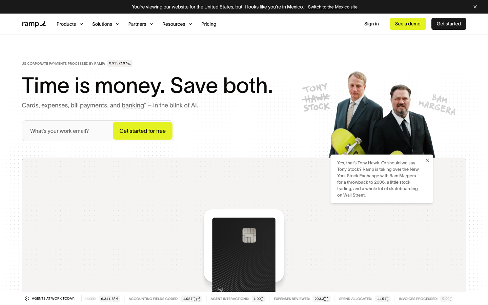
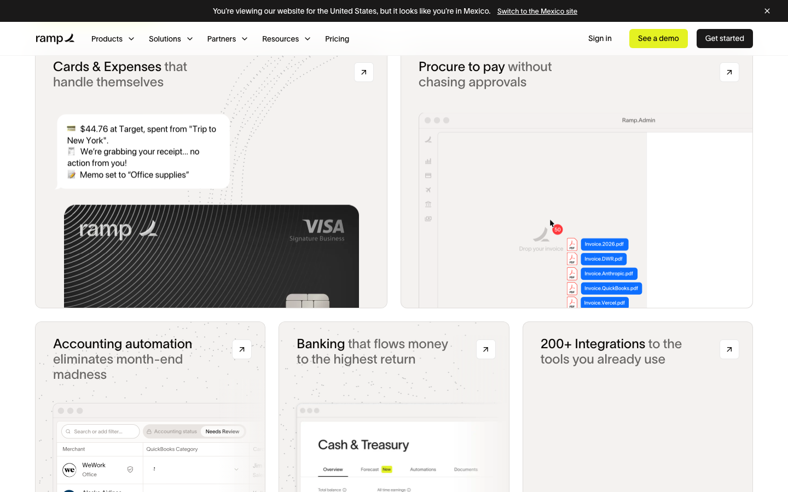
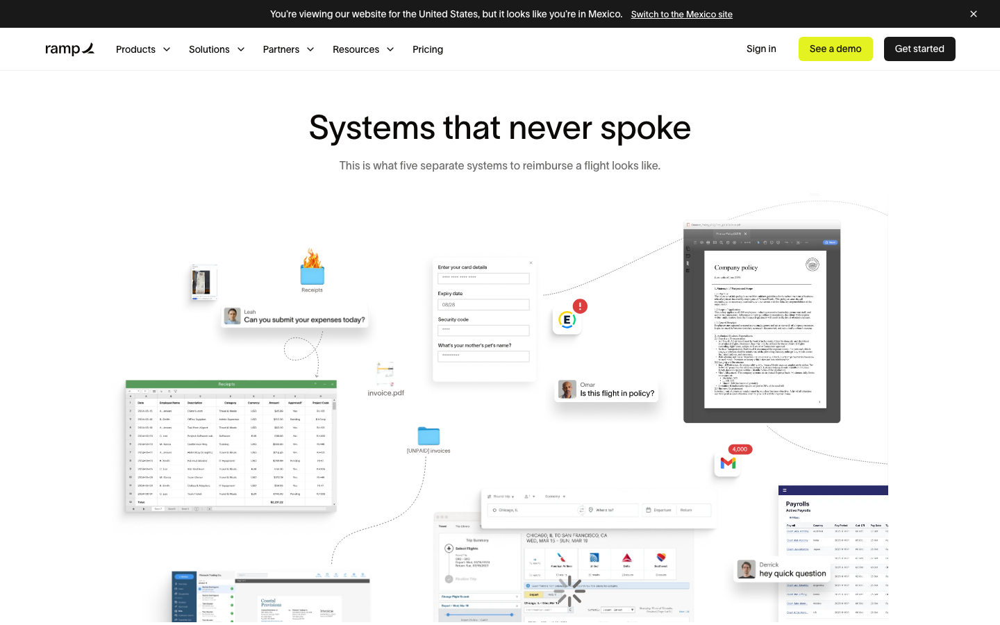
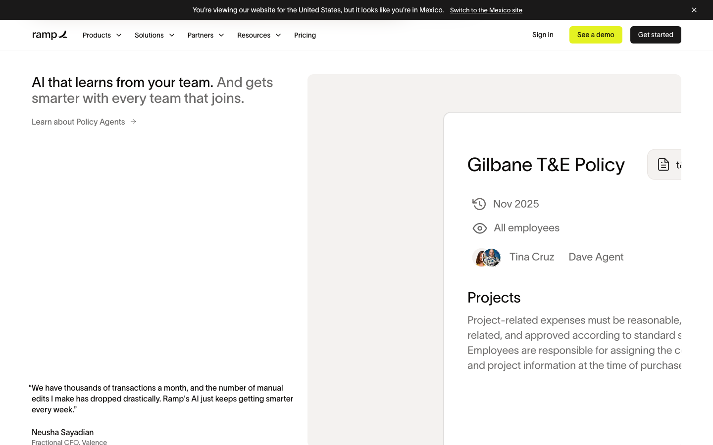
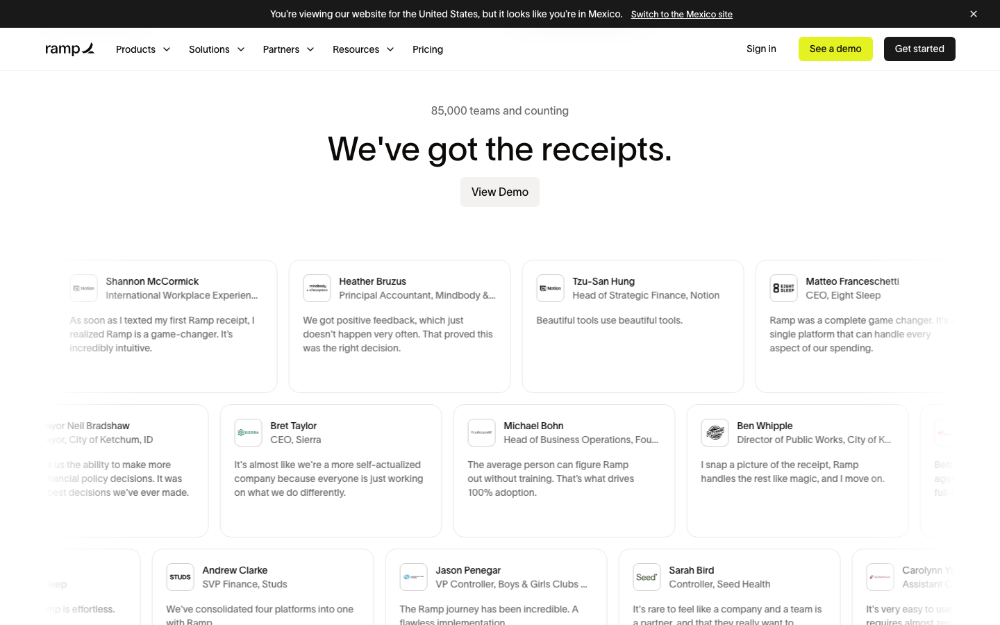
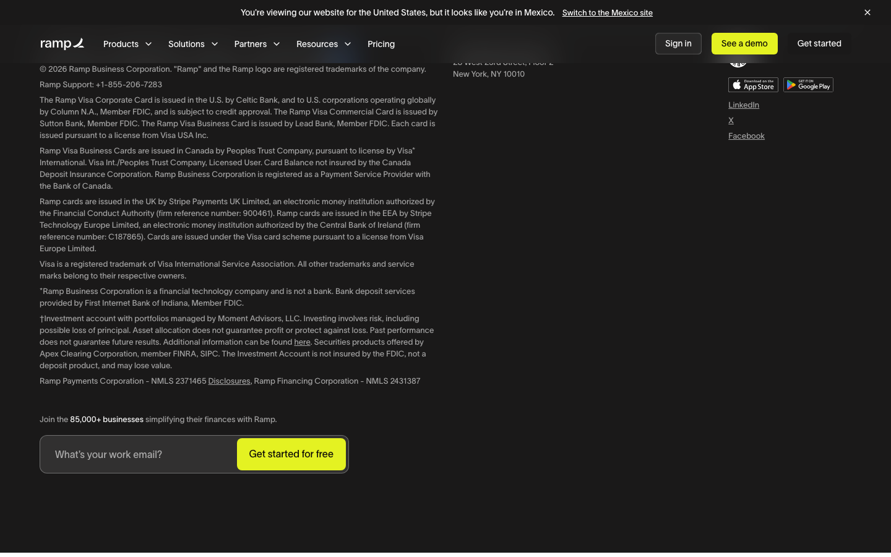
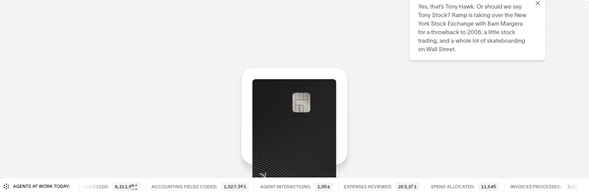
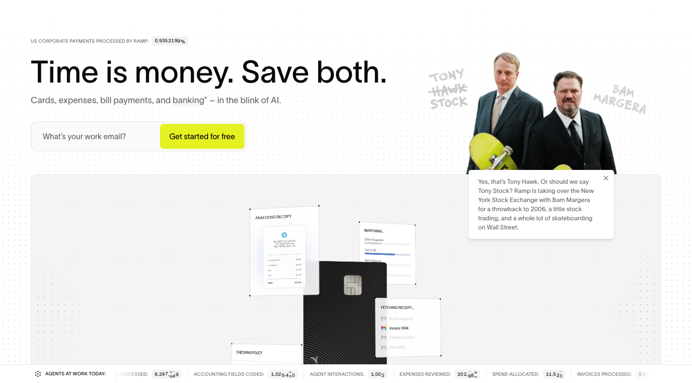

# ramp — Visual Guide

> Master visual reference. Study every screenshot carefully before implementing any UI.
> Match colors, layout, typography, spacing, and motion states exactly.

**WebGL/3D:** Detected (9 canvas elements) — replicate with Three.js or CSS 3D transforms

## Scroll Journey

The page has cinematic scroll animations. Each screenshot below shows the exact visual state at that scroll depth.
**Replicate these transitions precisely** — the design changes dramatically as you scroll.

### Hero — Above the fold

*Scroll position: 0px of 14554px total*

### 17% scroll depth

*Scroll position: 2321px of 14554px total*

### 33% scroll depth

*Scroll position: 4506px of 14554px total*

### 50% scroll depth

*Scroll position: 6827px of 14554px total*

### 67% scroll depth

*Scroll position: 9148px of 14554px total*

### 83% scroll depth

*Scroll position: 11333px of 14554px total*

### Footer — End of page

*Scroll position: 13652px of 14554px total*

## Video Backgrounds

These videos play as background elements. Use first-frame as poster image while video loads.

### Video 2 (background)

*Source: `https://assets.ramp.com/nextjs/videos/homepage-hero-423.webm...`*

## Full Page Screenshots

### Spend Management, Corporate Cards & Accounts Payable Solutions | Ramp

*URL: `https://ramp.com`*

## Section Screenshots

Clipped sections showing individual components in context.

### Section 1 — `section`

*1440×1013px*

