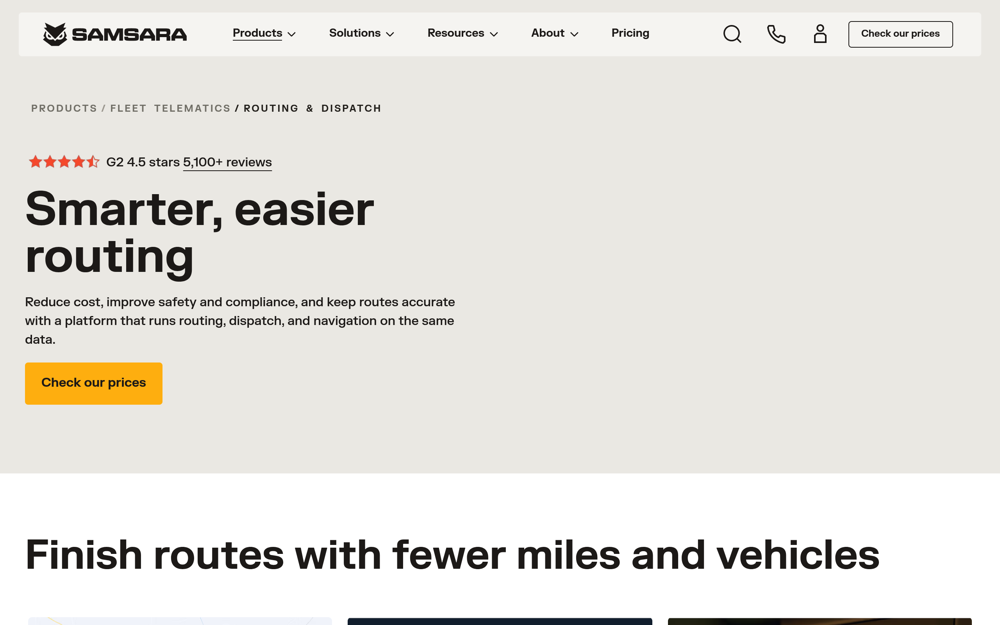
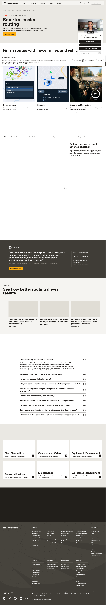
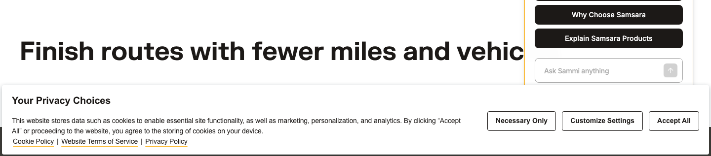

# samsara-routing Design System

You are building UI for **samsara-routing**. Light-themed, neutral palette, sans-serif typography (Samsara Sans), compact density on a 4px grid, expressive motion.

## Visual Reference

**IMPORTANT**: Study ALL screenshots below before writing any UI. Match colors, typography, spacing, layout, and motion exactly as shown.

### Homepage



### Scroll Journey (Cinematic Visual States)

> These screenshots capture the website at different scroll depths. The design changes dramatically as you scroll — each frame shows a different cinematic state. Replicate these exact visual transitions.

#### 0% — Hero / Above the fold


#### 17% — Mid-page at 17% scroll


#### 33% — Mid-page at 33% scroll


#### 50% — Mid-page at 50% scroll


#### 67% — Mid-page at 67% scroll


#### 83% — Mid-page at 83% scroll


#### 100% — Footer / End of page


### Video Backgrounds (First Frames)


> Read `references/DESIGN.md` for full token details. Read `references/ANIMATIONS.md` for motion specs. Read `references/LAYOUT.md` for layout structure. Read `references/COMPONENTS.md` for component patterns.

## Ultra Reference Files

This package includes extended documentation. **Read these files before implementing:**

| File | Contents |
|------|----------|
| `references/DESIGN.md` | Full design system tokens, colors, typography, spacing |
| `references/VISUAL_GUIDE.md` | **START HERE** — Master visual guide with all screenshots embedded |
| `references/ANIMATIONS.md` | CSS keyframes, scroll triggers, motion library stack, video specs |
| `references/LAYOUT.md` | Flex/grid containers, page structure, spacing relationships |
| `references/COMPONENTS.md` | DOM component patterns, HTML structure, class fingerprints |
| `references/INTERACTIONS.md` | Hover/focus states with before/after style diffs |
| `screens/scroll/` | 7 scroll journey screenshots showing cinematic states |

### Animation Stack Detected

- **Web Animations API (2 active)** — animation

## Design Philosophy

- **Layered depth** — use shadow tokens to create a sense of physical layering. Each elevation level has a specific shadow.
- **Gradient accents** — gradients are used thoughtfully for emphasis, not decoration.
- **Type pairing** — Samsara Sans for body/UI text, FK Grotesk for headings/display. Never introduce a third typeface.
- **compact density** — 4px base grid. Every dimension is a multiple of 4.
- **neutral palette** — the color temperature runs neutral, matching the sans-serif typography.
- **Expressive motion** — animations are an integral part of the experience. Use spring physics and layout animations.

## Color System

### Core Palette

| Role | Token | Hex | Use |
|------|-------|-----|-----|
| Background | `--background` | `#ffffff` | Page/app background |
| Surface | `--surface` | `#f5f4f1` | Cards, panels, modals |
| Text Primary | `--text-primary` | `#1c1917` | Headings, body text |
| Text Muted | `--text-muted` | `#716f67` | Captions, placeholders |
| Border | `--border` | `#403d37` | Dividers, card borders |

### Status Colors

| Status | Hex | Use |
|--------|-----|-----|
| Success | `#0dab41` | Confirmations, positive trends |
| Warning | `#feae0f` | Caution states, pending items |
| Danger | `#df2036` | Errors, destructive actions |

### Extended Palette

- **sm-background-default:** `#e0ddd5`
- `#000000` — Deep background layer or shadow color
- **sm-color-gray-300:** `#ccc9c1`
- **sm-background-muted:** `#eae8e3` — Secondary text, placeholder text
- **sm-border-muted:** `#9c9890` — Secondary text, placeholder text
- **sm-color-blue-900:** `#0c2648`
- `#af419e`
- `#4670d5`

### CSS Variable Tokens

```css
--sm-background-base: #fff;
--sm-background-base-rgb: 255 255 255;
--sm-background-default: #e0ddd5;
--sm-background-default-rgb: 224 221 213;
--sm-background-faint: #f5f4f1;
--sm-background-faint-rgb: 245 244 241;
--sm-background-inverse: #1c1917;
--sm-background-inverse-rgb: 28 25 23;
--sm-background-loud: #feae0f;
--sm-background-loud-rgb: 254 174 15;
--sm-background-muted: #eae8e3;
--sm-background-muted-rgb: 234 232 227;
--sm-border-default: #1c1917;
--sm-border-default-rgb: 28 25 23;
--sm-border-faint: #eae8e3;
--sm-border-faint-rgb: 234 232 227;
--sm-border-inverse: #fff;
--sm-border-inverse-rgb: 255 255 255;
--sm-border-loud: #feae0f;
--sm-border-loud-rgb: 254 174 15;
```

## Typography

### Font Stack

- **Samsara Sans** — Heading 1, Heading 2, Heading 3
- **FK Grotesk** — Body, Caption
- **FK Grotesk Mono** — Code

### Font Sources

```css
@font-face {
  font-family: "FK Grotesk";
  src: url("fonts/FKGrotesk-Regular.woff2") format("woff2");
  font-weight: 400;
}
@font-face {
  font-family: "FK Grotesk";
  src: url("fonts/FKGrotesk-700.woff2") format("woff2");
  font-weight: 700;
}
@font-face {
  font-family: "FK Grotesk Mono";
  src: url("fonts/FKGroteskMono-Regular.woff2") format("woff2");
  font-weight: 400;
}
@font-face {
  font-family: "FK Grotesk Mono";
  src: url("fonts/FKGroteskMono-700.woff2") format("woff2");
  font-weight: 700;
}
@font-face {
  font-family: "Samsara Sans";
  src: url("fonts/SamsaraSans-700.woff2") format("woff2");
  font-weight: 700;
}
@font-face {
  font-family: "Samsara Script";
  src: url("fonts/SamsaraScript-Regular.woff2") format("woff2");
  font-weight: 400;
}
@font-face {
  font-family: "Anybody";
  src: url("fonts/Anybody-Bold.ttf") format("truetype");
  font-weight: 700;
}
@font-face {
  font-family: "Anybody";
  src: url("fonts/Anybody-Regular.ttf") format("truetype");
  font-weight: 400;
}
@font-face {
  font-family: "Acumin Pro ExtraCondensed";
  src: url("fonts/AcuminProExtraCondensed-800.woff2") format("woff2");
  font-weight: 800;
}
```

### Type Scale

| Role | Family | Size | Weight |
|------|--------|------|--------|
| Heading 1 | Samsara Sans | 6.5rem | 700 |
| Heading 2 | Samsara Sans | 97.6px | 700 |
| Heading 3 | Samsara Sans | 5.5rem | 700 |
| Body | FK Grotesk | .875rem | 400 |
| Caption | FK Grotesk | 1rem | 400 |
| Code | FK Grotesk Mono | 14px | 400 |

### Typography Rules

- Body/UI: **Samsara Sans**, Headings: **FK Grotesk** — these are the only display fonts
- Max 3-4 font sizes per screen
- Headings: weight 600-700, body: weight 400
- Use color and opacity for text hierarchy, not additional font sizes
- Line height: 1.5 for body, 1.2 for headings

## Spacing & Layout

### Base Grid: 4px

Every dimension (margin, padding, gap, width, height) must be a multiple of **4px**.

### Spacing Scale

`2, 4, 6, 8, 10, 12, 14, 16, 18, 20, 22, 24` px

### Spacing as Meaning

| Spacing | Use |
|---------|-----|
| 4-8px | Tight: related items (icon + label, avatar + name) |
| 12-16px | Medium: between groups within a section |
| 24-32px | Wide: between distinct sections |
| 48px+ | Vast: major page section breaks |

### Border Radius

Scale: `0px 0px 4px 4px, .125rem, .375rem, .75rem, 1rem, 2px, 2.5px, 3px, 4px, 5px, 8px, 12px, 14px, 16px, 25px, 50em, 100px, inherit`
Default: `5px`

### Container

Max-width: `1099px`, centered with auto margins.

### Breakpoints

| Name | Value |
|------|-------|
| xs | 375px |
| xs | 379px |
| xs | 380px |
| xs | 389px |
| xs | 415px |
| xs | 429px |
| xs | 436px |
| sm | 503px |
| sm | 640px |
| md | 650px |
| md | 767px |
| md | 768px |
| lg | 847px |
| lg | 850px |
| lg | 999px |
| lg | 1000px |
| lg | 1024px |
| xl | 1080px |
| xl | 1099px |
| xl | 1100px |
| xl | 1200px |
| xl | 1279px |
| xl | 1280px |
| 2xl | 1300px |
| 2xl | 1439px |
| 2xl | 1440px |
| 2xl | 1441px |
| 2xl | 1680px |
| 2xl | 1800px |

Mobile-first: design for small screens, layer on responsive overrides.

## Component Patterns

### Card

```css
.card {
  background: #f5f4f1;
  border: 1px solid #403d37;
  border-radius: 5px;
  padding: 16px;
  box-shadow: inset var(--decorator-grid-line-width)0 0 var(--decorator-grid-color),inset calc(var(--decorator-grid-line-width)*-1)0 0 var(--decorator-grid-color);
}
```

```html
<div class="card">
  <h3>Card Title</h3>
  <p>Card content goes here.</p>
</div>
```

### Button

```css
/* Primary */
.btn-primary {
  background: #cccccc;
  color: #1c1917;
  border-radius: 5px;
  padding: 8px 16px;
  font-weight: 500;
  transition: opacity 150ms ease;
}
.btn-primary:hover { opacity: 0.9; }

/* Ghost */
.btn-ghost {
  background: transparent;
  border: 1px solid #403d37;
  color: #1c1917;
  border-radius: 5px;
  padding: 8px 16px;
}
```

```html
<button class="btn-primary">Get Started</button>
<button class="btn-ghost">Learn More</button>
```

### Input

```css
.input {
  background: #ffffff;
  border: 1px solid #403d37;
  border-radius: 5px;
  padding: 8px 12px;
  color: #1c1917;
  font-size: 14px;
}
.input:focus { border-color: var(--accent); outline: none; }
```

```html
<input class="input" type="text" placeholder="Search..." />
```

### Badge / Chip

```css
.badge {
  display: inline-flex;
  align-items: center;
  padding: 4px 8px;
  border-radius: 9999px;
  font-size: 12px;
  font-weight: 500;
  background: #f5f4f1;
  color: #716f67;
}
```

```html
<span class="badge">New</span>
<span class="badge">Beta</span>
```

### Modal / Dialog

```css
.modal-backdrop { background: rgba(0, 0, 0, 0.6); }
.modal {
  background: #f5f4f1;
  border: 1px solid #403d37;
  border-radius: inherit;
  padding: 24px;
  max-width: 480px;
  width: 90vw;
  box-shadow: 0 2px 20px #403d371a,0 0 4px #403d371a;
}
```

```html
<div class="modal-backdrop">
  <div class="modal">
    <h2>Dialog Title</h2>
    <p>Dialog content.</p>
    <button class="btn-primary">Confirm</button>
    <button class="btn-ghost">Cancel</button>
  </div>
</div>
```

### Table

```css
.table { width: 100%; border-collapse: collapse; }
.table th {
  text-align: left;
  padding: 8px 12px;
  font-weight: 500;
  font-size: 12px;
  color: #716f67;
  text-transform: uppercase;
  letter-spacing: 0.05em;
  border-bottom: 1px solid #403d37;
}
.table td {
  padding: 12px;
  border-bottom: 1px solid #403d37;
}
```

```html
<table class="table">
  <thead><tr><th>Name</th><th>Status</th><th>Date</th></tr></thead>
  <tbody>
    <tr><td>Item One</td><td>Active</td><td>Jan 1</td></tr>
    <tr><td>Item Two</td><td>Pending</td><td>Jan 2</td></tr>
  </tbody>
</table>
```

### Navigation

```css
.nav {
  display: flex;
  align-items: center;
  gap: 8px;
  padding: 12px 16px;
  border-bottom: 1px solid #403d37;
}
.nav-link {
  color: #716f67;
  padding: 8px 12px;
  border-radius: 5px;
  transition: color 150ms;
}
.nav-link:hover { color: #1c1917; }
```

```html
<nav class="nav">
  <a href="/" class="nav-link active">Home</a>
  <a href="/about" class="nav-link">About</a>
  <a href="/pricing" class="nav-link">Pricing</a>
  <button class="btn-primary" style="margin-left: auto">Get Started</button>
</nav>
```

### Extracted Components

These components were found in the codebase:

**Button** (`html`)
- Variants: `-blue`, `-blue:hover`, `-icon`, `-icon-audio`

**Card** (`html`)
- Variants: `logo-container`, `image`, `content`, `headings`, `carousel`

**Navigation** (`html`)

**Modal** (`html`)

## Page Structure

The following page sections were detected:

- **Navigation** — Top navigation bar (5 items)
- **Hero** — Hero section (detected from heading structure)
- **Features** — Feature/benefit cards grid (76 items)
- **Faq** — FAQ/accordion section
- **Footer** — Page footer with links and info (166 items)
- **Cta** — Call-to-action section
- **Stats** — Statistics/metrics display
- **Testimonials** — Testimonials/reviews section
- **Hero** — Hero/banner section with headline and CTAs

When building pages, follow this section order and structure.

## Animation & Motion

This project uses **expressive motion**. Animations are part of the design language.

### CSS Animations

- `fadeInLeft`
- `scroll-hint`
- `fadeIn`
- `fadeInTop`
- `pulse`

### Motion Tokens

- **Duration scale:** `0s`, `.01s`, `.1s`, `.14s`, `.15s`, `.16s`, `.2s`, `.25s`, `.28s`, `.3s`, `.4s`, `.5s`, `.6s`, `50ms`, `75ms`, `100ms`, `150ms`, `200ms`, `300ms`, `325ms`, `500ms`, `600ms`
- **Easing functions:** `cubic-bezier(.4,0,.2,1)`, `cubic-bezier(0,0,.2,1)`, `ease-in-out`, `cubic-bezier(.4,0,1,1)`, `ease`, `linear`, `cubic-bezier(.075,.82,.165,1)`, `ease-out`, `cubic-bezier(.55,.085,.68,.53)`, `ease-in`

### Motion Guidelines

- **Duration:** Use values from the duration scale above. Short (0s) for micro-interactions, long (600ms) for page transitions
- **Easing:** Use `cubic-bezier(.4,0,.2,1)` as the default easing curve
- **Direction:** Elements enter from bottom/right, exit to top/left
- **Reduced motion:** Always respect `prefers-reduced-motion` — disable animations when set

## Depth & Elevation

### Shadow Tokens

- Subtle: `inset 0 1px rgb(var(--sm-color-gray-200-rgb))`
- Subtle: `inset 0-1px rgb(var(--sm-color-gray-200-rgb))`
- Raised (cards, buttons): `inset var(--decorator-grid-line-width)0 0 var(--decorator-grid-color),inset calc(var(--decorator-grid-line-width)*-1)0 0 var(--decorator-grid-color)`
- Raised (cards, buttons): `0 1px 5px #0000001a`
- Raised (cards, buttons): `0-4px #fff,0 4px #fff`
- Floating (dropdowns, popovers): `0 2px 20px #403d371a,0 0 4px #403d371a`

### Z-Index Scale

`0, 1, 2, 3, 4, 5, 6, 9, 10, 12, 13, 20, 30, 40, 50, 60, 120, 300, 999, 1000, 9998, 9999, 10000, 10001`

Use these exact values — never invent z-index values.

## Anti-Patterns (Never Do)

- **No blur effects** — no backdrop-blur, no filter: blur()
- **No zebra striping** — tables and lists use borders for separation
- **No invented colors** — every hex value must come from the palette above
- **No arbitrary spacing** — every dimension is a multiple of 4px
- **No extra fonts** — only Samsara Sans and FK Grotesk and FK Grotesk Mono are allowed
- **No arbitrary border-radius** — use the scale: .125rem, .375rem, .75rem, 1rem, 2px, 2.5px, 3px, 4px, 5px, 8px
- **No opacity for disabled states** — use muted colors instead

## Workflow

1. **Read** `references/DESIGN.md` before writing any UI code
2. **Pick colors** from the Color System section — never invent new ones
3. **Set typography** — Samsara Sans, FK Grotesk, FK Grotesk Mono only, using the type scale
4. **Build layout** on the 4px grid — check every margin, padding, gap
5. **Match components** to patterns above before creating new ones
6. **Apply elevation** — use shadow tokens
7. **Validate** — every value traces back to a design token. No magic numbers.

## Brand Spec

- **Favicon:** `/favicons/light/favicon.ico`
- **Site URL:** `https://www.samsara.com/products/telematics/routing`
- **Brand typeface:** Samsara Sans

## Quick Reference

```
Background:     #ffffff
Surface:        #f5f4f1
Text:           #1c1917 / #716f67
Accent:         (not extracted)
Border:         #403d37
Font:           Samsara Sans
Spacing:        4px grid
Radius:         5px
Components:     10 detected
```

## When to Trigger

Activate this skill when:
- Creating new components, pages, or visual elements for samsara-routing
- Writing CSS, Tailwind classes, styled-components, or inline styles
- Building page layouts, templates, or responsive designs
- Reviewing UI code for design consistency
- The user mentions "samsara-routing" design, style, UI, or theme
- Generating mockups, wireframes, or visual prototypes

---

# Full Reference Files

> Every output file is embedded below. Claude has full design system context from /skills alone.

## Design System Tokens (DESIGN.md)

# samsara-routing DESIGN.md

> Auto-generated design system — reverse-engineered via static analysis by skillui.
> Frameworks: None detected
> Colors: 20 · Fonts: 3 · Components: 10
> Icon library: not detected · State: not detected
> Primary theme: light · Dark mode toggle: no · Motion: expressive

## Visual Reference

**Match this design exactly** — study colors, fonts, spacing, and component shapes before writing any UI code.


---

## 1. Visual Theme & Atmosphere

This is a **light-themed** interface with a neutral, approachable feel. The light background emphasizes content clarity. Typography pairs **FK Grotesk** for display/headings with **Samsara Sans** for body text, creating clear visual hierarchy through type contrast. Spacing follows a **4px base grid** (compact density), with scale: 2, 4, 6, 8, 10, 12, 14, 16px. Motion is expressive — spring physics, layout animations, and staggered reveals are part of the visual language.

---

## 2. Color Palette & Roles

| Token | Hex | Role | Use |
|---|---|---|---|
| tw-ring-offset-color | `#ffffff` | background | Page background, darkest surface |
| sm-background-faint | `#f5f4f1` | surface | Card and panel backgrounds |
| sm-background-inverse | `#1c1917` | text-primary | Headings and body text |
| sm-color-gray-600 | `#716f67` | text-muted | Captions, placeholders, secondary info |
| sm-color-gray-700 | `#403d37` | border | Dividers, card borders, outlines |
| danger | `#df2036` | danger | Error states, destructive actions |
| success | `#0dab41` | success | Success states, positive indicators |
| sm-background-loud | `#feae0f` | warning | Warning states, caution indicators |
| sm-color-blue-900 | `#0c2648` | info | Informational highlights |
| sm-background-default | `#e0ddd5` | unknown | Palette color |
| unknown | `#000000` | unknown | Palette color |
| sm-color-gray-300 | `#ccc9c1` | unknown | Palette color |
| sm-background-muted | `#eae8e3` | unknown | Palette color |
| sm-border-muted | `#9c9890` | unknown | Palette color |
| unknown | `#af419e` | unknown | Palette color |
| unknown | `#4670d5` | unknown | Palette color |
| unknown | `#333333` | unknown | Palette color |
| sm-color-orange-50 | `#ffe0d1` | unknown | Palette color |
| unknown | `#0b0f20` | unknown | Palette color |
| unknown | `#989fa9` | unknown | Palette color |

### CSS Variable Tokens

```css
--tw-border-spacing-x: 0;
--tw-border-spacing-y: 0;
--tw-border-opacity: 1;
--tw-border-opacity: 1;
--tw-border-opacity: 1;
--tw-border-opacity: 1;
--tw-border-opacity: 1;
--tw-border-opacity: 1;
--tw-border-opacity: 1;
--tw-border-opacity: .25;
--tw-border-opacity: 1;
--sm-background-base: #fff;
--sm-background-base-rgb: 255 255 255;
--sm-background-default: #e0ddd5;
--sm-background-default-rgb: 224 221 213;
--sm-background-faint: #f5f4f1;
--sm-background-faint-rgb: 245 244 241;
--sm-background-inverse: #1c1917;
--sm-background-inverse-rgb: 28 25 23;
--sm-background-loud: #feae0f;
```


---

## 3. Typography Rules

**Font Stack:**
- **Samsara Sans** — Heading 1, Heading 2, Heading 3
- **FK Grotesk** — Body, Caption
- **FK Grotesk Mono** — Code

**Font Sources:**

```css
@font-face {
  font-family: "FK Grotesk";
  src: url("fonts/FKGrotesk-Regular.woff2") format("woff2");
  font-weight: 400;
}
@font-face {
  font-family: "FK Grotesk";
  src: url("fonts/FKGrotesk-700.woff2") format("woff2");
  font-weight: 700;
}
@font-face {
  font-family: "FK Grotesk Mono";
  src: url("fonts/FKGroteskMono-Regular.woff2") format("woff2");
  font-weight: 400;
}
@font-face {
  font-family: "FK Grotesk Mono";
  src: url("fonts/FKGroteskMono-700.woff2") format("woff2");
  font-weight: 700;
}
@font-face {
  font-family: "Samsara Sans";
  src: url("fonts/SamsaraSans-700.woff2") format("woff2");
  font-weight: 700;
}
@font-face {
  font-family: "Samsara Script";
  src: url("fonts/SamsaraScript-Regular.woff2") format("woff2");
  font-weight: 400;
}
@font-face {
  font-family: "Anybody";
  src: url("fonts/Anybody-Bold.ttf") format("truetype");
  font-weight: 700;
}
@font-face {
  font-family: "Anybody";
  src: url("fonts/Anybody-Regular.ttf") format("truetype");
  font-weight: 400;
}
@font-face {
  font-family: "Acumin Pro ExtraCondensed";
  src: url("fonts/AcuminProExtraCondensed-800.woff2") format("woff2");
  font-weight: 800;
}
```

| Role | Font | Size | Weight |
|---|---|---|---|
| Heading 1 | Samsara Sans | 6.5rem | 700 |
| Heading 2 | Samsara Sans | 97.6px | 700 |
| Heading 3 | Samsara Sans | 5.5rem | 700 |
| Body | FK Grotesk | .875rem | 400 |
| Caption | FK Grotesk | 1rem | 400 |
| Code | FK Grotesk Mono | 14px | 400 |

**Typographic Rules:**
- Limit to 3 font families max per screen
- Use **Samsara Sans** for body/UI text, **FK Grotesk** for display/headings
- Maintain consistent hierarchy: no more than 3-4 font sizes per screen
- Headings use bold (600-700), body uses regular (400)
- Line height: 1.5 for body text, 1.2 for headings
- Use color and opacity for secondary hierarchy, not additional font sizes


---

## 4. Component Stylings

### Layout (1)

**Footer** — `html`

### Navigation (1)

**Navigation** — `html`

### Data Display (3)

**Card** — `html`
- Variants: `logo-container`, `image`, `content`, `headings`, `carousel`

**Badge** — `html`

**List** — `html`

### Data Input (2)

**Button** — `html`
- Variants: `-blue`, `-blue:hover`, `-icon`, `-icon-audio`
- Animation: 

**Input** — `html`
- State: :focus, :placeholder

### Overlay (1)

**Modal** — `html`

### Media (2)

**Image** — `html`

**Icon** — `html`


---

## 5. Layout Principles

- **Base spacing unit:** 4px
- **Spacing scale:** 2, 4, 6, 8, 10, 12, 14, 16, 18, 20, 22, 24
- **Border radius:** 0px 0px 4px 4px, .125rem, .375rem, .75rem, 1rem, 2px, 2.5px, 3px, 4px, 5px, 8px, 12px, 14px, 16px, 25px, 50em, 100px, inherit
- **Max content width:** 1099px

**Spacing as Meaning:**
| Spacing | Use |
|---|---|
| 4-8px | Tight: related items within a group |
| 12-16px | Medium: between groups |
| 24-32px | Wide: between sections |
| 48px+ | Vast: major section breaks |


---

## 6. Depth & Elevation

### Flat — subtle depth hints

- `inset 0 1px rgb(var(--sm-color-gray-200-rgb))`
- `inset 0-1px rgb(var(--sm-color-gray-200-rgb))`

### Raised — cards, buttons, interactive elements

- `inset var(--decorator-grid-line-width)0 0 var(--decorator-grid-color),inset calc(var(--decorator-grid-line-width)*-1)0 0 var(--decorator-grid-color)`
- `0 1px 5px #0000001a`
- `0-4px #fff,0 4px #fff`

### Floating — dropdowns, popovers, modals

- `0 2px 20px #403d371a,0 0 4px #403d371a`
- `0 0 9px #00000021`

### Overlay — full-screen overlays, top-level dialogs

- `1px 0 41px 2px #00263e0f`
- `rgba(0, 0, 0, 0) 0px 0px 0px 0px, rgba(0, 0, 0, 0) 0px 0px 0px 0px, rgba(64, 61, 55, 0.06) 0px 0px 11px 0px, rgba(64, 61, 55, 0) 0px 231px 65px 0px, rgba(64, 61, 55, 0.01) 0px 148px 59px 0px, rgba(64, 61, 55, 0.05) 0px 83px 50px 0px, rgba(64, 61, 55, 0.09) 0px 22px 37px 0px`

### Z-Index Scale

`0, 1, 2, 3, 4, 5, 6, 9, 10, 12, 13, 20, 30, 40, 50, 60, 120, 300, 999, 1000, 9998, 9999, 10000, 10001`


---

## 7. Animation & Motion

This project uses **expressive motion**. Animations are an integral part of the experience.

### CSS Animations

- `@keyframes fadeInLeft`
- `@keyframes scroll-hint`
- `@keyframes fadeIn`
- `@keyframes fadeInTop`
- `@keyframes pulse`
- `@keyframes spin`
- `@keyframes fadein`
- `@keyframes fadeinfromright`

### Animated Components

- **Button**: 

### Motion Guidelines

- Duration: 150-300ms for micro-interactions, 300-500ms for page transitions
- Easing: `ease-out` for enters, `ease-in` for exits
- Always respect `prefers-reduced-motion`


---

## 8. Do's and Don'ts

### Do's

- Use `#ffffff` as the primary page background
- Pair **Samsara Sans** (body) with **FK Grotesk** (display) — these are the only allowed fonts
- Follow the **4px** spacing grid for all margins, padding, and gaps
- Use the defined shadow tokens for elevation — see Section 6
- Use border-radius from the scale: 0px 0px 4px 4px, .125rem, .375rem, .75rem, 1rem
- Reuse existing components from Section 4 before creating new ones

### Don'ts

- Don't introduce colors outside this palette — extend the design tokens first
- Don't introduce additional font families beyond Samsara Sans and FK Grotesk and FK Grotesk Mono
- Don't use arbitrary spacing values — stick to multiples of 4px
- Don't create custom box-shadow values outside the system tokens
- Don't use arbitrary border-radius values — pick from the defined scale
- Don't duplicate component patterns — check Section 4 first
- Don't use backdrop-blur or blur effects

### Anti-Patterns (detected from codebase)

- No blur or backdrop-blur effects
- No zebra striping on tables/lists


---

## 9. Responsive Behavior

| Name | Value | Source |
|---|---|---|
| xs | 375px | css |
| xs | 379px | css |
| xs | 380px | css |
| xs | 389px | css |
| xs | 415px | css |
| xs | 429px | css |
| xs | 436px | css |
| sm | 503px | css |
| sm | 640px | css |
| md | 650px | css |
| md | 767px | css |
| md | 768px | css |
| lg | 847px | css |
| lg | 850px | css |
| lg | 999px | css |
| lg | 1000px | css |
| lg | 1024px | css |
| xl | 1080px | css |
| xl | 1099px | css |
| xl | 1100px | css |
| xl | 1200px | css |
| xl | 1279px | css |
| xl | 1280px | css |
| 2xl | 1300px | css |
| 2xl | 1439px | css |
| 2xl | 1440px | css |
| 2xl | 1441px | css |
| 2xl | 1680px | css |
| 2xl | 1800px | css |

**Approach:** Use `@media (min-width: ...)` queries matching the breakpoints above.


---

## 10. Agent Prompt Guide

Use these as starting points when building new UI:

### Build a Card

```
Background: #f5f4f1
Border: 1px solid #403d37
Radius: 5px
Padding: 16px
Font: Samsara Sans
Use shadow tokens from Section 6.
```

### Build a Button

```
Primary: bg var(--accent), text white
Ghost: bg transparent, border #403d37
Padding: 8px 16px
Radius: 5px
Hover: opacity 0.9 or lighter shade
Focus: ring with var(--accent)
```

### Build a Page Layout

```
Background: #ffffff
Max-width: 1099px, centered
Grid: 4px base
Responsive: mobile-first, breakpoints from Section 9
```

### Build a Stats Card

```
Surface: #f5f4f1
Label: #716f67 (muted, 12px, uppercase)
Value: #1c1917 (primary, 24-32px, bold)
Status: use success/warning/danger from Section 2
```

### Build a Form

```
Input bg: #ffffff
Input border: 1px solid #403d37
Focus: border-color var(--accent)
Label: #716f67 12px
Spacing: 16px between fields
Radius: 5px
```

### General Component

```
1. Read DESIGN.md Sections 2-6 for tokens
2. Colors: only from palette
3. Font: Samsara Sans, type scale from Section 3
4. Spacing: 4px grid
5. Components: match patterns from Section 4
6. Elevation: shadow tokens
```

## Visual Guide — Screenshots (VISUAL_GUIDE.md)

# samsara-routing — Visual Guide

> Master visual reference. Study every screenshot carefully before implementing any UI.
> Match colors, layout, typography, spacing, and motion states exactly.

**Motion Stack:** **Web Animations API (2 active)**

## Scroll Journey

The page has cinematic scroll animations. Each screenshot below shows the exact visual state at that scroll depth.
**Replicate these transitions precisely** — the design changes dramatically as you scroll.

### Hero — Above the fold

*Scroll position: 0px of 8238px total*


### 17% scroll depth

*Scroll position: 1247px of 8238px total*


### 33% scroll depth

*Scroll position: 2422px of 8238px total*


### 50% scroll depth

*Scroll position: 3669px of 8238px total*


### 67% scroll depth

*Scroll position: 4916px of 8238px total*


### 83% scroll depth

*Scroll position: 6091px of 8238px total*


### Footer — End of page

*Scroll position: 7338px of 8238px total*


## Video Backgrounds

These videos play as background elements. Use first-frame as poster image while video loads.

### Video 1 (content)

*Source: `//videos.ctfassets.net/bx9krvy0u3sx/56shhkf4SINe2WuOJH15U0/2f186d505b2baa1517c4b...`*


## Full Page Screenshots

### Fleet Routing and Dispatch Solutions | Samsara

*URL: `https://www.samsara.com/products/telematics/routing`*


## Section Screenshots

Clipped sections showing individual components in context.

### Section 1 — `section`

*1400×864px*


### Section 8 — `main > div`

*1440×582px*


### Section 9 — `main > div`

*1440×1048px*


## Animations & Motion (ANIMATIONS.md)

# Animation Reference

> Cinematic motion design extracted from live DOM. Follow these specs exactly to recreate the experience.

## Motion Technology Stack

| Library | Type | Notes |
|---------|------|-------|
| **Web Animations API (2 active)** | animation |  |
| Canvas (2 elements) | 2D Canvas | 2D canvas rendering |

## Scroll Journey

The page is **8,238px** tall. Each frame below shows what the user sees at that scroll depth.

> **Use these screenshots to understand WHAT animates, WHEN it animates, and HOW it moves.**

### 0% — Top / Hero
Scroll position: 0px


### 17% — Opening Section
Scroll position: 1,247px


### 33% — First Feature Section
Scroll position: 2,422px


### 50% — Mid-Page
Scroll position: 3,669px


### 67% — Lower Content
Scroll position: 4,916px


### 83% — Near Footer
Scroll position: 6,091px


### 100% — Bottom / Footer
Scroll position: 7,338px


## Video Elements

| # | Role | Autoplay | Loop | Muted | Size | First Frame |
|---|------|----------|------|-------|------|-------------|
| 1 | content | ✓ | ✓ | ✓ | 660×150 | [view](../screens/scroll/video-1-frame.png) |
| 2 | background | — | — | ✓ | 864×648 | — |

**Video 1 first frame:**


- **Source:** `//videos.ctfassets.net/bx9krvy0u3sx/56shhkf4SINe2WuOJH15U0/2f186d505b2baa1517c4b1ebe0ae5b28/route-and-nav-hero.mp4`

## CSS Keyframes (37 extracted)

### `@keyframes fadein`

Duration: `0.2s` · Easing: `ease-in-out` · Delay: `0s` · Iteration: `1` · Fill: `forwards`

Used by: `.\!isLoaded`, `.isLoaded`, `.is-mounted .image-cycler-inner[data-v-6e917a84]`

```css
@keyframes fadein {
  0% {
    opacity: 0;
  }
  100% {
    opacity: 1;
  }
}
```

> Opacity fade

### `@keyframes fadeInTop`

Duration: `0.1s` · Easing: `ease-out` · Delay: `0.1s` · Iteration: `1` · Fill: `both`

Used by: `.animate-fade-in-top-1`, `.animate-fade-in-top-2`

```css
@keyframes fadeInTop {
  0% {
    opacity: 0;
    transform: translateY(-3px);
  }
  100% {
    opacity: 1;
    transform: translateY(0px);
  }
}
```

> Fade + motion enter animation

### `@keyframes scroll-hint`

Duration: `0.6s` · Easing: `ease-in-out` · Delay: `0s` · Iteration: `infinite` · Fill: `none`

Used by: `.contentful-table-wrapper--color-map .contentful-table-scroll-hint-chevron`

```css
@keyframes scroll-hint {
  0% {
    transform: translate(0px);
  }
  100% {
    transform: translate(30%);
  }
}
```

> Transform/motion animation

### `@keyframes fadeIn`

Duration: `0.3s` · Easing: `ease-out` · Delay: `0s` · Iteration: `1` · Fill: `forwards`

Used by: `.animate-fade-in`

```css
@keyframes fadeIn {
  0% {
    opacity: 0;
  }
  100% {
    opacity: 1;
  }
}
```

> Opacity fade

### `@keyframes fadeInLeft`

Duration: `0.1s` · Easing: `ease-out` · Delay: `0.1s` · Iteration: `1` · Fill: `both`

Used by: `.animate-fade-in-1`

```css
@keyframes fadeInLeft {
  0% {
    opacity: 0;
    transform: translate(-3px);
  }
  100% {
    opacity: 1;
    transform: translate(0px);
  }
}
```

> Fade + motion enter animation

### `@keyframes pulse`

Duration: `2s` · Easing: `cubic-bezier(0.4, 0, 0.6, 1)` · Delay: `0s` · Iteration: `infinite` · Fill: `none`

Used by: `.animate-pulse`

```css
@keyframes pulse {
  50% {
    opacity: 0.5;
  }
}
```

> Opacity fade

### `@keyframes spin`

Duration: `1s` · Easing: `linear` · Delay: `0s` · Iteration: `infinite` · Fill: `none`

Used by: `.animate-spin`

```css
@keyframes spin {
  100% {
    transform: rotate(1turn);
  }
}
```

> Transform/motion animation

### `@keyframes lds-spinner-ed9388ce`

Duration: `1.2s` · Easing: `linear` · Delay: `0s` · Iteration: `infinite` · Fill: `none`

Used by: `svg rect[data-v-ed9388ce]`

```css
@keyframes lds-spinner-ed9388ce {
  0% {
    opacity: 1;
  }
  100% {
    opacity: 0;
  }
}
```

> Opacity fade

### `@keyframes loading-dot-bounce-981231ff`

Duration: `0.85s` · Easing: `ease-in-out` · Delay: `0s` · Iteration: `infinite` · Fill: `both`

Used by: `.loading-dot[data-v-981231ff]`

```css
@keyframes loading-dot-bounce-981231ff {
  0%, 60%, 100% {
    transform: translateY(0px);
  }
  30% {
    transform: translateY(-2px);
  }
}
```

> Transform/motion animation

### `@keyframes slide-in-613136f4`

Duration: `325ms` · Fill: `forwards`

Used by: `.tn--nav-animateY[data-v-613136f4]`

```css
@keyframes slide-in-613136f4 {
  0% {
    transform: translateY(-10px);
    opacity: 0;
  }
  100% {
    transform: translateY(0px);
    opacity: 1;
  }
}
```

> Fade + motion enter animation

### `@keyframes slide-in-7a6033b8`

Duration: `325ms` · Fill: `forwards`

Used by: `.tn--nav-animateY[data-v-7a6033b8]`

```css
@keyframes slide-in-7a6033b8 {
  0% {
    transform: translateY(-10px);
    opacity: 0;
  }
  100% {
    transform: translateY(0px);
    opacity: 1;
  }
}
```

> Fade + motion enter animation

### `@keyframes minus-icon-bracket-left-9da58a39`

Duration: `0.18s` · Easing: `ease-out` · Delay: `0s` · Iteration: `1` · Fill: `none`

Used by: `.minus-icon__bracket--left[data-v-9da58a39]`

```css
@keyframes minus-icon-bracket-left-9da58a39 {
  50% {
    transform: translate(2px);
  }
}
```

> Transform/motion animation

### `@keyframes minus-icon-bracket-right-9da58a39`

Duration: `0.18s` · Easing: `ease-out` · Delay: `0s` · Iteration: `1` · Fill: `none`

Used by: `.minus-icon__bracket--right[data-v-9da58a39]`

```css
@keyframes minus-icon-bracket-right-9da58a39 {
  50% {
    transform: translate(-2px);
  }
}
```

> Transform/motion animation

### `@keyframes plus-icon-bracket-left-07e3942d`

Duration: `0.18s` · Easing: `ease-out` · Delay: `0s` · Iteration: `1` · Fill: `none`

Used by: `.plus-icon__bracket--left[data-v-07e3942d]`

```css
@keyframes plus-icon-bracket-left-07e3942d {
  50% {
    transform: translate(2px);
  }
}
```

> Transform/motion animation

### `@keyframes plus-icon-bracket-right-07e3942d`

Duration: `0.18s` · Easing: `ease-out` · Delay: `0s` · Iteration: `1` · Fill: `none`

Used by: `.plus-icon__bracket--right[data-v-07e3942d]`

```css
@keyframes plus-icon-bracket-right-07e3942d {
  50% {
    transform: translate(-2px);
  }
}
```

> Transform/motion animation

### `@keyframes fadeinfromright-e1861f8a`

Duration: `0.3s` · Easing: `ease-out` · Delay: `0s` · Iteration: `1` · Fill: `forwards`

Used by: `.ds-default-slider .ds-default-slider--slide[data-v-e1861f8a]`

```css
@keyframes fadeinfromright-e1861f8a {
  0% {
    opacity: 0;
    transform: translate(-3px);
  }
  100% {
    opacity: 1;
    transform: translate(0px);
  }
}
```

> Fade + motion enter animation

### `@keyframes progress-9f421744`

Duration: `10s` · Easing: `linear` · Delay: `0s` · Iteration: `1` · Fill: `forwards`

Used by: `.ds-default-slider .indicator-animated.play[data-v-9f421744]`

```css
@keyframes progress-9f421744 {
  0% {
    transform: scaleX(0);
  }
  100% {
    transform: scaleX(1);
  }
}
```

> Transform/motion animation

### `@keyframes fadeinfromright-9f421744`

Duration: `0.3s` · Easing: `ease-out` · Delay: `0s` · Iteration: `1` · Fill: `forwards`

Used by: `.ds-default-slider .dsb__default-slider--slide[data-v-9f421744]`

```css
@keyframes fadeinfromright-9f421744 {
  0% {
    opacity: 0;
    transform: translate(-3px);
  }
  100% {
    opacity: 1;
    transform: translate(0px);
  }
}
```

> Fade + motion enter animation

### `@keyframes progress-4bb5c38a`

Duration: `10s` · Easing: `linear` · Delay: `0s` · Iteration: `1` · Fill: `forwards`

Used by: `.dsb__default-slider .indicator-animated.play[data-v-4bb5c38a]`

```css
@keyframes progress-4bb5c38a {
  0% {
    transform: scaleX(0);
  }
  100% {
    transform: scaleX(1);
  }
}
```

> Transform/motion animation

### `@keyframes fadeinfromright-4bb5c38a`

Duration: `0.3s` · Easing: `ease-out` · Delay: `0s` · Iteration: `1` · Fill: `forwards`

Used by: `.dsb__default-slider .dsb__default-slider--slide[data-v-4bb5c38a]`

```css
@keyframes fadeinfromright-4bb5c38a {
  0% {
    opacity: 0;
    transform: translate(-3px);
  }
  100% {
    opacity: 1;
    transform: translate(0px);
  }
}
```

> Fade + motion enter animation

### `@keyframes i-slide-in--left`

Duration: `0.75s` · Easing: `ease-in` · Delay: `0s` · Iteration: `1` · Fill: `none`

Used by: `.intellimize-popup.intellimize-sidepop`

```css
@keyframes i-slide-in--left {
  0% {
    transform: translate(-120%);
  }
  100% {
    transform: translate(0px);
  }
}
```

> Transform/motion animation

### `@keyframes placeholderAnimate-edb4a6dc`

Duration: `1.7s` · Easing: `linear` · Delay: `0s` · Iteration: `infinite` · Fill: `none`

Used by: `.placeholder-content_item[data-v-edb4a6dc]::before`

```css
@keyframes placeholderAnimate-edb4a6dc {
  0% {
    transform: translate(calc(-50% - 650px));
  }
  100% {
    transform: translate(650px);
  }
}
```

> Transform/motion animation

### `@keyframes ketch-backdropFadeOut`

Duration: `0.4s` · Easing: `ease` · Delay: `0s` · Iteration: `1` · Fill: `forwards`

Used by: `#lanyard_root * .ketch-animate-backdropFadeOut`

```css
@keyframes ketch-backdropFadeOut {
  0% {
    opacity: 1;
  }
  100% {
    opacity: 0;
  }
}
```

> Opacity fade

### `@keyframes ketch-bannerAnimateCenter`

Duration: `0.4s` · Easing: `ease` · Delay: `0s` · Iteration: `1` · Fill: `forwards`

Used by: `#lanyard_root * .ketch-animate-bannerAnimateCenter`

```css
@keyframes ketch-bannerAnimateCenter {
  0% {
    opacity: 0;
  }
  100% {
    opacity: 1;
  }
}
```

> Opacity fade

### `@keyframes ketch-bannerAnimateTop`

Duration: `0.4s` · Easing: `ease` · Delay: `0s` · Iteration: `1` · Fill: `forwards`

Used by: `#lanyard_root * .ketch-animate-bannerAnimateTop`

```css
@keyframes ketch-bannerAnimateTop {
  0% {
    transform: translateY(-900px);
  }
  100% {
    transform: translateY(0px);
  }
}
```

> Transform/motion animation

### `@keyframes ketch-bannerDesktopAnimate`

Duration: `0.4s` · Easing: `ease` · Delay: `0s` · Iteration: `1` · Fill: `forwards`

Used by: `#lanyard_root * .ketch-animate-bannerDesktopAnimate`

```css
@keyframes ketch-bannerDesktopAnimate {
  0% {
    transform: translateY(900px);
  }
  100% {
    transform: translateY(0px);
  }
}
```

> Transform/motion animation

### `@keyframes ketch-bannerDismissBottom`

Duration: `0.4s` · Easing: `ease` · Delay: `0s` · Iteration: `1` · Fill: `forwards`

Used by: `#lanyard_root * .ketch-animate-bannerDismissBottom`

```css
@keyframes ketch-bannerDismissBottom {
  0% {
    transform: translateY(0px);
  }
  100% {
    transform: translateY(900px);
  }
}
```

> Transform/motion animation

### `@keyframes ketch-bannerDismissCenter`

Duration: `0.4s` · Easing: `ease` · Delay: `0s` · Iteration: `1` · Fill: `forwards`

Used by: `#lanyard_root * .ketch-animate-bannerDismissCenter`

```css
@keyframes ketch-bannerDismissCenter {
  0% {
    opacity: 1;
  }
  100% {
    opacity: 0;
  }
}
```

> Opacity fade

### `@keyframes ketch-bannerMobileBottomAnimate`

Duration: `0.4s` · Easing: `ease` · Delay: `0s` · Iteration: `1` · Fill: `forwards`

Used by: `#lanyard_root * .ketch-animate-bannerMobileBottomAnimate`

```css
@keyframes ketch-bannerMobileBottomAnimate {
  0% {
    transform: translateY(900px);
  }
  100% {
    transform: translateY(0px);
  }
}
```

> Transform/motion animation

### `@keyframes ketch-bannerMobileDismissBottom`

Duration: `0.4s` · Easing: `ease` · Delay: `0s` · Iteration: `1` · Fill: `forwards`

Used by: `#lanyard_root * .ketch-animate-bannerMobileDismissBottom`

```css
@keyframes ketch-bannerMobileDismissBottom {
  0% {
    transform: translateY(0px);
  }
  100% {
    transform: translateY(900px);
  }
}
```

> Transform/motion animation

### `@keyframes ketch-fadeIn`

Duration: `0.5s` · Easing: `ease-in-out` · Delay: `0s` · Iteration: `1` · Fill: `none`

Used by: `#lanyard_root * .ketch-animate-fadeIn`

```css
@keyframes ketch-fadeIn {
  0% {
    opacity: 0;
  }
  100% {
    opacity: 1;
  }
}
```

> Opacity fade

### `@keyframes ketch-modalAnimatedLeft`

Duration: `0.4s` · Easing: `ease` · Delay: `0s` · Iteration: `1` · Fill: `forwards`

Used by: `#lanyard_root * .ketch-animate-modalAnimatedLeft`

```css
@keyframes ketch-modalAnimatedLeft {
  0% {
    left: -900px;
  }
  100% {
    left: 4px;
  }
}
```

### `@keyframes ketch-modalAnimatedRight`

Duration: `0.4s` · Easing: `ease` · Delay: `0s` · Iteration: `1` · Fill: `forwards`

Used by: `#lanyard_root * .ketch-animate-modalAnimatedRight`

```css
@keyframes ketch-modalAnimatedRight {
  0% {
    right: -900px;
  }
  100% {
    right: 4px;
  }
}
```

### `@keyframes ketch-pulseOpacity`

Duration: `2s` · Easing: `ease-in-out` · Delay: `0s` · Iteration: `infinite` · Fill: `none`

Used by: `#lanyard_root * .ketch-animate-pulseOpacity`

```css
@keyframes ketch-pulseOpacity {
  0%, 100% {
    opacity: 0.3;
  }
  50% {
    opacity: 1;
  }
}
```

> Opacity fade

### `@keyframes fadeinfromright`

```css
@keyframes fadeinfromright {
  0% {
    opacity: 0;
  }
  100% {
    opacity: 1;
    transform: translate(0px);
  }
}
```

> Fade + motion enter animation

### `@keyframes photo-strip-scroll-b2c0efda`

```css
@keyframes photo-strip-scroll-b2c0efda {
  0% {
    transform: translateZ(0px);
  }
  100% {
    transform: translate3d(calc(var(--photo-strip-loop-distance)*-1),0,0);
  }
}
```

> Transform/motion animation

### `@keyframes i-slide-in--up`

```css
@keyframes i-slide-in--up {
  0% {
    transform: translateY(120%);
  }
  100% {
    transform: translateY(0px);
  }
}
```

> Transform/motion animation

## Motion Tokens (CSS Variables)

### Easing Tokens

```css
--k-consentGate-actionBlock-footer-teaser-text-color: rgba(0, 0, 0, 1);
```

## Global Transition Declarations

These `transition` values were extracted from CSS rules across the site:

```css
transition: 0.1s ease-in-out;
transition: opacity 0.2s;
transition: opacity 0.5s;
transition: transform 0.3s;
transition: opacity 0.3s;
transition: 0.6s ease-in-out;
transition: color 0.2s, background-color 0.2s, text-decoration-color 0.2s;
transition: 0.3s ease-out;
transition: opacity 0.1s ease-in-out;
transition: color 0.1s, fill 0.1s;
transition: color 0.1s, fill 0.1s, stroke 0.1s;
transition: 0.2s ease-in-out;
```

## How to Recreate This Motion Design

### Step 1 — Install Dependencies

```bash
```

### Step 2 — Scroll-Reveal Pattern

Elements that animate into view follow this pattern:

```css
/* Initial hidden state */
.reveal {
  opacity: 0;
  transform: translateY(40px);
  transition: opacity 0.1s rgba(0, 0, 0, 1),
              transform 0.1s rgba(0, 0, 0, 1);
}
.reveal.visible {
  opacity: 1;
  transform: translateY(0);
}
```

### Step 3 — Key Motion Principles

- **Video backgrounds** — use `<video autoplay loop muted playsinline>` for background videos. Always include a poster image fallback
- **Canvas elements (2)** — animated via requestAnimationFrame loop. Use canvas for particle effects, gradient animations, and WebGL scenes
- **Duration scale:** `0.1s` · `0.2s` · `0.5s` · `0.3s` — use these values, never invent new durations
- **Always add** `@media (prefers-reduced-motion: reduce) { * { animation-duration: 0.01ms !important; transition-duration: 0.01ms !important; } }`

### Step 4 — Scroll Journey Reference

Match what happens at each scroll position:

- **0%** (`0px`) → `screens/scroll/scroll-000.png`
- **17%** (`1247px`) → `screens/scroll/scroll-017.png`
- **33%** (`2422px`) → `screens/scroll/scroll-033.png`
- **50%** (`3669px`) → `screens/scroll/scroll-050.png`
- **67%** (`4916px`) → `screens/scroll/scroll-067.png`
- **83%** (`6091px`) → `screens/scroll/scroll-083.png`
- **100%** (`7338px`) → `screens/scroll/scroll-100.png`

## Layout & Grid (LAYOUT.md)

# Layout Reference

> Auto-extracted from live DOM. Use this to understand how the site is structured spatially.

## Spacing System

**Base grid:** 4px

**Scale:** `2, 4, 6, 8, 10, 12, 14, 16, 18, 20, 22, 24, 26, 28, 30` px

| Spacing | Semantic Use |
|---------|-------------|
| 4px | Tight — within a component |
| 8px | Medium — between sibling items |
| 16px | Wide — between sections |
| 32px | Vast — major section breaks |

## Flex Layouts

| Element | Direction | Justify | Align | Gap | Children |
|---------|-----------|---------|-------|-----|----------|
| `div#ketch-banner.ketch-fixed.ketch-flex` | row | — | — | — | 1 |
| `div#ketch-consent-banner.ketch-w-full.ketch-flex` | column | stretch | — | — | 1 |
| `div.ketch-flex.ketch-max-h-full` | column | — | — | — | 2 |
| `div#header-cont-2.text--all-white.mx-1/12` | row | space-between | center | — | 2 |
| `div#ketch-banner-content.ketch-flex.ketch-max-h-full` | row | space-between | center | 32px | 2 |
| `section#2jCxQBcfowHc31OKWTXace.accordions__base-accordion.re` | column | — | — | — | 10 |
| `div#ketch-banner-buttons-container-standard.ketch-w-full.ket` | row | — | end | 12px | 3 |
| `div.flex.w-full` | row | — | — | — | 2 |
| `div.ketch-flex.ketch-flex-1` | column | — | — | 16px | 2 |
| `div.flex.flex-col` | row | — | — | 40px | 2 |
| `div.mt-s80.flex` | row | — | — | 40px | 2 |
| `div.columns-wrapper.flex` | row | — | — | — | 2 |
| `div.columns-wrapper.flex` | row | — | — | — | 2 |
| `div.columns-wrapper.flex` | row | — | — | — | 2 |
| `div.columns-wrapper.flex` | row | — | — | — | 1 |

## Structural Containers

### `<main>` (`main#main-content`)

```
display:          block
children:         10
```

### `<footer>` (`footer#site-footer.footer-redesign.relative`)

```
display:          block
children:         3
```

### `<section>` (`section#7IQ84gDvtqAuQpyyUq7Uf1.pt-s70.md:pt-s50`)

```
display:          block
padding:          40px 0px 80px
children:         2
```

### `<section>` (`section#2jCxQBcfowHc31OKWTXace.accordions__base-accordion.re`)

```
display:          flex
flex-direction:   column
justify-content:  —
align-items:      —
padding:          64px 24px 96px
max-width:        942px
children:         10
```

### `<section>` (`section.bg-gray-50`)

```
display:          block
children:         1
```

### `<nav>` (`nav.top-s20.tn--nav`)

```
display:          block
padding:          0px 24px
children:         1
```

## Layout Rules

- **Container max-width:** `942px` — always center with `margin: auto`
- Primary layout system: **Flexbox**
- Every spacing value must be a multiple of **4px**
- Never use arbitrary margin/padding values outside the spacing scale

## Component Patterns (COMPONENTS.md)

# Component Reference

> Repeated DOM patterns detected by structural analysis. Each component appeared 3+ times.

## Detected Components

| Component | Category | Instances | Key Classes |
|-----------|----------|-----------|-------------|
| **Block** | card | 9× | `.block`, `.card`, `.flex` |
| **Px Gap2** | unknown | 5× | `.px-gap2`, `.row-container`, `.w-full` |
| **!Ketch Border [  K Banner Buttons Tertiary Background Color]** | button | 3× | `.!ketch-border-[--k-banner-buttons-tertiary-background-color]`, `.!ketch-outline-2`, `.!ketch-outline-ketch-black-black-100` |
| **Group/Row** | unknown | 3× | `.group/row`, `.row` |
| **C  Collection Card** | card | 3× | `.c--collection-card`, `.card`, `.card--collection-card` |
| **Card Logo Container** | card | 3× | `.card-logo-container` |
| **Card Image** | card | 3× | `.card-image`, `.flex`, `.items-start` |
| **H Full** | unknown | 3× | `.h-full`, `.image--wrapper`, `.w-full` |
| **Mb Gap** | unknown | 3× | `.mb-gap`, `.overflow-hidden`, `.rounded-[5px]` |
| **Block** | unknown | 3× | `.block`, `.image`, `.overflow-hidden` |
| **H Full** | unknown | 3× | `.h-full`, `.object-contain`, `.w-full` |
| **Card Content** | card | 3× | `.card-content`, `.h-full` |
| **Rc  Rich Content** | card | 3× | `.rc__rich-content`, `.type--card-headings` |
| **Ds Nav Item** | card | 3× | `.ds-nav-item`, `.duration-300`, `.ease-out` |
| **Cursor Pointer** | unknown | 3× | `.cursor-pointer`, `.flex`, `.flex-col` |
| **Font Normal** | unknown | 3× | `.font-normal` |
| **Not Last:Mb Gap2** | unknown | 3× | `.not-last:mb-gap2`, `.px-s25`, `.w-full` |
| **Block** | unknown | 3× | `.block`, `.content-module__text`, `.relative` |
| **Rc  Rich Content** | unknown | 3× | `.rc__rich-content`, `.relative` |
| **Benefits Card** | card | 3× | `.benefits-card`, `.border-black`, `.border-t` |

## Cards

### Block

**Instances found:** 9

**CSS classes:** `.block` `.card` `.flex` `.flex-col` `.h-auto` `.li-list-item`

**HTML structure:**

```html
<div class="li-list-item relative flex flex-col card mb-0 pb-space1 md:mb-1 h-auto lg:w-[calc(33.333333%_-_13.333333px)] md:w-[calc(33.333333%_-_13.333333px)] w-full block text-left transition-all" list-item-data-id="0" data-v-4bbbf889="" data-v-84bc0525=""><div class="c--collection-card relative flex h-full flex-col rounded-[5px] transition-all duration-300 ease-in-out card card--collection-card" data-v-84bc0525="" data-v-388550e2=""><div class="card-logo-container" data-v-388550e2=""><div class="card-image flex items-start" data-v-388550e2=""><div class="image--wrapper h-full w-full" data-v-
```

**Base styles (from design tokens):**

```css
.block {
  background: #f5f4f1;
  border: 1px solid #403d37;
  border-radius: 5px;
  padding: 8px;
}```

### C  Collection Card

**Instances found:** 3

**CSS classes:** `.c--collection-card` `.card` `.card--collection-card` `.duration-300` `.ease-in-out` `.flex`

**HTML structure:**

```html
<div class="c--collection-card relative flex h-full flex-col rounded-[5px] transition-all duration-300 ease-in-out card card--collection-card" data-v-84bc0525="" data-v-388550e2=""><div class="card-logo-container" data-v-388550e2=""><div class="card-image flex items-start" data-v-388550e2=""><div class="image--wrapper h-full w-full" data-v-388550e2=""><div class="mb-gap overflow-hidden rounded-[5px]" data-v-388550e2=""><span class="whitespace-normal image block overflow-hidden rounded-[5px]" data-v-388550e2=""><picture class="contents" data-not-lazy=""><source data-not-lazy="" type="image/avif
```

**Base styles (from design tokens):**

```css
.c--collection-card {
  background: #f5f4f1;
  border: 1px solid #403d37;
  border-radius: 5px;
  padding: 8px;
}```

### Card Logo Container

**Instances found:** 3

**CSS classes:** `.card-logo-container`

**HTML structure:**

```html
<div class="card-logo-container" data-v-388550e2=""><div class="card-image flex items-start" data-v-388550e2=""><div class="image--wrapper h-full w-full" data-v-388550e2=""><div class="mb-gap overflow-hidden rounded-[5px]" data-v-388550e2=""><span class="whitespace-normal image block overflow-hidden rounded-[5px]" data-v-388550e2=""><picture class="contents" data-not-lazy=""><source data-not-lazy="" type="image/avif" sizes="(max-width: 768px) 768px, 1352px" srcset="//images.ctfassets.net/bx9krvy0u3sx/1Wexrj8MAkHQaKSXH1MBsQ/5eb4608a35cc34b585679fe8bd847196/Route-Planning.png?w=320&amp;fm=avif&a
```

**Base styles (from design tokens):**

```css
.card-logo-container {
  background: #f5f4f1;
  border: 1px solid #403d37;
  border-radius: 5px;
  padding: 8px;
}```

### Card Image

**Instances found:** 3

**CSS classes:** `.card-image` `.flex` `.items-start`

**HTML structure:**

```html
<div class="card-image flex items-start" data-v-388550e2=""><div class="image--wrapper h-full w-full" data-v-388550e2=""><div class="mb-gap overflow-hidden rounded-[5px]" data-v-388550e2=""><span class="whitespace-normal image block overflow-hidden rounded-[5px]" data-v-388550e2=""><picture class="contents" data-not-lazy=""><source data-not-lazy="" type="image/avif" sizes="(max-width: 768px) 768px, 1352px" srcset="//images.ctfassets.net/bx9krvy0u3sx/1Wexrj8MAkHQaKSXH1MBsQ/5eb4608a35cc34b585679fe8bd847196/Route-Planning.png?w=320&amp;fm=avif&amp;q=80 320w, //images.ctfassets.net/bx9krvy0u3sx/1W
```

**Base styles (from design tokens):**

```css
.card-image {
  background: #f5f4f1;
  border: 1px solid #403d37;
  border-radius: 5px;
  padding: 8px;
}```

### Card Content

**Instances found:** 3

**CSS classes:** `.card-content` `.h-full`

**HTML structure:**

```html
<div class="card-content h-full" data-v-388550e2=""><div class="layout-wrapper relative w-full flex md:flex-col flex-col justify-start items-start content-start" style="" data-v-388550e2=""><!----><!--[--><!--[--><!----><!--[--><!----><div class="rc__rich-content type--card-headings"><!--[--><p></p><h4>Route planning</h4><p>Generate smarter, optimized routes, whet…</p><!--]--></div><!--]--><!----><!----><!----><!----><!--]--><!--]--></div></div>
```

**Base styles (from design tokens):**

```css
.card-content {
  background: #f5f4f1;
  border: 1px solid #403d37;
  border-radius: 5px;
  padding: 8px;
}```

### Rc  Rich Content

**Instances found:** 3

**CSS classes:** `.rc__rich-content` `.type--card-headings`

**HTML structure:**

```html
<div class="rc__rich-content type--card-headings"><!--[--><p></p><h4>Route planning</h4><p>Generate smarter, optimized routes, whet…</p><!--]--></div>
```

**Base styles (from design tokens):**

```css
.rc__rich-content {
  background: #f5f4f1;
  border: 1px solid #403d37;
  border-radius: 5px;
  padding: 8px;
}```

### Ds Nav Item

**Instances found:** 3

**CSS classes:** `.ds-nav-item` `.duration-300` `.ease-out` `.flex-col` `.grow` `.relative`

**HTML structure:**

```html
<li data-index="1" class="ds-nav-item relative w-[190px] grow flex-col self-end transition-all duration-300 ease-out" data-v-4bb5c38a=""><span class="cursor-pointer hover:opacity-100 opacity-70 flex h-full flex-grow flex-col transition-all" data-v-4bb5c38a=""><!----><h3 class="p font-normal p" data-v-4bb5c38a="">Optimized routes</h3><span class="indicator absolute bottom-0 z-10 block h-[5px] w-full overflow-hidden" data-v-4bb5c38a=""><span class="indicator-animated opacity-1 absolute z-20 h-[5px] w-full origin-left scale-0 bg-blue" data-v-4bb5c38a=""></span><span class="bg-blue-dark absolute b
```

**Base styles (from design tokens):**

```css
.ds-nav-item {
  background: #f5f4f1;
  border: 1px solid #403d37;
  border-radius: 5px;
  padding: 8px;
}```

### Benefits Card

**Instances found:** 3

**CSS classes:** `.benefits-card` `.border-black` `.border-t` `.group-[.text--all-white]/content-module:border-white` `.group-[.text--all-white]/row:border-white`

**HTML structure:**

```html
<article class="benefits-card border-t border-black group-[.text--all-white]/content-module:border-white group-[.text--all-white]/row:border-white" data-v-374f6aab=""><div class="benefits-card__content flex flex-col" data-v-374f6aab=""><span class="size-[46px] lg:size-[56px] [&amp;_svg]:size-full icon-without-image flex justify-center items-center icon benefits-card__icon shrink-0 overflow-hidden text-black" data-v-374f6aab="" data-v-394ee1a0=""><!----><!----><svg width="48" height="48" viewBox="0 0 48 48" fill="none" xmlns="http://www.w3.org/2000/svg" title="Routing icon [REUSABLE] " class="s
```

**Base styles (from design tokens):**

```css
.benefits-card {
  background: #f5f4f1;
  border: 1px solid #403d37;
  border-radius: 5px;
  padding: 8px;
}```

## Buttons

### !Ketch Border [  K Banner Buttons Tertiary Background Color]

**Instances found:** 3

**CSS classes:** `.!ketch-border-[--k-banner-buttons-tertiary-background-color]` `.!ketch-outline-2` `.!ketch-outline-ketch-black-black-100` `.!ketch-outline-offset-2` `.!ketch-rounded-[--k-banner-buttons-tertiary-cornerRadius]` `.!ketch-text-[--k-banner-buttons-tertiary-text-color]`

**HTML structure:**

```html
<button aria-label="Necessary Only" id="ketch-banner-button-tertiary" data-nav="eyJleHBlcmllbmNlIjoia2V0Y2gtY29uc2VudC1iYW5uZXIiLCJuYXYtaW5kZXgiOjJ9" class="ketch-relative ketch-inline-flex ketch-items-center ketch-justify-center ketch-font-semibold ketch-transition ketch-duration-300 ketch-ease-in-out ketch-cursor-pointer ketch-shadow-none focus-visible:ketch-outline focus-visible:ketch-outline-2 focus-visible:ketch-outline-default-outline ketch-overflow-hidden ketch-rounded-none ketch-border-[1.5px] ketch-border-black ketch-border-solid ketch-text-black ketch-bg-transparent ketch-gap-3 activ
```

**Base styles (from design tokens):**

```css
.!ketch-border-[--k-banner-buttons-tertiary-background-color] {
  color: #1c1917;
  border-radius: 5px;
  padding: 4px 8px;
  cursor: pointer;
}```

## Other Components

### Px Gap2

**Instances found:** 5

**CSS classes:** `.px-gap2` `.row-container` `.w-full` `.z-10`

**HTML structure:**

```html
<div class="row-container w-full px-gap2 lg:container z-10"><div class="columns-wrapper flex -mx-s25 flex-wrap md:pt-2 md:pb-4 md:mt-0 md:mb-0 pb-3 pt-3 mt-0 mb-0"><!--[--><!--[--><!----><!--[--><div id="7GYOlkUyDpcx4uRRJEaCTb" class="column group/column px-s25 whitespace-pre-wrap md:w-6/12 w-12/12 md:ml-0 sm:ml-0 visible" style=""><!--[--><div class="breadcrumbs my-1 inline-flex max-w-full rounded-sm group-[.text--all-white]/content-module:text-gray-300 group-[.text--all-white]/row:text-gray-300" id="6axPsVmASYwewWwFQ911tp" data-v-82e331e0=""><ol itemscope="" itemtype="https://schema.org/Brea
```

**Base styles (from design tokens):**

```css
.px-gap2 {
  background: #f5f4f1;
  padding: 4px;
}```

### Group/Row

**Instances found:** 3

**CSS classes:** `.group/row` `.row`

**HTML structure:**

```html
<div class="row group/row"><div class="row-container w-full px-gap2 lg:container z-10"><div class="columns-wrapper flex -mx-s25 flex-wrap md:pt-4 md:pb-2 md:mt-0 md:mb-0 pb-1 pt-4 mt-0 mb-0"><!--[--><!--[--><!----><!--[--><div id="27HPmWEqYWOT1bhpIQl3lY" class="column group/column px-s25 whitespace-pre-wrap md:w-12/12 w-12/12 md:ml-0 sm:ml-0 fade-slide visible" style=""><!--[--><h2>Finish routes with fewer miles and vehic…</h2><p></p><!--]--><!----></div><!--]--><!--]--><section id="" class="pt-space2 md:px-gap2 lw-wrapper w-full" style="--v622d42d8:0;" data-v-4bbbf889=""><div class="align-str
```

**Base styles (from design tokens):**

```css
.group/row {
  background: #f5f4f1;
  padding: 4px;
}```

### H Full

**Instances found:** 3

**CSS classes:** `.h-full` `.image--wrapper` `.w-full`

**HTML structure:**

```html
<div class="image--wrapper h-full w-full" data-v-388550e2=""><div class="mb-gap overflow-hidden rounded-[5px]" data-v-388550e2=""><span class="whitespace-normal image block overflow-hidden rounded-[5px]" data-v-388550e2=""><picture class="contents" data-not-lazy=""><source data-not-lazy="" type="image/avif" sizes="(max-width: 768px) 768px, 1352px" srcset="//images.ctfassets.net/bx9krvy0u3sx/1Wexrj8MAkHQaKSXH1MBsQ/5eb4608a35cc34b585679fe8bd847196/Route-Planning.png?w=320&amp;fm=avif&amp;q=80 320w, //images.ctfassets.net/bx9krvy0u3sx/1Wexrj8MAkHQaKSXH1MBsQ/5eb4608a35cc34b585679fe8bd847196/Route-
```

**Base styles (from design tokens):**

```css
.h-full {
  background: #f5f4f1;
  padding: 4px;
}```

### Mb Gap

**Instances found:** 3

**CSS classes:** `.mb-gap` `.overflow-hidden` `.rounded-[5px]`

**HTML structure:**

```html
<div class="mb-gap overflow-hidden rounded-[5px]" data-v-388550e2=""><span class="whitespace-normal image block overflow-hidden rounded-[5px]" data-v-388550e2=""><picture class="contents" data-not-lazy=""><source data-not-lazy="" type="image/avif" sizes="(max-width: 768px) 768px, 1352px" srcset="//images.ctfassets.net/bx9krvy0u3sx/1Wexrj8MAkHQaKSXH1MBsQ/5eb4608a35cc34b585679fe8bd847196/Route-Planning.png?w=320&amp;fm=avif&amp;q=80 320w, //images.ctfassets.net/bx9krvy0u3sx/1Wexrj8MAkHQaKSXH1MBsQ/5eb4608a35cc34b585679fe8bd847196/Route-Planning.png?w=480&amp;fm=avif&amp;q=80 480w, //images.ctfass
```

**Base styles (from design tokens):**

```css
.mb-gap {
  background: #f5f4f1;
  padding: 4px;
}```

### Block

**Instances found:** 3

**CSS classes:** `.block` `.image` `.overflow-hidden` `.rounded-[5px]` `.whitespace-normal`

**HTML structure:**

```html
<span class="whitespace-normal image block overflow-hidden rounded-[5px]" data-v-388550e2=""><picture class="contents" data-not-lazy=""><source data-not-lazy="" type="image/avif" sizes="(max-width: 768px) 768px, 1352px" srcset="//images.ctfassets.net/bx9krvy0u3sx/1Wexrj8MAkHQaKSXH1MBsQ/5eb4608a35cc34b585679fe8bd847196/Route-Planning.png?w=320&amp;fm=avif&amp;q=80 320w, //images.ctfassets.net/bx9krvy0u3sx/1Wexrj8MAkHQaKSXH1MBsQ/5eb4608a35cc34b585679fe8bd847196/Route-Planning.png?w=480&amp;fm=avif&amp;q=80 480w, //images.ctfassets.net/bx9krvy0u3sx/1Wexrj8MAkHQaKSXH1MBsQ/5eb4608a35cc34b585679fe8b
```

**Base styles (from design tokens):**

```css
.block {
  background: #f5f4f1;
  padding: 4px;
}```

### H Full

**Instances found:** 3

**CSS classes:** `.h-full` `.object-contain` `.w-full`

**HTML structure:**

```html
<!----><h3 class="p font-normal p" data-v-4bb5c38a="">Optimized routes</h3><span class="indicator absolute bottom-0 z-10 block h-[5px] w-full overflow-hidden" data-v-4bb5c38a=""><span class="indicator-animated opacity-1 absolute z-20 h-[5px] w-full origin-left scale-0 bg-blue" data-v-4bb5c38a=""></span><span class="bg-blue-dark absolute bottom-0 z-10 h-[5px] w-full opacity-[0.06]" data-v-4bb5c38a=""></span></span></span>
```

**Base styles (from design tokens):**

```css
.cursor-pointer {
  background: #f5f4f1;
  padding: 4px;
}```

### Font Normal

**Instances found:** 3

**CSS classes:** `.font-normal`

**HTML structure:**

```html
<h3 class="p font-normal p" data-v-4bb5c38a="">Optimized routes</h3>
```

**Base styles (from design tokens):**

```css
.font-normal {
  background: #f5f4f1;
  padding: 4px;
}```

### Not Last:Mb Gap2

**Instances found:** 3

**CSS classes:** `.not-last:mb-gap2` `.px-s25` `.w-full`

**HTML structure:**

```html
<div class="not-last:mb-gap2 w-full px-s25 md:w-4/12" data-v-522c4979=""><!----><!----><div class="content-module__text relative block" data-v-522c4979=""><!----><!--[--><!----><div class="rc__rich-content relative"><!--[--><article class="benefits-card border-t border-black group-[.text--all-white]/content-module:border-white group-[.text--all-white]/row:border-white" data-v-374f6aab=""><div class="benefits-card__content flex flex-col" data-v-374f6aab=""><span class="size-[46px] lg:size-[56px] [&amp;_svg]:size-full icon-without-image flex justify-center items-center icon benefits-card__icon s
```

**Base styles (from design tokens):**

```css
.not-last:mb-gap2 {
  background: #f5f4f1;
  padding: 4px;
}```

### Block

**Instances found:** 3

**CSS classes:** `.block` `.content-module__text` `.relative`

**HTML structure:**

```html
<div class="content-module__text relative block" data-v-522c4979=""><!----><!--[--><!----><div class="rc__rich-content relative"><!--[--><article class="benefits-card border-t border-black group-[.text--all-white]/content-module:border-white group-[.text--all-white]/row:border-white" data-v-374f6aab=""><div class="benefits-card__content flex flex-col" data-v-374f6aab=""><span class="size-[46px] lg:size-[56px] [&amp;_svg]:size-full icon-without-image flex justify-center items-center icon benefits-card__icon shrink-0 overflow-hidden text-black" data-v-374f6aab="" data-v-394ee1a0=""><!----><!----
```

**Base styles (from design tokens):**

```css
.block {
  background: #f5f4f1;
  padding: 4px;
}```

### Rc  Rich Content

**Instances found:** 3

**CSS classes:** `.rc__rich-content` `.relative`

**HTML structure:**

```html
<div class="rc__rich-content relative"><!--[--><article class="benefits-card border-t border-black group-[.text--all-white]/content-module:border-white group-[.text--all-white]/row:border-white" data-v-374f6aab=""><div class="benefits-card__content flex flex-col" data-v-374f6aab=""><span class="size-[46px] lg:size-[56px] [&amp;_svg]:size-full icon-without-image flex justify-center items-center icon benefits-card__icon shrink-0 overflow-hidden text-black" data-v-374f6aab="" data-v-394ee1a0=""><!----><!----><svg width="48" height="48" viewBox="0 0 48 48" fill="none" xmlns="http://www.w3.org/2000
```

**Base styles (from design tokens):**

```css
.rc__rich-content {
  background: #f5f4f1;
  padding: 4px;
}```

## Component Rules

- Match class names exactly from the patterns above
- Each component instance must be visually identical to others of its type
- Do not add extra wrappers or change the DOM structure
- Use `#403d37` for all dividers within components

## Interactions & States (INTERACTIONS.md)

# Interaction Reference

> Micro-interactions extracted from live DOM. Recreate these exactly for authentic feel.

## Coverage

| Component Type | Count | States Captured |
|----------------|-------|----------------|
| Button | 3 | default, hover, focus |
| Role Button | 2 | default, hover, focus |
| Link | 3 | default, hover, focus |
| Input | 1 | default, hover, focus |

## Transition System

These transition declarations were extracted from interactive elements:

```css
transition: color 0.3s cubic-bezier(0.4, 0, 0.2, 1), background-color 0.3s cubic-bezier(0.4, 0, 0.2, 1), border-color 0.3s cubic-bezier(0.4, 0, 0.2, 1), text-decoration-color 0.3s cubic-bezier(0.4, 0, 0.2, 1), fill 0.3s cubic-bezier(0.4, 0, 0.2, 1), stroke 0.3s cubic-bezier(0.4, 0, 0.2, 1), opacity 0.3s cubic-bezier(0.4, 0, 0.2, 1), box-shadow 0.3s cubic-bezier(0.4, 0, 0.2, 1), transform 0.3s cubic-bezier(0.4, 0, 0.2, 1), filter 0.3s cubic-bezier(0.4, 0, 0.2, 1), backdrop-filter 0.3s cubic-bezier(0.4, 0, 0.2, 1);
transition: 0.2s cubic-bezier(0.4, 0, 0.2, 1);
transition: color 0.1s cubic-bezier(0.4, 0, 0.2, 1), background-color 0.1s cubic-bezier(0.4, 0, 0.2, 1), border-color 0.1s cubic-bezier(0.4, 0, 0.2, 1), text-decoration-color 0.1s cubic-bezier(0.4, 0, 0.2, 1), fill 0.1s cubic-bezier(0.4, 0, 0.2, 1), stroke 0.1s cubic-bezier(0.4, 0, 0.2, 1);
transition: color 0.2s cubic-bezier(0.4, 0, 0.2, 1), background-color 0.2s cubic-bezier(0.4, 0, 0.2, 1), border-color 0.2s cubic-bezier(0.4, 0, 0.2, 1), text-decoration-color 0.2s cubic-bezier(0.4, 0, 0.2, 1), fill 0.2s cubic-bezier(0.4, 0, 0.2, 1), stroke 0.2s cubic-bezier(0.4, 0, 0.2, 1), opacity 0.2s cubic-bezier(0.4, 0, 0.2, 1), box-shadow 0.2s cubic-bezier(0.4, 0, 0.2, 1), transform 0.2s cubic-bezier(0.4, 0, 0.2, 1), filter 0.2s cubic-bezier(0.4, 0, 0.2, 1), backdrop-filter 0.2s cubic-bezier(0.4, 0, 0.2, 1);
transition: all;
```

Apply these to all interactive elements. Never invent new durations or easings.

## Button Interactions

### Button 1 — `Necessary Only`

**States:**

- Default: `../screens/states/button-1-default.png`
- Hover: `../screens/states/button-1-hover.png`
- Focus: `../screens/states/button-1-focus.png`

**On focus:**

```css
/* outline: rgb(7, 26, 36) none 2px → */ outline: rgb(7, 26, 36) solid 2px;
```

**Transition:** `color 0.3s cubic-bezier(0.4, 0, 0.2, 1), background-color 0.3s cubic-bezier(0.4, 0, 0.2, 1), border-color 0.3s cubic-bezier(0.4, 0, 0.2, 1), text-decoration-color 0.3s cubic-bezier(0.4, 0, 0.2, 1), fill 0.3s cubic-bezier(0.4, 0, 0.2, 1), stroke 0.3s cubic-bezier(0.4, 0, 0.2, 1), opacity 0.3s cubic-bezier(0.4, 0, 0.2, 1), box-shadow 0.3s cubic-bezier(0.4, 0, 0.2, 1), transform 0.3s cubic-bezier(0.4, 0, 0.2, 1), filter 0.3s cubic-bezier(0.4, 0, 0.2, 1), backdrop-filter 0.3s cubic-bezier(0.4, 0, 0.2, 1)`

### Button 2 — `Customize Settings`

**States:**

- Default: `../screens/states/button-2-default.png`
- Hover: `../screens/states/button-2-hover.png`
- Focus: `../screens/states/button-2-focus.png`

**On focus:**

```css
/* outline: rgb(7, 26, 36) none 2px → */ outline: rgb(7, 26, 36) solid 2px;
```

**Transition:** `color 0.3s cubic-bezier(0.4, 0, 0.2, 1), background-color 0.3s cubic-bezier(0.4, 0, 0.2, 1), border-color 0.3s cubic-bezier(0.4, 0, 0.2, 1), text-decoration-color 0.3s cubic-bezier(0.4, 0, 0.2, 1), fill 0.3s cubic-bezier(0.4, 0, 0.2, 1), stroke 0.3s cubic-bezier(0.4, 0, 0.2, 1), opacity 0.3s cubic-bezier(0.4, 0, 0.2, 1), box-shadow 0.3s cubic-bezier(0.4, 0, 0.2, 1), transform 0.3s cubic-bezier(0.4, 0, 0.2, 1), filter 0.3s cubic-bezier(0.4, 0, 0.2, 1), backdrop-filter 0.3s cubic-bezier(0.4, 0, 0.2, 1)`

### Button 3 — `Accept All`

**States:**

- Default: `../screens/states/button-3-default.png`
- Hover: `../screens/states/button-3-hover.png`
- Focus: `../screens/states/button-3-focus.png`

**On focus:**

```css
/* outline: rgb(7, 26, 36) none 2px → */ outline: rgb(7, 26, 36) solid 2px;
```

**Transition:** `color 0.3s cubic-bezier(0.4, 0, 0.2, 1), background-color 0.3s cubic-bezier(0.4, 0, 0.2, 1), border-color 0.3s cubic-bezier(0.4, 0, 0.2, 1), text-decoration-color 0.3s cubic-bezier(0.4, 0, 0.2, 1), fill 0.3s cubic-bezier(0.4, 0, 0.2, 1), stroke 0.3s cubic-bezier(0.4, 0, 0.2, 1), opacity 0.3s cubic-bezier(0.4, 0, 0.2, 1), box-shadow 0.3s cubic-bezier(0.4, 0, 0.2, 1), transform 0.3s cubic-bezier(0.4, 0, 0.2, 1), filter 0.3s cubic-bezier(0.4, 0, 0.2, 1), backdrop-filter 0.3s cubic-bezier(0.4, 0, 0.2, 1)`

## Role Button Interactions

### Role Button 1 — `Check our prices`

**States:**

- Default: `../screens/states/role-button-1-default.png`
- Hover: `../screens/states/role-button-1-hover.png`
- Focus: `../screens/states/role-button-1-focus.png`

**On hover:**

```css
/* background-color: rgba(0, 0, 0, 0) → */ background-color: rgb(204, 201, 193);
/* border-color: rgb(28, 25, 23) → */ border-color: rgb(204, 201, 193);
```

**On focus:**

```css
/* outline: rgb(28, 25, 23) none 3px → */ outline: rgb(0, 95, 204) auto 1px;
/* outline-color: rgb(28, 25, 23) → */ outline-color: rgb(0, 95, 204);
```

**Transition:** `0.2s cubic-bezier(0.4, 0, 0.2, 1)`

### Role Button 2 — `English (CA)
Français (CA)
Deutsch (DE,A`

**States:**

- Default: `../screens/states/role-button-2-default.png`
- Hover: `../screens/states/role-button-2-hover.png`
- Focus: `../screens/states/role-button-2-focus.png`

**On hover:**

```css
/* background-color: rgba(0, 0, 0, 0) → */ background-color: rgb(255, 255, 255);
/* color: rgb(28, 25, 23) → */ color: rgb(64, 61, 55);
/* outline: rgb(28, 25, 23) none 3px → */ outline: rgb(64, 61, 55) none 3px;
/* outline-color: rgb(28, 25, 23) → */ outline-color: rgb(64, 61, 55);
```

**On focus:**

```css
/* background-color: rgba(0, 0, 0, 0) → */ background-color: rgb(255, 255, 255);
/* color: rgb(28, 25, 23) → */ color: rgb(64, 61, 55);
/* outline: rgb(28, 25, 23) none 3px → */ outline: rgb(0, 95, 204) auto 1px;
/* outline-color: rgb(28, 25, 23) → */ outline-color: rgb(0, 95, 204);
```

**Transition:** `color 0.1s cubic-bezier(0.4, 0, 0.2, 1), background-color 0.1s cubic-bezier(0.4, 0, 0.2, 1), border-color 0.1s cubic-bezier(0.4, 0, 0.2, 1), text-decoration-color 0.1s cubic-bezier(0.4, 0, 0.2, 1), fill 0.1s cubic-bezier(0.4, 0, 0.2, 1), stroke 0.1s cubic-bezier(0.4, 0, 0.2, 1)`

## Link Interactions

### Link 1 — `Cookie Policy`

**States:**

- Default: `../screens/states/link-1-default.png`
- Hover: `../screens/states/link-1-hover.png`
- Focus: `../screens/states/link-1-focus.png`

**On hover:**

```css
/* background-color: rgba(0, 0, 0, 0) → */ background-color: rgb(254, 174, 15);
/* color: rgb(28, 25, 23) → */ color: rgb(255, 255, 255);
/* text-decoration: underline rgb(254, 174, 15) → */ text-decoration: underline rgba(0, 0, 0, 0);
```

**On focus:**

```css
/* outline: rgb(7, 26, 36) none 2px → */ outline: rgb(7, 26, 36) solid 2px;
```

**Transition:** `color 0.2s cubic-bezier(0.4, 0, 0.2, 1), background-color 0.2s cubic-bezier(0.4, 0, 0.2, 1), border-color 0.2s cubic-bezier(0.4, 0, 0.2, 1), text-decoration-color 0.2s cubic-bezier(0.4, 0, 0.2, 1), fill 0.2s cubic-bezier(0.4, 0, 0.2, 1), stroke 0.2s cubic-bezier(0.4, 0, 0.2, 1), opacity 0.2s cubic-bezier(0.4, 0, 0.2, 1), box-shadow 0.2s cubic-bezier(0.4, 0, 0.2, 1), transform 0.2s cubic-bezier(0.4, 0, 0.2, 1), filter 0.2s cubic-bezier(0.4, 0, 0.2, 1), backdrop-filter 0.2s cubic-bezier(0.4, 0, 0.2, 1)`

### Link 2 — `Website Terms of Service`

**States:**

- Default: `../screens/states/link-2-default.png`
- Hover: `../screens/states/link-2-hover.png`
- Focus: `../screens/states/link-2-focus.png`

**On hover:**

```css
/* background-color: rgba(0, 0, 0, 0) → */ background-color: rgb(254, 174, 15);
/* color: rgb(28, 25, 23) → */ color: rgb(255, 255, 255);
/* text-decoration: underline rgb(254, 174, 15) → */ text-decoration: underline rgba(0, 0, 0, 0);
```

**On focus:**

```css
/* outline: rgb(7, 26, 36) none 2px → */ outline: rgb(7, 26, 36) solid 2px;
```

**Transition:** `color 0.2s cubic-bezier(0.4, 0, 0.2, 1), background-color 0.2s cubic-bezier(0.4, 0, 0.2, 1), border-color 0.2s cubic-bezier(0.4, 0, 0.2, 1), text-decoration-color 0.2s cubic-bezier(0.4, 0, 0.2, 1), fill 0.2s cubic-bezier(0.4, 0, 0.2, 1), stroke 0.2s cubic-bezier(0.4, 0, 0.2, 1), opacity 0.2s cubic-bezier(0.4, 0, 0.2, 1), box-shadow 0.2s cubic-bezier(0.4, 0, 0.2, 1), transform 0.2s cubic-bezier(0.4, 0, 0.2, 1), filter 0.2s cubic-bezier(0.4, 0, 0.2, 1), backdrop-filter 0.2s cubic-bezier(0.4, 0, 0.2, 1)`

### Link 3 — `Privacy Policy`

**States:**

- Default: `../screens/states/link-3-default.png`
- Hover: `../screens/states/link-3-hover.png`
- Focus: `../screens/states/link-3-focus.png`

**On hover:**

```css
/* background-color: rgba(0, 0, 0, 0) → */ background-color: rgb(254, 174, 15);
/* color: rgb(28, 25, 23) → */ color: rgb(255, 255, 255);
/* text-decoration: underline rgb(254, 174, 15) → */ text-decoration: underline rgba(0, 0, 0, 0);
```

**On focus:**

```css
/* outline: rgb(7, 26, 36) none 2px → */ outline: rgb(7, 26, 36) solid 2px;
```

**Transition:** `color 0.2s cubic-bezier(0.4, 0, 0.2, 1), background-color 0.2s cubic-bezier(0.4, 0, 0.2, 1), border-color 0.2s cubic-bezier(0.4, 0, 0.2, 1), text-decoration-color 0.2s cubic-bezier(0.4, 0, 0.2, 1), fill 0.2s cubic-bezier(0.4, 0, 0.2, 1), stroke 0.2s cubic-bezier(0.4, 0, 0.2, 1), opacity 0.2s cubic-bezier(0.4, 0, 0.2, 1), box-shadow 0.2s cubic-bezier(0.4, 0, 0.2, 1), transform 0.2s cubic-bezier(0.4, 0, 0.2, 1), filter 0.2s cubic-bezier(0.4, 0, 0.2, 1), backdrop-filter 0.2s cubic-bezier(0.4, 0, 0.2, 1)`

## Input Interactions

### Input 1 — `Work email`

**States:**

- Default: `../screens/states/input-1-default.png`
- Hover: `../screens/states/input-1-hover.png`
- Focus: `../screens/states/input-1-focus.png`

**On focus:**

```css
/* outline: rgba(0, 0, 0, 0) solid 3px → */ outline: rgba(0, 0, 0, 0) solid 0px;
```

**Transition:** `all`

## Interaction Rules

- Hover effects include **color transitions** — use the extracted values, not approximations
- Focus states use **outline** (not box-shadow) — always match the extracted focus ring
- Transition durations in use: `0.3s`, `0.2s`, `0.1s`
- Always respect `prefers-reduced-motion` — set all transitions to `0s` when enabled

## Design Tokens — JSON Files

### tokens/colors.json
```json
{
  "$schema": "https://design-tokens.github.io/community-group/format/",
  "core": {
    "background": {
      "value": "#ffffff",
      "role": "background",
      "name": "tw-ring-offset-color"
    },
    "text-primary": {
      "value": "#1c1917",
      "role": "text-primary",
      "name": "sm-background-inverse"
    },
    "border": {
      "value": "#403d37",
      "role": "border",
      "name": "sm-color-gray-700"
    },
    "text-muted": {
      "value": "#716f67",
      "role": "text-muted",
      "name": "sm-color-gray-600"
    },
    "surface": {
      "value": "#f5f4f1",
      "role": "surface",
      "name": "sm-background-faint"
    }
  },
  "status": {
    "warning": {
      "value": "#feae0f",
      "role": "warning",
      "name": "sm-background-loud"
    },
    "danger": {
      "value": "#df2036",
      "role": "danger"
    },
    "success": {
      "value": "#0dab41",
      "role": "success"
    }
  },
  "extended": {
    "sm-background-default": {
      "value": "#e0ddd5",
      "role": "unknown",
      "name": "sm-background-default"
    },
    "color-000000": {
      "value": "#000000",
      "role": "unknown"
    },
    "sm-color-gray-300": {
      "value": "#ccc9c1",
      "role": "unknown",
      "name": "sm-color-gray-300"
    },
    "sm-background-muted": {
      "value": "#eae8e3",
      "role": "unknown",
      "name": "sm-background-muted"
    },
    "sm-border-muted": {
      "value": "#9c9890",
      "role": "unknown",
      "name": "sm-border-muted"
    },
    "sm-color-blue-900": {
      "value": "#0c2648",
      "role": "info",
      "name": "sm-color-blue-900"
    },
    "color-af419e": {
      "value": "#af419e",
      "role": "unknown"
    },
    "color-4670d5": {
      "value": "#4670d5",
      "role": "unknown"
    },
    "color-333333": {
      "value": "#333333",
      "role": "unknown"
    },
    "sm-color-orange-50": {
      "value": "#ffe0d1",
      "role": "unknown",
      "name": "sm-color-orange-50"
    },
    "color-0b0f20": {
      "value": "#0b0f20",
      "role": "unknown"
    },
    "color-989fa9": {
      "value": "#989fa9",
      "role": "unknown"
    }
  },
  "meta": {
    "theme": "light",
    "extracted": "2026-10-17"
  }
}
```

### tokens/spacing.json
```json
{
  "base": {
    "value": "4px",
    "description": "Grid unit — all spacing must be multiples of this"
  },
  "unit": "px",
  "scale": {
    "xs": {
      "value": "2px",
      "px": 2
    },
    "sm": {
      "value": "4px",
      "px": 4
    },
    "md": {
      "value": "6px",
      "px": 6
    },
    "lg": {
      "value": "8px",
      "px": 8
    },
    "xl": {
      "value": "10px",
      "px": 10
    },
    "2xl": {
      "value": "12px",
      "px": 12
    },
    "3xl": {
      "value": "14px",
      "px": 14
    },
    "4xl": {
      "value": "16px",
      "px": 16
    },
    "5xl": {
      "value": "18px",
      "px": 18
    },
    "6xl": {
      "value": "20px",
      "px": 20
    }
  },
  "multipliers": {
    "1x": {
      "value": "4px",
      "raw": 4
    },
    "2x": {
      "value": "8px",
      "raw": 8
    },
    "3x": {
      "value": "12px",
      "raw": 12
    },
    "4x": {
      "value": "16px",
      "raw": 16
    },
    "5x": {
      "value": "20px",
      "raw": 20
    },
    "6x": {
      "value": "24px",
      "raw": 24
    },
    "7x": {
      "value": "28px",
      "raw": 28
    },
    "8x": {
      "value": "32px",
      "raw": 32
    },
    "9x": {
      "value": "36px",
      "raw": 36
    },
    "10x": {
      "value": "40px",
      "raw": 40
    },
    "11x": {
      "value": "44px",
      "raw": 44
    },
    "12x": {
      "value": "48px",
      "raw": 48
    },
    "13x": {
      "value": "52px",
      "raw": 52
    },
    "14x": {
      "value": "56px",
      "raw": 56
    },
    "15x": {
      "value": "60px",
      "raw": 60
    },
    "16x": {
      "value": "64px",
      "raw": 64
    }
  },
  "meta": {
    "totalValues": 15,
    "min": 2,
    "max": 30
  }
}
```

### tokens/typography.json
```json
{
  "families": [
    "Samsara Sans",
    "FK Grotesk",
    "FK Grotesk Mono"
  ],
  "scale": {
    "heading-1": {
      "fontFamily": "Samsara Sans",
      "fontSize": "6.5rem",
      "fontWeight": "700",
      "lineHeight": null,
      "source": "css"
    },
    "heading-2": {
      "fontFamily": "Samsara Sans",
      "fontSize": "97.6px",
      "fontWeight": "700",
      "lineHeight": null,
      "source": "css"
    },
    "heading-3": {
      "fontFamily": "Samsara Sans",
      "fontSize": "5.5rem",
      "fontWeight": "700",
      "lineHeight": null,
      "source": "css"
    },
    "body": {
      "fontFamily": "FK Grotesk",
      "fontSize": ".875rem",
      "fontWeight": "400",
      "lineHeight": null,
      "source": "css"
    },
    "caption": {
      "fontFamily": "FK Grotesk",
      "fontSize": "1rem",
      "fontWeight": "400",
      "lineHeight": null,
      "source": "css"
    },
    "code": {
      "fontFamily": "FK Grotesk Mono",
      "fontSize": "14px",
      "fontWeight": "400",
      "lineHeight": null,
      "source": "css"
    }
  },
  "fontFaces": [
    {
      "family": "FK Grotesk",
      "src": "https://www.samsara.com/fonts/fk-grotesk/FKGrotesk-Thin.woff2",
      "format": "woff2",
      "weight": "100"
    },
    {
      "family": "FK Grotesk",
      "src": "https://www.samsara.com/fonts/fk-grotesk/FKGrotesk-ThinItalic.woff2",
      "format": "woff2",
      "weight": "100"
    },
    {
      "family": "FK Grotesk",
      "src": "https://www.samsara.com/fonts/fk-grotesk/FKGrotesk-Light.woff2",
      "format": "woff2",
      "weight": "300"
    },
    {
      "family": "FK Grotesk",
      "src": "https://www.samsara.com/fonts/fk-grotesk/FKGrotesk-LightItalic.woff2",
      "format": "woff2",
      "weight": "300"
    },
    {
      "family": "FK Grotesk",
      "src": "https://www.samsara.com/fonts/fk-grotesk/FKGrotesk-Regular.woff2",
      "format": "woff2",
      "weight": "400"
    },
    {
      "family": "FK Grotesk",
      "src": "https://www.samsara.com/fonts/fk-grotesk/FKGrotesk-Italic.woff2",
      "format": "woff2",
      "weight": "400"
    },
    {
      "family": "FK Grotesk",
      "src": "https://www.samsara.com/fonts/fk-grotesk/FKGrotesk-Medium.woff2",
      "format": "woff2",
      "weight": "500"
    },
    {
      "family": "FK Grotesk",
      "src": "https://www.samsara.com/fonts/fk-grotesk/FKGrotesk-MediumItalic.woff2",
      "format": "woff2",
      "weight": "500"
    },
    {
      "family": "FK Grotesk",
      "src": "https://www.samsara.com/fonts/fk-grotesk/FKGrotesk-Bold.woff2",
      "format": "woff2",
      "weight": "700"
    },
    {
      "family": "FK Grotesk",
      "src": "https://www.samsara.com/fonts/fk-grotesk/FKGrotesk-BoldItalic.woff2",
      "format": "woff2",
      "weight": "700"
    },
    {
      "family": "FK Grotesk",
      "src": "https://www.samsara.com/fonts/fk-grotesk/FKGrotesk-Black.woff2",
      "format": "woff2",
      "weight": "900"
    },
    {
      "family": "FK Grotesk",
      "src": "https://www.samsara.com/fonts/fk-grotesk/FKGrotesk-BlackItalic.woff2",
      "format": "woff2",
      "weight": "900"
    },
    {
      "family": "FK Grotesk Mono",
      "src": "https://www.samsara.com/fonts/fk-grotesk/FKGroteskMono-Thin.woff2",
      "format": "woff2",
      "weight": "100"
    },
    {
      "family": "FK Grotesk Mono",
      "src": "https://www.samsara.com/fonts/fk-grotesk/FKGroteskMono-ThinItalic.woff2",
      "format": "woff2",
      "weight": "100"
    },
    {
      "family": "FK Grotesk Mono",
      "src": "https://www.samsara.com/fonts/fk-grotesk/FKGroteskMono-Light.woff2",
      "format": "woff2",
      "weight": "300"
    },
    {
      "family": "FK Grotesk Mono",
      "src": "https://www.samsara.com/fonts/fk-grotesk/FKGroteskMono-LightItalic.woff2",
      "format": "woff2",
      "weight": "300"
    },
    {
      "family": "FK Grotesk Mono",
      "src": "https://www.samsara.com/fonts/fk-grotesk/FKGroteskMono-Regular.woff2",
      "format": "woff2",
      "weight": "400"
    },
    {
      "family": "FK Grotesk Mono",
      "src": "https://www.samsara.com/fonts/fk-grotesk/FKGroteskMono-Italic.woff2",
      "format": "woff2",
      "weight": "400"
    },
    {
      "family": "FK Grotesk Mono",
      "src": "https://www.samsara.com/fonts/fk-grotesk/FKGroteskMono-Medium.woff2",
      "format": "woff2",
      "weight": "500"
    },
    {
      "family": "FK Grotesk Mono",
      "src": "https://www.samsara.com/fonts/fk-grotesk/FKGroteskMono-MediumItalic.woff2",
      "format": "woff2",
      "weight": "500"
    },
    {
      "family": "FK Grotesk Mono",
      "src": "https://www.samsara.com/fonts/fk-grotesk/FKGroteskMono-Bold.woff2",
      "format": "woff2",
      "weight": "700"
    },
    {
      "family": "FK Grotesk Mono",
      "src": "https://www.samsara.com/fonts/fk-grotesk/FKGroteskMono-BoldItalic.woff2",
      "format": "woff2",
      "weight": "700"
    },
    {
      "family": "FK Grotesk Mono",
      "src": "https://www.samsara.com/fonts/fk-grotesk/FKGroteskMono-Black.woff2",
      "format": "woff2",
      "weight": "900"
    },
    {
      "family": "FK Grotesk Mono",
      "src": "https://www.samsara.com/fonts/fk-grotesk/FKGroteskMono-BlackItalic.woff2",
      "format": "woff2",
      "weight": "900"
    },
    {
      "family": "Samsara Sans",
      "src": "https://www.samsara.com/fonts/samsara-sans/SamsaraSans-Regular.woff2",
      "format": "woff2",
      "weight": "700"
    },
    {
      "family": "Samsara Script",
      "src": "https://www.samsara.com/fonts/samsara-script/SamsaraScript-Regular.woff2",
      "format": "woff2",
      "weight": "400"
    },
    {
      "family": "Anybody",
      "src": "https://www.samsara.com/fonts/Anybody-BlackItalic-subset.woff2",
      "format": "woff2",
      "weight": "900"
    },
    {
      "family": "Acumin Pro ExtraCondensed",
      "src": "https://www.samsara.com/fonts/acumin-pro-extracondensed-bold.woff2",
      "format": "woff2",
      "weight": "800"
    }
  ],
  "rules": {
    "maxSizesPerScreen": 4,
    "headingWeightRange": "600-700",
    "bodyWeight": 400,
    "lineHeightBody": 1.5,
    "lineHeightHeading": 1.2
  }
}
```

## Bundled Fonts (fonts/)

The following font files are bundled in the `fonts/` directory:

- `fonts/AcuminProExtraCondensed-800.woff2`
- `fonts/Anybody-Black.ttf`
- `fonts/Anybody-Bold.ttf`
- `fonts/Anybody-ExtraBold.ttf`
- `fonts/Anybody-ExtraLight.ttf`
- `fonts/Anybody-Light.ttf`
- `fonts/Anybody-Medium.ttf`
- `fonts/Anybody-Regular.ttf`
- `fonts/Anybody-SemiBold.ttf`
- `fonts/Anybody-Thin.ttf`
- `fonts/FKGrotesk-100.woff2`
- `fonts/FKGrotesk-300.woff2`
- `fonts/FKGrotesk-500.woff2`
- `fonts/FKGrotesk-700.woff2`
- `fonts/FKGrotesk-900.woff2`
- `fonts/FKGrotesk-Regular.woff2`
- `fonts/FKGroteskMono-100.woff2`
- `fonts/FKGroteskMono-300.woff2`
- `fonts/FKGroteskMono-500.woff2`
- `fonts/FKGroteskMono-700.woff2`
- `fonts/FKGroteskMono-900.woff2`
- `fonts/FKGroteskMono-Regular.woff2`
- `fonts/SamsaraSans-700.woff2`
- `fonts/SamsaraScript-Regular.woff2`

Use these local font files in `@font-face` declarations instead of fetching from Google Fonts.

## Screenshots Inventory (screens/)

> Study all screenshots carefully before implementing any UI. Match every visual detail exactly.

### Scroll Journey (screens/scroll/)

*Cinematic scroll states — page visual at each scroll depth*


### Full Page Screenshots (screens/pages/)

*Full-page screenshots of each crawled URL*



### Section Clips (screens/sections/)

*Clipped individual sections and components*




### Interaction States (screens/states/)

*Hover, focus, and active state captures*


### Screenshot Index (screens/INDEX.md)

# Screenshot Index

## Scroll Journey

> Shows the cinematic state at each point of the page

| Scroll | Y Position | File |
|--------|-----------|------|
| 0% | 0px | `screens/scroll/scroll-000.png` |
| 17% | 1247px | `screens/scroll/scroll-017.png` |
| 33% | 2422px | `screens/scroll/scroll-033.png` |
| 50% | 3669px | `screens/scroll/scroll-050.png` |
| 67% | 4916px | `screens/scroll/scroll-067.png` |
| 83% | 6091px | `screens/scroll/scroll-083.png` |
| 100% | 7338px | `screens/scroll/scroll-100.png` |

## Video First Frames

- Video 1 (content): `screens/scroll/video-1-frame.png`

## Pages

| Page | URL | File |
|------|-----|------|
| Fleet Routing and Dispatch Solutions | Samsara | `https://www.samsara.com/products/telematics/routing` | `screens/pages/products-telematics-routing.png` |

## Sections

| Page | Section | File |
|------|---------|------|
| products-telematics-routing | #1 (section) | `screens/sections/products-telematics-routing-section-1.png` |
| products-telematics-routing | #8 (main > div) | `screens/sections/products-telematics-routing-section-8.png` |
| products-telematics-routing | #9 (main > div) | `screens/sections/products-telematics-routing-section-9.png` |

## Homepage Screenshots (screenshots/)


