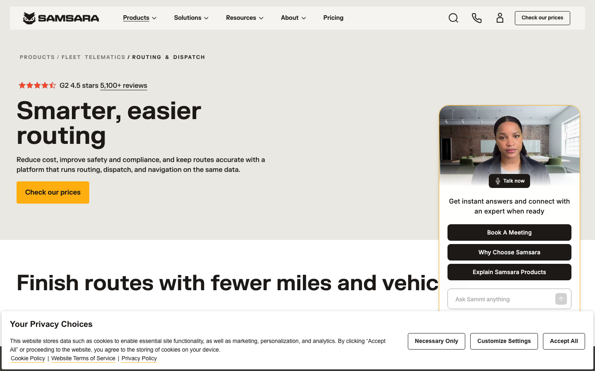
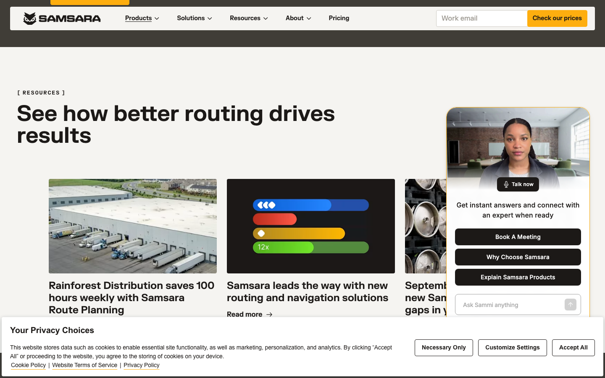
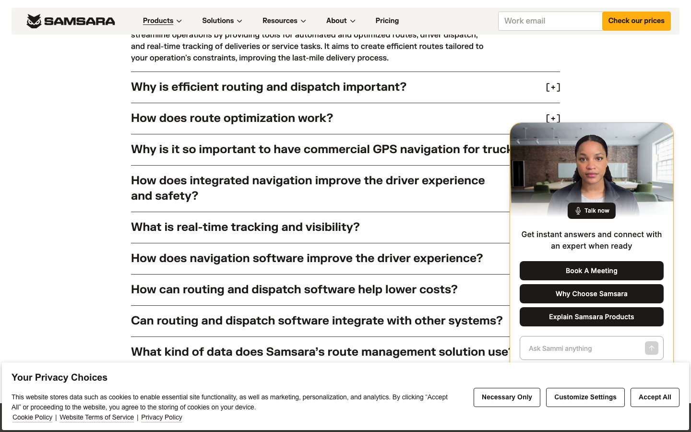

# Animation Reference

> Cinematic motion design extracted from live DOM. Follow these specs exactly to recreate the experience.

## Motion Technology Stack

| Library | Type | Notes |
|---------|------|-------|
| **Web Animations API (2 active)** | animation |  |
| Canvas (2 elements) | 2D Canvas | 2D canvas rendering |

## Scroll Journey

The page is **8,238px** tall. Each frame below shows what the user sees at that scroll depth.

> **Use these screenshots to understand WHAT animates, WHEN it animates, and HOW it moves.**

### 0% — Top / Hero
Scroll position: 0px



### 17% — Opening Section
Scroll position: 1,247px


### 33% — First Feature Section
Scroll position: 2,422px


### 50% — Mid-Page
Scroll position: 3,669px



### 67% — Lower Content
Scroll position: 4,916px



### 83% — Near Footer
Scroll position: 6,091px


### 100% — Bottom / Footer
Scroll position: 7,338px


## Video Elements

| # | Role | Autoplay | Loop | Muted | Size | First Frame |
|---|------|----------|------|-------|------|-------------|
| 1 | content | ✓ | ✓ | ✓ | 660×150 | [view](../screens/scroll/video-1-frame.png) |
| 2 | background | — | — | ✓ | 864×648 | — |

**Video 1 first frame:**


- **Source:** `//videos.ctfassets.net/bx9krvy0u3sx/56shhkf4SINe2WuOJH15U0/2f186d505b2baa1517c4b1ebe0ae5b28/route-and-nav-hero.mp4`

## CSS Keyframes (37 extracted)

### `@keyframes fadein`

Duration: `0.2s` · Easing: `ease-in-out` · Delay: `0s` · Iteration: `1` · Fill: `forwards`

Used by: `.\!isLoaded`, `.isLoaded`, `.is-mounted .image-cycler-inner[data-v-6e917a84]`

```css
@keyframes fadein {
  0% {
    opacity: 0;
  }
  100% {
    opacity: 1;
  }
}
```

> Opacity fade

### `@keyframes fadeInTop`

Duration: `0.1s` · Easing: `ease-out` · Delay: `0.1s` · Iteration: `1` · Fill: `both`

Used by: `.animate-fade-in-top-1`, `.animate-fade-in-top-2`

```css
@keyframes fadeInTop {
  0% {
    opacity: 0;
    transform: translateY(-3px);
  }
  100% {
    opacity: 1;
    transform: translateY(0px);
  }
}
```

> Fade + motion enter animation

### `@keyframes scroll-hint`

Duration: `0.6s` · Easing: `ease-in-out` · Delay: `0s` · Iteration: `infinite` · Fill: `none`

Used by: `.contentful-table-wrapper--color-map .contentful-table-scroll-hint-chevron`

```css
@keyframes scroll-hint {
  0% {
    transform: translate(0px);
  }
  100% {
    transform: translate(30%);
  }
}
```

> Transform/motion animation

### `@keyframes fadeIn`

Duration: `0.3s` · Easing: `ease-out` · Delay: `0s` · Iteration: `1` · Fill: `forwards`

Used by: `.animate-fade-in`

```css
@keyframes fadeIn {
  0% {
    opacity: 0;
  }
  100% {
    opacity: 1;
  }
}
```

> Opacity fade

### `@keyframes fadeInLeft`

Duration: `0.1s` · Easing: `ease-out` · Delay: `0.1s` · Iteration: `1` · Fill: `both`

Used by: `.animate-fade-in-1`

```css
@keyframes fadeInLeft {
  0% {
    opacity: 0;
    transform: translate(-3px);
  }
  100% {
    opacity: 1;
    transform: translate(0px);
  }
}
```

> Fade + motion enter animation

### `@keyframes pulse`

Duration: `2s` · Easing: `cubic-bezier(0.4, 0, 0.6, 1)` · Delay: `0s` · Iteration: `infinite` · Fill: `none`

Used by: `.animate-pulse`

```css
@keyframes pulse {
  50% {
    opacity: 0.5;
  }
}
```

> Opacity fade

### `@keyframes spin`

Duration: `1s` · Easing: `linear` · Delay: `0s` · Iteration: `infinite` · Fill: `none`

Used by: `.animate-spin`

```css
@keyframes spin {
  100% {
    transform: rotate(1turn);
  }
}
```

> Transform/motion animation

### `@keyframes lds-spinner-ed9388ce`

Duration: `1.2s` · Easing: `linear` · Delay: `0s` · Iteration: `infinite` · Fill: `none`

Used by: `svg rect[data-v-ed9388ce]`

```css
@keyframes lds-spinner-ed9388ce {
  0% {
    opacity: 1;
  }
  100% {
    opacity: 0;
  }
}
```

> Opacity fade

### `@keyframes loading-dot-bounce-981231ff`

Duration: `0.85s` · Easing: `ease-in-out` · Delay: `0s` · Iteration: `infinite` · Fill: `both`

Used by: `.loading-dot[data-v-981231ff]`

```css
@keyframes loading-dot-bounce-981231ff {
  0%, 60%, 100% {
    transform: translateY(0px);
  }
  30% {
    transform: translateY(-2px);
  }
}
```

> Transform/motion animation

### `@keyframes slide-in-613136f4`

Duration: `325ms` · Fill: `forwards`

Used by: `.tn--nav-animateY[data-v-613136f4]`

```css
@keyframes slide-in-613136f4 {
  0% {
    transform: translateY(-10px);
    opacity: 0;
  }
  100% {
    transform: translateY(0px);
    opacity: 1;
  }
}
```

> Fade + motion enter animation

### `@keyframes slide-in-7a6033b8`

Duration: `325ms` · Fill: `forwards`

Used by: `.tn--nav-animateY[data-v-7a6033b8]`

```css
@keyframes slide-in-7a6033b8 {
  0% {
    transform: translateY(-10px);
    opacity: 0;
  }
  100% {
    transform: translateY(0px);
    opacity: 1;
  }
}
```

> Fade + motion enter animation

### `@keyframes minus-icon-bracket-left-9da58a39`

Duration: `0.18s` · Easing: `ease-out` · Delay: `0s` · Iteration: `1` · Fill: `none`

Used by: `.minus-icon__bracket--left[data-v-9da58a39]`

```css
@keyframes minus-icon-bracket-left-9da58a39 {
  50% {
    transform: translate(2px);
  }
}
```

> Transform/motion animation

### `@keyframes minus-icon-bracket-right-9da58a39`

Duration: `0.18s` · Easing: `ease-out` · Delay: `0s` · Iteration: `1` · Fill: `none`

Used by: `.minus-icon__bracket--right[data-v-9da58a39]`

```css
@keyframes minus-icon-bracket-right-9da58a39 {
  50% {
    transform: translate(-2px);
  }
}
```

> Transform/motion animation

### `@keyframes plus-icon-bracket-left-07e3942d`

Duration: `0.18s` · Easing: `ease-out` · Delay: `0s` · Iteration: `1` · Fill: `none`

Used by: `.plus-icon__bracket--left[data-v-07e3942d]`

```css
@keyframes plus-icon-bracket-left-07e3942d {
  50% {
    transform: translate(2px);
  }
}
```

> Transform/motion animation

### `@keyframes plus-icon-bracket-right-07e3942d`

Duration: `0.18s` · Easing: `ease-out` · Delay: `0s` · Iteration: `1` · Fill: `none`

Used by: `.plus-icon__bracket--right[data-v-07e3942d]`

```css
@keyframes plus-icon-bracket-right-07e3942d {
  50% {
    transform: translate(-2px);
  }
}
```

> Transform/motion animation

### `@keyframes fadeinfromright-e1861f8a`

Duration: `0.3s` · Easing: `ease-out` · Delay: `0s` · Iteration: `1` · Fill: `forwards`

Used by: `.ds-default-slider .ds-default-slider--slide[data-v-e1861f8a]`

```css
@keyframes fadeinfromright-e1861f8a {
  0% {
    opacity: 0;
    transform: translate(-3px);
  }
  100% {
    opacity: 1;
    transform: translate(0px);
  }
}
```

> Fade + motion enter animation

### `@keyframes progress-9f421744`

Duration: `10s` · Easing: `linear` · Delay: `0s` · Iteration: `1` · Fill: `forwards`

Used by: `.ds-default-slider .indicator-animated.play[data-v-9f421744]`

```css
@keyframes progress-9f421744 {
  0% {
    transform: scaleX(0);
  }
  100% {
    transform: scaleX(1);
  }
}
```

> Transform/motion animation

### `@keyframes fadeinfromright-9f421744`

Duration: `0.3s` · Easing: `ease-out` · Delay: `0s` · Iteration: `1` · Fill: `forwards`

Used by: `.ds-default-slider .dsb__default-slider--slide[data-v-9f421744]`

```css
@keyframes fadeinfromright-9f421744 {
  0% {
    opacity: 0;
    transform: translate(-3px);
  }
  100% {
    opacity: 1;
    transform: translate(0px);
  }
}
```

> Fade + motion enter animation

### `@keyframes progress-4bb5c38a`

Duration: `10s` · Easing: `linear` · Delay: `0s` · Iteration: `1` · Fill: `forwards`

Used by: `.dsb__default-slider .indicator-animated.play[data-v-4bb5c38a]`

```css
@keyframes progress-4bb5c38a {
  0% {
    transform: scaleX(0);
  }
  100% {
    transform: scaleX(1);
  }
}
```

> Transform/motion animation

### `@keyframes fadeinfromright-4bb5c38a`

Duration: `0.3s` · Easing: `ease-out` · Delay: `0s` · Iteration: `1` · Fill: `forwards`

Used by: `.dsb__default-slider .dsb__default-slider--slide[data-v-4bb5c38a]`

```css
@keyframes fadeinfromright-4bb5c38a {
  0% {
    opacity: 0;
    transform: translate(-3px);
  }
  100% {
    opacity: 1;
    transform: translate(0px);
  }
}
```

> Fade + motion enter animation

### `@keyframes i-slide-in--left`

Duration: `0.75s` · Easing: `ease-in` · Delay: `0s` · Iteration: `1` · Fill: `none`

Used by: `.intellimize-popup.intellimize-sidepop`

```css
@keyframes i-slide-in--left {
  0% {
    transform: translate(-120%);
  }
  100% {
    transform: translate(0px);
  }
}
```

> Transform/motion animation

### `@keyframes placeholderAnimate-edb4a6dc`

Duration: `1.7s` · Easing: `linear` · Delay: `0s` · Iteration: `infinite` · Fill: `none`

Used by: `.placeholder-content_item[data-v-edb4a6dc]::before`

```css
@keyframes placeholderAnimate-edb4a6dc {
  0% {
    transform: translate(calc(-50% - 650px));
  }
  100% {
    transform: translate(650px);
  }
}
```

> Transform/motion animation

### `@keyframes ketch-backdropFadeOut`

Duration: `0.4s` · Easing: `ease` · Delay: `0s` · Iteration: `1` · Fill: `forwards`

Used by: `#lanyard_root * .ketch-animate-backdropFadeOut`

```css
@keyframes ketch-backdropFadeOut {
  0% {
    opacity: 1;
  }
  100% {
    opacity: 0;
  }
}
```

> Opacity fade

### `@keyframes ketch-bannerAnimateCenter`

Duration: `0.4s` · Easing: `ease` · Delay: `0s` · Iteration: `1` · Fill: `forwards`

Used by: `#lanyard_root * .ketch-animate-bannerAnimateCenter`

```css
@keyframes ketch-bannerAnimateCenter {
  0% {
    opacity: 0;
  }
  100% {
    opacity: 1;
  }
}
```

> Opacity fade

### `@keyframes ketch-bannerAnimateTop`

Duration: `0.4s` · Easing: `ease` · Delay: `0s` · Iteration: `1` · Fill: `forwards`

Used by: `#lanyard_root * .ketch-animate-bannerAnimateTop`

```css
@keyframes ketch-bannerAnimateTop {
  0% {
    transform: translateY(-900px);
  }
  100% {
    transform: translateY(0px);
  }
}
```

> Transform/motion animation

### `@keyframes ketch-bannerDesktopAnimate`

Duration: `0.4s` · Easing: `ease` · Delay: `0s` · Iteration: `1` · Fill: `forwards`

Used by: `#lanyard_root * .ketch-animate-bannerDesktopAnimate`

```css
@keyframes ketch-bannerDesktopAnimate {
  0% {
    transform: translateY(900px);
  }
  100% {
    transform: translateY(0px);
  }
}
```

> Transform/motion animation

### `@keyframes ketch-bannerDismissBottom`

Duration: `0.4s` · Easing: `ease` · Delay: `0s` · Iteration: `1` · Fill: `forwards`

Used by: `#lanyard_root * .ketch-animate-bannerDismissBottom`

```css
@keyframes ketch-bannerDismissBottom {
  0% {
    transform: translateY(0px);
  }
  100% {
    transform: translateY(900px);
  }
}
```

> Transform/motion animation

### `@keyframes ketch-bannerDismissCenter`

Duration: `0.4s` · Easing: `ease` · Delay: `0s` · Iteration: `1` · Fill: `forwards`

Used by: `#lanyard_root * .ketch-animate-bannerDismissCenter`

```css
@keyframes ketch-bannerDismissCenter {
  0% {
    opacity: 1;
  }
  100% {
    opacity: 0;
  }
}
```

> Opacity fade

### `@keyframes ketch-bannerMobileBottomAnimate`

Duration: `0.4s` · Easing: `ease` · Delay: `0s` · Iteration: `1` · Fill: `forwards`

Used by: `#lanyard_root * .ketch-animate-bannerMobileBottomAnimate`

```css
@keyframes ketch-bannerMobileBottomAnimate {
  0% {
    transform: translateY(900px);
  }
  100% {
    transform: translateY(0px);
  }
}
```

> Transform/motion animation

### `@keyframes ketch-bannerMobileDismissBottom`

Duration: `0.4s` · Easing: `ease` · Delay: `0s` · Iteration: `1` · Fill: `forwards`

Used by: `#lanyard_root * .ketch-animate-bannerMobileDismissBottom`

```css
@keyframes ketch-bannerMobileDismissBottom {
  0% {
    transform: translateY(0px);
  }
  100% {
    transform: translateY(900px);
  }
}
```

> Transform/motion animation

### `@keyframes ketch-fadeIn`

Duration: `0.5s` · Easing: `ease-in-out` · Delay: `0s` · Iteration: `1` · Fill: `none`

Used by: `#lanyard_root * .ketch-animate-fadeIn`

```css
@keyframes ketch-fadeIn {
  0% {
    opacity: 0;
  }
  100% {
    opacity: 1;
  }
}
```

> Opacity fade

### `@keyframes ketch-modalAnimatedLeft`

Duration: `0.4s` · Easing: `ease` · Delay: `0s` · Iteration: `1` · Fill: `forwards`

Used by: `#lanyard_root * .ketch-animate-modalAnimatedLeft`

```css
@keyframes ketch-modalAnimatedLeft {
  0% {
    left: -900px;
  }
  100% {
    left: 4px;
  }
}
```

### `@keyframes ketch-modalAnimatedRight`

Duration: `0.4s` · Easing: `ease` · Delay: `0s` · Iteration: `1` · Fill: `forwards`

Used by: `#lanyard_root * .ketch-animate-modalAnimatedRight`

```css
@keyframes ketch-modalAnimatedRight {
  0% {
    right: -900px;
  }
  100% {
    right: 4px;
  }
}
```

### `@keyframes ketch-pulseOpacity`

Duration: `2s` · Easing: `ease-in-out` · Delay: `0s` · Iteration: `infinite` · Fill: `none`

Used by: `#lanyard_root * .ketch-animate-pulseOpacity`

```css
@keyframes ketch-pulseOpacity {
  0%, 100% {
    opacity: 0.3;
  }
  50% {
    opacity: 1;
  }
}
```

> Opacity fade

### `@keyframes fadeinfromright`

```css
@keyframes fadeinfromright {
  0% {
    opacity: 0;
  }
  100% {
    opacity: 1;
    transform: translate(0px);
  }
}
```

> Fade + motion enter animation

### `@keyframes photo-strip-scroll-b2c0efda`

```css
@keyframes photo-strip-scroll-b2c0efda {
  0% {
    transform: translateZ(0px);
  }
  100% {
    transform: translate3d(calc(var(--photo-strip-loop-distance)*-1),0,0);
  }
}
```

> Transform/motion animation

### `@keyframes i-slide-in--up`

```css
@keyframes i-slide-in--up {
  0% {
    transform: translateY(120%);
  }
  100% {
    transform: translateY(0px);
  }
}
```

> Transform/motion animation

## Motion Tokens (CSS Variables)

### Easing Tokens

```css
--k-consentGate-actionBlock-footer-teaser-text-color: rgba(0, 0, 0, 1);
```

## Global Transition Declarations

These `transition` values were extracted from CSS rules across the site:

```css
transition: 0.1s ease-in-out;
transition: opacity 0.2s;
transition: opacity 0.5s;
transition: transform 0.3s;
transition: opacity 0.3s;
transition: 0.6s ease-in-out;
transition: color 0.2s, background-color 0.2s, text-decoration-color 0.2s;
transition: 0.3s ease-out;
transition: opacity 0.1s ease-in-out;
transition: color 0.1s, fill 0.1s;
transition: color 0.1s, fill 0.1s, stroke 0.1s;
transition: 0.2s ease-in-out;
```

## How to Recreate This Motion Design

### Step 1 — Install Dependencies

```bash
```

### Step 2 — Scroll-Reveal Pattern

Elements that animate into view follow this pattern:

```css
/* Initial hidden state */
.reveal {
  opacity: 0;
  transform: translateY(40px);
  transition: opacity 0.1s rgba(0, 0, 0, 1),
              transform 0.1s rgba(0, 0, 0, 1);
}
.reveal.visible {
  opacity: 1;
  transform: translateY(0);
}
```

### Step 3 — Key Motion Principles

- **Video backgrounds** — use `<video autoplay loop muted playsinline>` for background videos. Always include a poster image fallback
- **Canvas elements (2)** — animated via requestAnimationFrame loop. Use canvas for particle effects, gradient animations, and WebGL scenes
- **Duration scale:** `0.1s` · `0.2s` · `0.5s` · `0.3s` — use these values, never invent new durations
- **Always add** `@media (prefers-reduced-motion: reduce) { * { animation-duration: 0.01ms !important; transition-duration: 0.01ms !important; } }`

### Step 4 — Scroll Journey Reference

Match what happens at each scroll position:

- **0%** (`0px`) → `screens/scroll/scroll-000.png`
- **17%** (`1247px`) → `screens/scroll/scroll-017.png`
- **33%** (`2422px`) → `screens/scroll/scroll-033.png`
- **50%** (`3669px`) → `screens/scroll/scroll-050.png`
- **67%** (`4916px`) → `screens/scroll/scroll-067.png`
- **83%** (`6091px`) → `screens/scroll/scroll-083.png`
- **100%** (`7338px`) → `screens/scroll/scroll-100.png`

